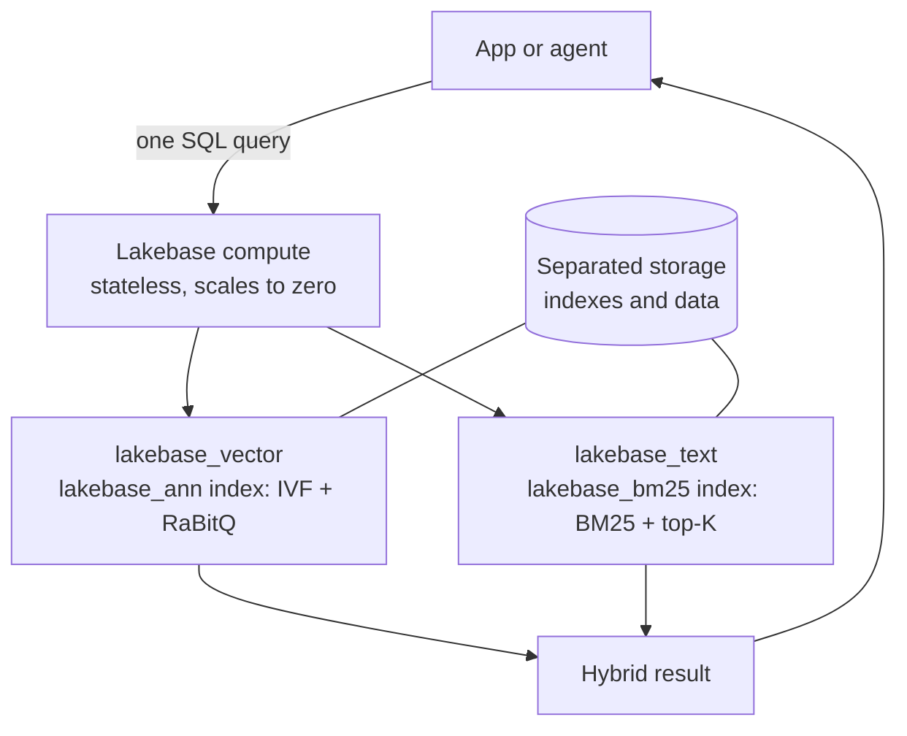

Lakebase Search gives your agents and apps semantic, keyword, and hybrid search over your own data, as plain SQL inside your [Lakebase Postgres](/docs/postgres/overview) database on Neon. It's built for retrieval at agent scale: there's no separate vector database to run, no pipeline to keep in sync, and nothing to rebuild when your data changes.

<AgentPrompt title="Set up with your agent" src="/prompts/lakebase-search-landing.md" buttonText="Copy prompt" />

<Callout title="About Lakebase Search">
Lakebase Search is developed by Databricks. The same extensions power search on Neon and on the Databricks Lakebase platform.
</Callout>

## Scaling search past pgvector

Most teams start vector search in Postgres with `pgvector`, and it works well until the data grows. The usual `pgvector` index, HNSW (Hierarchical Navigable Small World), has to fit in memory, and that memory grows with the number of vectors, not with how much you actually query. Past roughly tens of millions of vectors, you're paying for a large, always-on instance just to hold the index. These are the limits you run into:

- **Memory scales with data, not usage**: an HNSW index keeps its whole graph in RAM and traverses it with random reads at query time, so cost tracks how much data you store rather than how much you search.
- **Index builds are slow and disruptive**: building or rebuilding an HNSW index is CPU-heavy and can tie up the database for a long time on large tables.
- **Recall versus latency is a constant tradeoff**: tuning HNSW means trading recall against query speed, and the balance shifts as the dataset grows.
- **A separate vector database adds a sync tax**: moving vectors out to a dedicated vector store means running a second system and a pipeline to feed it. Your search results lag your writes, and you own the plumbing that keeps the two in step.

That last point is the one teams feel most. When search lives in a different system from your data, your results are only as fresh as the last sync. Lakebase Search keeps search in the same database as your data, so a row is searchable as soon as it's written. No pipeline, no second system, no sync lag.

None of this means leaving `pgvector` behind. `lakebase_vector` is a strict superset of `pgvector`: the same `vector` types, the same distance operators, and the same SQL. You keep what you already use and add an index tuned to run faster and scale further, without the HNSW memory wall.

## How Lakebase Search works

Lakebase Search scales vector search in Postgres past `pgvector` by separating storage from compute, the same architecture that powers Neon. Your indexes live in storage rather than in compute memory, so compute stays stateless and can scale to zero when the database is idle. Lakebase Search is built on two search extensions, `lakebase_vector` and `lakebase_text`, plus `lakebase_tokenizer` for configurable tokenization.

The pieces behind that flow:

- **Separated storage and compute**: indexes live in storage, not in compute RAM, so the size of your index doesn't force you onto a large, always-on instance.
- **IVF clustering**: `lakebase_ann` partitions the vector space into lists (Inverted File, or IVF) and scans only the relevant ones at query time, using sequential I/O that suits storage-backed systems rather than random pointer-chasing.
- **RaBitQ compression**: vectors are compressed with RaBitQ quantization, which keeps index size and build time down while preserving search quality.
- **Stateless, scale-to-zero compute**: you pay for compute only while the database is serving queries, so an idle dev or staging database doesn't cost you compute while it waits.
- **Native BM25 keyword search**: `lakebase_text` adds the `lakebase_bm25` index with Block-Max WAND top-K pushdown, returning the most relevant results directly instead of scoring the whole match set the way a GIN index does.
- **Hybrid as plain SQL**: vector and keyword search are both just SQL, so you can combine their results in one query and then fuse or rerank them.

## What you get

If you need the `pgvector`-compatible path to scale past tens of millions of vectors, Lakebase Search gives you:

- **Lower cost at scale**: because indexes live in storage and compute scales to zero, you avoid paying for a large, always-on instance sized to hold an in-memory HNSW index.
- **Scale to 100 million vectors and beyond**: a single `lakebase_ann` index grows with your data without resharding or rebuilding.
- **Serverless with scale-to-zero**: indexes survive a cold start with no rebuild or re-index. The first query after a cold start pays object-storage latency while the cache warms. You can call `lakebase_ann_prewarm` to warm an index ahead of time.
- **Hybrid search with BM25**: semantic matching and exact-term matching in a single query, so queries that mix intent with specific terms work well.
- **Data searchable immediately**: a row is searchable as soon as it's written, with no second system to keep in sync.

Because branches on Neon copy on write, your search indexes are available on every branch without re-indexing, which keeps preview and development branches cheap.

## Benchmarks

How fast is it? Databricks has published benchmark results for Lakebase Search on large vector workloads, including query throughput and recall at 100-million-vector scale. For the methodology and the measured figures, see the Databricks engineering blog, [Lakebase Search: state-of-the-art full-text and vector search in Postgres](https://www.databricks.com/blog/lakebase-search-state-art-full-text-and-vector-search-postgres). Those figures were measured by Databricks on Databricks Lakebase.

## Search types

Lakebase Search supports three kinds of search. Hybrid search on Neon combines the first two in a single SQL query:

- **Vector (semantic) search** finds rows whose meaning is closest to your query, even when they share no words. You search with an embedding, and the `lakebase_ann` index from [`lakebase_vector`](/docs/extensions/lakebase-vector) returns the nearest vectors by distance. Use it for natural-language questions, recommendations, and retrieval-augmented generation (RAG).
- **Keyword (full-text) search** ranks rows by how well they match the exact terms in your query, using BM25 relevance scoring from the `lakebase_bm25` index in [`lakebase_text`](/docs/extensions/lakebase-text). Use it for names, codes, and exact-term lookups where wording matters.
- **Hybrid search** combines vector and keyword results with fusion or reranking, so you get semantic and exact-term matches together. The [Get started guide](/docs/ai/lakebase-search-get-started#combine-results-with-hybrid-search) shows how to combine results with Jev, a reranking model on Neon AI Gateway, or with Reciprocal Rank Fusion (RRF).

For configurable whole-word tokenization and Chinese, Japanese, and Korean (CJK) analysis, [`lakebase_tokenizer`](/docs/extensions/lakebase-tokenizer) produces standard `tsvector` values that work with both GIN and `lakebase_bm25` indexes.

## Get started

<DetailIconCards>

<a href="/docs/ai/lakebase-search-get-started" description="Install lakebase_vector and lakebase_text, create a schema, insert documents with embeddings, and run your first searches" icon="openai">Quickstart</a>

<a href="/docs/extensions/lakebase-vector" description="Index options, operator classes, and tuning reference for lakebase_vector" icon="openai">lakebase_vector reference</a>

<a href="/docs/extensions/lakebase-text" description="BM25 operators, functions, fallback parameters, and prefilter reference for lakebase_text" icon="openai">lakebase_text reference</a>

<a href="/docs/extensions/lakebase-tokenizer" description="Whole-word and CJK tokenization, built-in language configurations, custom stop words, synonyms, and stemming" icon="openai">lakebase_tokenizer reference</a>

</DetailIconCards>

<NeedHelp />
