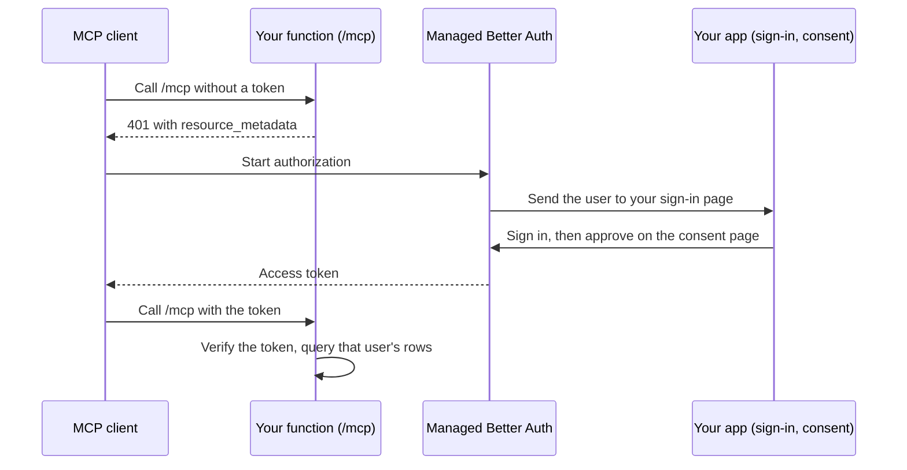

Let your customers use your app from Claude, Cursor, or ChatGPT. They connect to your app's MCP server, sign in with their existing account, and call tools that read and write only their own rows in Lakebase Postgres.

The MCP server runs on [Neon Functions](/docs/compute/functions/overview). [Managed Better Auth](/docs/auth/overview), with its [OAuth provider plugin](/docs/auth/guides/plugins/oauth-provider), is the OAuth 2.1 authorization server. Your app hosts the sign-in and consent pages on a public HTTPS origin, because remote clients can't complete OAuth against `localhost`. This guide builds the pages in Next.js, but any framework works if its pages meet the [page requirements](#what-your-sign-in-and-consent-pages-must-do).

If you don't need per-user sign-in, start from the [`mcp-postgres` function template](/functions/templates/mcp-postgres) instead.

<CopyPrompt
  src="/prompts/mcp-server-on-neon-functions-prompt.md"
  description="Use this prompt to build this with your AI agent."
  buttonText="Copy prompt"
/>

## How it works



The MCP client calls your function, which answers `401` and names Managed Better Auth as the authorization server. The client then sends the user through your app's sign-in and consent pages and gets an access token from Managed Better Auth. Every later call carries that token: the function verifies it, reads the user ID from its `sub` claim, and queries only that user's rows.

### What your sign-in and consent pages must do

- Run on a public HTTPS origin that you add as a [trusted domain](/docs/auth/guides/configure-domains).
- On the sign-in page, sign the user in. If the sign-in response doesn't redirect, resume the authorization request with `oauth2.continue({ selected: true })`. Do the same when a signed-in user lands on the page with an OAuth query.
- On the consent page, require a session. Show the client name, redirect hosts, and the requested `scope` and `resource`, and warn when every redirect URI is loopback. Then call `oauth2.consent({ accept })`.
- Block framing with a `frame-ancestors 'none'` header.

The `@neon/auth` client (0.8.0 or later) passes the signed OAuth query for you. Without it, call the endpoints in [How the pages complete the flow](/docs/auth/guides/plugins/oauth-provider#how-the-pages-complete-the-flow).

## The example

This guide builds a to-do list with `list_todos`, `add_todo`, and `complete_todo`.

Asked for your todos, ChatGPT calls `list_todos` and shows the result:


The optional [MCP Apps section](#render-todos-in-chat-with-mcp-apps-optional) adds an interactive widget.

## Before you start

For this guide, you need:

- A Neon project in AWS US East (Ohio) (`aws-us-east-2`), AWS US East (N. Virginia) (`aws-us-east-1`), AWS Europe (Frankfurt) (`aws-eu-central-1`), or AWS Asia Pacific (Singapore) (`aws-ap-southeast-1`). Support is expanding toward [all regions](/docs/introduction/regions).
- The [Neon CLI](/docs/cli/install), signed in with `neon login`.
- A Next.js 16 or later app, or another framework whose pages meet the [page requirements](#what-your-sign-in-and-consent-pages-must-do). In Next.js 16, route protection lives in `proxy.ts`.

## Set up the project

In your app's directory, link it to your project and check out a development branch, not production:

```bash
neon link
neon checkout --create dev
```

[`neon link`](/docs/cli/link) pins your default branch, so run [`neon checkout`](/docs/cli/checkout) before anything else. It pins the development branch for the commands that follow and writes its environment variables to `.env.local`. If the parent branch already has this guide's setup, the new branch inherits its table, function, trusted domain, and OAuth settings.

Create [`neon.ts`](/docs/reference/neon-ts) in your app's root if you don't have one:

```typescript filename="neon.ts"
import { defineConfig } from "@neon/config/v1";

export default defineConfig({
  auth: true,
});
```

Install the config package, apply `neon.ts`, and check that Managed Better Auth is on:

```bash
npm install @neon/config
neon deploy
neon neon-auth status
```

## Create the table

Managed Better Auth stores users in the `neon_auth` schema, so keep app tables like `todos` in `public`. Run this SQL in the [SQL Editor](/docs/get-started/query-with-neon-sql-editor) or with `psql`:

```sql
CREATE TABLE IF NOT EXISTS todos (
  id serial PRIMARY KEY,
  user_id text NOT NULL,
  text text NOT NULL,
  done boolean NOT NULL DEFAULT false
);

CREATE INDEX IF NOT EXISTS todos_user_id_idx ON todos (user_id);
```

`user_id` stores the access-token `sub`. Use `text` because the ID is a string.

## Write the MCP server

Install the function's dependencies:

```bash
npm install @neon/oauth @neon/functions @modelcontextprotocol/sdk hono pg zod
npm install -D @types/pg
```

The server uses [`@neon/oauth`](https://github.com/neondatabase/neon-pkgs/tree/main/packages/oauth) 0.3.0 or later (beta) to verify tokens, and the web-standard MCP transport needs `@modelcontextprotocol/sdk` 1.25.0 or later.

Each tool filters by the token's `sub`. Build a new `McpServer` per request so the tools close over it, and keep the `pg` pool at module scope. Never take the user ID from tool input.

```typescript filename="functions/todos/index.ts" collapse={14-20,56-71}
import { Hono } from "hono";
import { McpServer } from "@modelcontextprotocol/sdk/server/mcp.js";
import { WebStandardStreamableHTTPServerTransport } from "@modelcontextprotocol/sdk/server/webStandardStreamableHttp.js";
import { createMcpAuth } from "@neon/oauth/mcp";
import { honoMcp, type McpAuthVariables } from "@neon/oauth/mcp/hono";
import { attachDatabasePool } from "@neon/functions";
import { Pool } from "pg";
import { z } from "zod";

type Todo = { id: number; text: string; done: boolean };

// Neon injects sslmode=require. Rewrite it to verify-full so node-postgres
// keeps its current behavior without warnings.
function databaseUrl() {
  const url = new URL(process.env.DATABASE_URL!);
  if (url.searchParams.get("sslmode") === "require") {
    url.searchParams.set("sslmode", "verify-full");
  }
  return url.toString();
}

const pool = new Pool({ connectionString: databaseUrl(), max: 5 });
attachDatabasePool(pool);

const mcpAuth = createMcpAuth({
  baseUrl: process.env.NEON_AUTH_BASE_URL!,
  resource: process.env.MCP_RESOURCE!,
});

const asText = (payload: unknown) => ({
  content: [{ type: "text" as const, text: JSON.stringify(payload) }],
});

function createServer(userId: string) {
  const server = new McpServer({ name: "todos", version: "1.0.0" });

  server.registerTool(
    "list_todos",
    {
      title: "List todos",
      description: "List the signed-in user's todos.",
      inputSchema: {},
      // ChatGPT treats tools without readOnlyHint as writes and may block them
      // until the user allows write tools.
      annotations: { readOnlyHint: true },
    },
    async () => {
      const { rows } = await pool.query<Todo>(
        "SELECT id, text, done FROM todos WHERE user_id = $1 ORDER BY id",
        [userId],
      );
      return asText(rows);
    },
  );

  server.registerTool(
    "add_todo",
    {
      title: "Add todo",
      description: "Add a todo for the signed-in user.",
      inputSchema: { text: z.string().min(1) },
      annotations: { readOnlyHint: false },
    },
    async ({ text }) => {
      const { rows } = await pool.query<Todo>(
        "INSERT INTO todos (user_id, text) VALUES ($1, $2) RETURNING id, text, done",
        [userId, text],
      );
      return asText(rows[0]);
    },
  );

  server.registerTool(
    "complete_todo",
    {
      title: "Complete todo",
      description: "Mark one of the signed-in user's todos as done.",
      inputSchema: { id: z.number().int().positive() },
      annotations: { readOnlyHint: false },
    },
    async ({ id }) => {
      const { rows } = await pool.query<Todo>(
        "UPDATE todos SET done = true WHERE id = $1 AND user_id = $2 RETURNING id, text, done",
        [id, userId],
      );
      return asText(rows[0] ?? { error: "not found" });
    },
  );

  return server;
}

const app = new Hono<McpAuthVariables>();

app.use(honoMcp(mcpAuth, { path: "/mcp" }));

app.all("/mcp", async (c) => {
  const server = createServer(c.get("auth").sub);
  const transport = new WebStandardStreamableHTTPServerTransport({
    sessionIdGenerator: undefined,
  });
  await server.connect(transport);
  return transport.handleRequest(c.req.raw);
});

export default app;
```

## Deploy the function

Neon injects `DATABASE_URL`, and `NEON_AUTH_BASE_URL` once Managed Better Auth is on for the branch. The function also needs `MCP_RESOURCE`, its own `/mcp` URL. You only get that URL after the first deploy, so you deploy twice. Until the second deploy, every request returns `502` with `function_load_failed`, because `createMcpAuth` requires an absolute `resource` URL.

The slug (`todos`) can be up to 20 lowercase letters or digits and can't change after the first deploy. If the branch inherited a `todos` function from its parent, the first deploy updates it, and it serves the parent's `MCP_RESOURCE` until the second deploy.

Deploy once with [`neon functions deploy`](/docs/cli/functions#deploy) and read the function URL:

```bash
neon functions deploy todos --src functions/todos
neon functions get todos
```

Append `/mcp` to the function URL from the output and deploy again:

```bash shouldWrap
neon functions deploy todos \
  --src functions/todos \
  --env "MCP_RESOURCE=https://<branch_id>-todos.compute.<cell>.aws.neon.tech/mcp"
```

A new deployment can take a few minutes to serve traffic. To confirm the running value, check that `resource` in the [protected resource metadata](/docs/auth/guides/plugins/oauth-provider#protect-an-mcp-server) matches `MCP_RESOURCE`:

```bash shouldWrap
curl https://<branch_id>-todos.compute.<cell>.aws.neon.tech/.well-known/oauth-protected-resource/mcp
```

To serve the function from your own domain instead, see [Use a custom domain](#use-a-custom-domain-optional).

### Manage the function from neon.ts (optional)

The function isn't declared in `neon.ts`, so `neon deploy` doesn't redeploy it. To manage it from `neon.ts` instead, declare it once you know the URL:

```typescript filename="neon.ts"
import { defineConfig } from "@neon/config/v1";

export default defineConfig({
  auth: true,
  functions: {
    todos: {
      name: "todos",
      source: "functions/todos/index.ts",
      env: { MCP_RESOURCE: process.env.MCP_RESOURCE! },
    },
  },
});
```

Add `MCP_RESOURCE` to `.env.local`, then deploy with the file:

```bash
neon deploy --env .env.local
```

`neon deploy` and `neon checkout --create` then refuse to run until `MCP_RESOURCE` is set.

## Build the sign-in and consent pages (Next.js example)

This section builds the pages in Next.js. On another framework, build pages that meet the [page requirements](#what-your-sign-in-and-consent-pages-must-do) and skip to the next section.

Install the Managed Better Auth SDK and generate a cookie secret:

```bash
npm install @neon/auth@latest
openssl rand -base64 32
```

The `neon deploy` you ran during setup wrote `NEON_AUTH_BASE_URL` to `.env.local`. If it's missing, run `neon env pull`. Add the cookie secret next to it:

```env filename=".env.local"
NEON_AUTH_BASE_URL=https://ep-xxx.neonauth.us-east-2.aws.neon.tech/neondb/auth
NEON_AUTH_COOKIE_SECRET=paste-the-openssl-output-here
```

Create `lib/auth/server.ts`, `lib/auth/client.ts`, and the `app/api/auth/[...path]/route.ts` handler as shown in [Use Managed Better Auth with Next.js](/docs/auth/quick-start/nextjs-api-only). If Managed Better Auth already works in your Next.js app, keep that setup.

For an MCP server, `proxy.ts` must protect every route except `/` and the sign-in and sign-up pages, so the consent page always has a session:

```typescript filename="proxy.ts"
import { auth } from "@/lib/auth/server";

export default auth.middleware({
  loginUrl: "/auth/sign-in",
  publicRoutes: ["/", "/auth/sign-in", "/auth/sign-up"],
});

export const config = {
  matcher: ["/((?!_next/static|_next/image|favicon.ico).*)"],
};
```

Block framing of the sign-in and consent pages with a `frame-ancestors 'none'` header. Add the `headers()` function to your existing `next.config.ts` instead of replacing the file:

```typescript filename="next.config.ts" collapse={1-3,16-19}
import type { NextConfig } from "next";

const nextConfig: NextConfig = {
  async headers() {
    return [
      {
        source: "/auth/:path*",
        headers: [
          {
            key: "Content-Security-Policy",
            value: "frame-ancestors 'none'",
          },
        ],
      },
    ];
  },
};

export default nextConfig;
```

Add a sign-up page at `/auth/sign-up` so test users can create accounts, like the one in [Use Managed Better Auth with Next.js](/docs/auth/quick-start/nextjs-api-only).

The markup below is unstyled. In a default Next.js app, Tailwind's base styles remove input borders, so the fields look invisible until you style them.

### Sign-in page

Put the OAuth logic in a helper that resumes the authorization request only when the URL has `client_id` and `response_type`. A normal visit, such as after sign-up, has no OAuth query, and `oauth2.continue` returns HTTP 400 for it:

```typescript filename="lib/auth/oauth.ts"
import { authClient } from "@/lib/auth/client";

// Auth sends users to the sign-in page with the authorization request in the query.
// A normal visit has no OAuth query, and oauth2.continue returns HTTP 400 for it.
export function hasOAuthQuery() {
  const params = new URLSearchParams(window.location.search);
  return params.has("client_id") && params.has("response_type");
}

// Resume the authorization request. Returns an error message, or null.
export async function continueOAuth() {
  const { error } = await authClient.oauth2.continue({ selected: true });
  return error ? "This sign-in link expired. Go back to the app and try again." : null;
}
```

Then call it from the sign-in page:

```tsx filename="app/auth/sign-in/page.tsx" collapse={9-13,34-45,55-84}
"use client";

import { useEffect, useState } from "react";
import { useRouter } from "next/navigation";
import { authClient } from "@/lib/auth/client";
import { continueOAuth, hasOAuthQuery } from "@/lib/auth/oauth";

export default function SignInPage() {
  const router = useRouter();
  const [email, setEmail] = useState("");
  const [password, setPassword] = useState("");
  const [error, setError] = useState<string | null>(null);
  const [pending, setPending] = useState(false);

  // A signed-in user sent here by an MCP client: resume the authorization request.
  useEffect(() => {
    let cancelled = false;

    async function resume() {
      if (!hasOAuthQuery()) return;
      const { data } = await authClient.getSession();
      if (cancelled || !data?.user) return;
      const message = await continueOAuth();
      if (message && !cancelled) setError(message);
    }

    void resume();
    return () => {
      cancelled = true;
    };
  }, []);

  async function onSubmit(event: React.FormEvent) {
    event.preventDefault();
    setPending(true);
    setError(null);

    const { data, error } = await authClient.signIn.email({ email, password });
    setPending(false);

    if (error) {
      setError(error.message || "Failed to sign in");
      return;
    }

    // After sign-in: let the SDK redirect, resume OAuth, or go home.
    if (data?.redirect) return;
    if (hasOAuthQuery()) {
      setError(await continueOAuth());
      return;
    }
    router.push("/");
  }

  return (
    <main>
      <h1>Sign in</h1>
      <form onSubmit={onSubmit}>
        <label>
          Email
          <input
            type="email"
            value={email}
            onChange={(event) => setEmail(event.target.value)}
            required
          />
        </label>
        <label>
          Password
          <input
            type="password"
            value={password}
            onChange={(event) => setPassword(event.target.value)}
            required
          />
        </label>
        {error ? <p>{error}</p> : null}
        <button type="submit" disabled={pending}>
          {pending ? "Signing in..." : "Sign in"}
        </button>
      </form>
    </main>
  );
}
```

### Consent page

Load the client with `oauth2.publicClient`, show the details listed in the [page requirements](#what-your-sign-in-and-consent-pages-must-do), then call `oauth2.consent({ accept })`:

```tsx filename="app/auth/consent/page.tsx" collapse={6-12,20-39,112-125}
"use client";

import { useEffect, useState } from "react";
import { authClient } from "@/lib/auth/client";

type PublicClient = {
  client_id: string;
  client_name: string;
  client_uri?: string;
  logo_uri?: string;
  redirect_uris?: string[];
};

type ConsentRequest = {
  client: PublicClient;
  scope: string;
  resource: string;
};

function hostFromUri(uri: string) {
  try {
    return new URL(uri).host;
  } catch {
    return uri;
  }
}

function isLoopback(uri: string) {
  try {
    const { hostname } = new URL(uri);
    return (
      hostname === "localhost" ||
      hostname === "127.0.0.1" ||
      hostname === "[::1]"
    );
  } catch {
    return false;
  }
}

export default function ConsentPage() {
  const [request, setRequest] = useState<ConsentRequest | null>(null);
  const [error, setError] = useState<string | null>(null);
  const [pending, setPending] = useState(false);

  useEffect(() => {
    let cancelled = false;

    async function load() {
      // Read the query in the browser. window doesn't exist during prerender.
      const params = new URLSearchParams(window.location.search);
      const { data, error } = await authClient.oauth2.publicClient({
        query: { client_id: params.get("client_id") ?? "" },
      });

      if (cancelled) return;
      if (error) {
        setError(error.message || "Failed to load client details");
        return;
      }
      setRequest({
        client: data as PublicClient,
        scope: params.get("scope") ?? "",
        resource: params.get("resource") ?? "",
      });
    }

    void load();
    return () => {
      cancelled = true;
    };
  }, []);

  async function respond(accept: boolean) {
    setPending(true);
    setError(null);
    const { error } = await authClient.oauth2.consent({ accept });
    setPending(false);
    if (error) {
      setError(error.message || "Consent failed");
    }
  }

  const redirectUris = request?.client.redirect_uris ?? [];
  const onlyLoopback =
    redirectUris.length > 0 && redirectUris.every(isLoopback);

  return (
    <main>
      <h1>Allow access</h1>
      {request ? (
        <>
          <p>
            <strong>{request.client.client_name}</strong> wants access to your
            account.
          </p>
          {request.client.client_uri ? (
            <p>Client site: {request.client.client_uri}</p>
          ) : null}
          {redirectUris.length > 0 ? (
            <p>Redirect hosts: {redirectUris.map(hostFromUri).join(", ")}</p>
          ) : null}
          {request.scope ? <p>Scopes: {request.scope}</p> : null}
          {request.resource ? <p>Resource: {request.resource}</p> : null}
          {onlyLoopback ? (
            <p>
              This client redirects only to localhost, so it runs on this
              device. The name above is not proof of identity.
            </p>
          ) : null}
        </>
      ) : (
        <p>Loading client details...</p>
      )}
      {error ? <p>{error}</p> : null}
      <button type="button" disabled={pending} onClick={() => void respond(true)}>
        Allow
      </button>
      <button
        type="button"
        disabled={pending}
        onClick={() => void respond(false)}
      >
        Deny
      </button>
    </main>
  );
}
```

The page reads `window.location.search` inside an effect, not during render. Next.js prerenders client components, and `window` doesn't exist there, so reading it during render fails `next build`.

## Deploy the app and turn on the OAuth server

Deploy your app to a public HTTPS origin (this guide uses Vercel), then point Managed Better Auth at it.

```bash
vercel link --yes --project app-mcp-tutorial
vercel env add NEON_AUTH_BASE_URL production
vercel env add NEON_AUTH_COOKIE_SECRET production
vercel env add DATABASE_URL production   # only if your app reads todos
vercel deploy --prod --yes
```

`vercel deploy --prod` prints this deployment's own URL and the project's stable production URL:

```text filename="Output"
Production  https://<project>-<hash>-<team>.vercel.app
Aliased     https://<project>.vercel.app
```

Use the `Aliased` URL (`https://<your-app>.vercel.app`) in the commands below. It stays the same across deploys.

Add the Vercel app's origin as a trusted domain, because Managed Better Auth redirects only to trusted origins. If the command reports that the domain already exists, it's already trusted. Then turn on the OAuth server with [`neon neon-auth config oauth-server`](/docs/cli/neon-auth#config-oauth-server):

```bash shouldWrap
neon neon-auth domain add https://<your-app>.vercel.app

neon neon-auth config oauth-server update --enabled \
  --login-page https://<your-app>.vercel.app/auth/sign-in \
  --consent-page https://<your-app>.vercel.app/auth/consent \
  --mcp-resource https://<branch_id>-todos.compute.<cell>.aws.neon.tech/mcp \
  --mcp-client-id-metadata-documents

neon neon-auth config oauth-server get
```

With [Client ID Metadata Documents](/docs/auth/guides/plugins/oauth-provider#client-id-metadata-documents) (CIMD), clients identify themselves, so you don't create a client for each one. CIMD is on by default once you set an MCP resource. If it was turned off earlier, setting `--mcp-resource` doesn't turn it back on, so pass `--mcp-client-id-metadata-documents`. Leave [dynamic client registration](/docs/auth/guides/plugins/oauth-provider#dynamic-client-registration-legacy) off unless a client can't use CIMD.

Each branch has its own OAuth settings, OAuth clients, trusted domains, and MCP resource URL. A new child branch copies them from its parent, including each client's ID and secret, and its function keeps the parent's `MCP_RESOURCE`, so both point at the parent's function URL. On a child branch, redeploy the function with that branch's URL in `MCP_RESOURCE` and run `neon neon-auth config oauth-server update --mcp-resource` with the same URL. Tokens from one branch don't work on another branch's server, because each branch has its own issuer. See [Branching authentication](/docs/auth/branching-authentication).

## Verify the server

1. Run `neon neon-auth config oauth-server get` and check that the login page (your sign-in page), consent page, and `mcp.resource` match your URLs.
2. Confirm `issuer` matches `NEON_AUTH_BASE_URL`. Load `.env.local` into your shell first, or paste the URL:

   ```bash
   curl "$NEON_AUTH_BASE_URL/.well-known/oauth-authorization-server"
   ```

3. Call the function with no token. Expect `401` and a `WWW-Authenticate` header with `resource_metadata`:

   ```bash
   curl -i https://<branch_id>-todos.compute.<cell>.aws.neon.tech/mcp
   ```

4. Create a user on `/auth/sign-up`. Connect ChatGPT (see [Connect ChatGPT](#connect-chatgpt)) or another MCP client that supports OAuth and Streamable HTTP to the function's `/mcp` URL. Complete sign-in and consent, then call `list_todos` and `add_todo`.

5. Test isolation with two users. When user B calls `complete_todo` with the ID of one of user A's todos, the result must be `not found`.

If a step fails, first check that the Neon CLI targets the branch you configured, that `--mcp-resource` matches `MCP_RESOURCE` exactly, and that your app's origin is a trusted domain.

### Connect ChatGPT

When you add the server to ChatGPT:

1. Use the function URL ending in `/mcp`, not the Vercel app URL.
2. After OAuth, open the connector details and allow write tools, or choose Allow all tools. Without that, reads can work while writes fail with an opaque error such as "Unknown tool."
3. Refresh the connector or start a new chat after you change tools. ChatGPT caches the tool snapshot.

## Use a custom domain (optional)

To give customers a URL on your own domain, such as `https://mcp.example.com/mcp`, [register a custom domain](/docs/compute/functions/custom-domains) for the function. Then use the custom URL wherever this guide uses the function URL: `MCP_RESOURCE`, `--mcp-resource`, and the URL customers add to their MCP client. Your code doesn't change. `@neon/oauth` builds the `resource_metadata` URL and the token audience from `MCP_RESOURCE`, not from the request's host.

Custom domains aren't inherited, so on a child branch use that branch's own function URL or a separate hostname.

## Test locally over HTTPS (optional)

Use this to test the pages with a local or scripted MCP client. Managed Better Auth sets `__Secure-` session cookies, which scripted clients often omit on plain `http://localhost`. Plain `http://localhost` is a trusted domain by default, while [localhost access](/docs/auth/guides/configure-domains#localhost-is-pre-configured) is on, but `https://localhost` isn't, so add it:

```bash shouldWrap
npm run dev -- --port 3010 --experimental-https

neon neon-auth domain add https://localhost:3010

neon neon-auth config oauth-server update --enabled \
  --login-page https://localhost:3010/auth/sign-in \
  --consent-page https://localhost:3010/auth/consent \
  --mcp-resource https://<branch_id>-todos.compute.<cell>.aws.neon.tech/mcp \
  --mcp-client-id-metadata-documents
```

Point the OAuth pages back at your Vercel origin before you connect a remote client again.

## Render todos in chat with MCP Apps (optional)

MCP clients that support [MCP Apps](https://modelcontextprotocol.io/extensions/apps/overview), such as ChatGPT, can render HTML for a tool result inside the conversation.

Export the HTML from a TypeScript module, so `neon functions deploy` bundles it. A separate `.html` file read with `readFileSync` isn't bundled.

```typescript filename="functions/todos/todo-list-ui.ts" collapse={7-113}
export const TODO_LIST_UI_URI = "ui://todos/list-v2.html";
export const TODO_LIST_SKYBRIDGE_URI = `${TODO_LIST_UI_URI}+skybridge`;
export const MCP_APP_MIME = "text/html;profile=mcp-app";
export const SKYBRIDGE_MIME = "text/html+skybridge";

export const todoListHtml = `<!doctype html>
<html lang="en">
  <head>
    <meta charset="utf-8" />
    <title>Todos</title>
    <style>
      body { font-family: system-ui, sans-serif; margin: 16px; }
      li.done span { text-decoration: line-through; opacity: 0.6; }
      button { margin-left: 8px; }
    </style>
  </head>
  <body>
    <h1>Your todos</h1>
    <p id="empty">No todos yet.</p>
    <ul id="list" hidden></ul>
    <script>
      function todosFrom(payload) {
        if (!payload) return [];
        if (Array.isArray(payload.todos)) return payload.todos;
        if (payload.structuredContent?.todos) return payload.structuredContent.todos;
        if (payload.result?.structuredContent?.todos) {
          return payload.result.structuredContent.todos;
        }
        return [];
      }

      function render(todos) {
        const list = document.getElementById("list");
        const empty = document.getElementById("empty");
        list.replaceChildren();
        if (!todos.length) {
          empty.hidden = false;
          list.hidden = true;
          return;
        }
        empty.hidden = true;
        list.hidden = false;
        for (const todo of todos) {
          const item = document.createElement("li");
          if (todo.done) item.classList.add("done");
          const label = document.createElement("span");
          label.textContent = todo.text;
          item.appendChild(label);
          if (!todo.done) {
            const button = document.createElement("button");
            button.textContent = "Complete";
            button.onclick = () => completeTodo(todo.id);
            item.appendChild(button);
          }
          list.appendChild(item);
        }
      }

      // Replies to tools/call requests sent over postMessage, keyed by request ID.
      const pending = new Map();

      function callTool(name, args) {
        if (window.openai?.callTool) return window.openai.callTool(name, args);
        const id = crypto.randomUUID();
        window.parent.postMessage(
          {
            jsonrpc: "2.0",
            id,
            method: "tools/call",
            params: { name, arguments: args },
          },
          "*",
        );
        return new Promise((resolve, reject) => pending.set(id, { resolve, reject }));
      }

      // Complete the todo, then fetch the list again so the widget shows the change.
      async function completeTodo(id) {
        try {
          await callTool("complete_todo", { id });
          render(todosFrom(await callTool("list_todos", {})));
        } catch (error) {
          console.error("complete_todo failed", error);
        }
      }

      window.addEventListener("message", (event) => {
        const data = event.data;
        if (!data || typeof data !== "object") return;
        if (data.id && pending.has(data.id)) {
          const { resolve, reject } = pending.get(data.id);
          pending.delete(data.id);
          if (data.error) reject(data.error);
          else resolve(data.result);
          return;
        }
        if (
          data.method === "ui/notifications/tool-result" ||
          data.method === "ui/initialize"
        ) {
          render(todosFrom(data.params));
        }
      });

      if (window.openai?.toolOutput) render(todosFrom(window.openai.toolOutput));
      window.parent.postMessage(
        { jsonrpc: "2.0", method: "ui/notifications/initialized" },
        "*",
      );
    </script>
  </body>
</html>
`;
```

The widget loads nothing from other origins. If yours calls an API or loads scripts, styles, or images from another domain, declare those domains in the resource's `_meta.ui.csp` (`connectDomains`, `resourceDomains`). See [OpenAI's CSP guidance](https://developers.openai.com/plugins/build/chatgpt-ui#content-security-policy-csp).

Register the UI as two resources in `functions/todos/index.ts`: the MCP Apps resource, and a `text/html+skybridge` variant, which ChatGPT still expects for widgets:

```typescript filename="functions/todos/index.ts" collapse={25-34}
import {
  MCP_APP_MIME,
  SKYBRIDGE_MIME,
  TODO_LIST_SKYBRIDGE_URI,
  TODO_LIST_UI_URI,
  todoListHtml,
} from "./todo-list-ui";

function registerTodoListUi(server: McpServer) {
  const readHtml = async (uri: string, mimeType: string) => ({
    contents: [{ uri, mimeType, text: todoListHtml }],
  });

  server.registerResource(
    "todo-list",
    TODO_LIST_UI_URI,
    {
      title: "Todo list",
      description: "Interactive list of the signed-in user's todos.",
      mimeType: MCP_APP_MIME,
    },
    async () => readHtml(TODO_LIST_UI_URI, MCP_APP_MIME),
  );

  server.registerResource(
    "todo-list-skybridge",
    TODO_LIST_SKYBRIDGE_URI,
    {
      title: "Todo list",
      description: "Interactive list of the signed-in user's todos.",
      mimeType: SKYBRIDGE_MIME,
    },
    async () => readHtml(TODO_LIST_SKYBRIDGE_URI, SKYBRIDGE_MIME),
  );
}
```

Call `registerTodoListUi(server)` from `createServer`, then replace `list_todos` with this version. It points at the UI with `_meta` and returns `structuredContent`. The query is the same as before:

```typescript filename="functions/todos/index.ts" collapse={16-19}
server.registerTool(
  "list_todos",
  {
    title: "List todos",
    description: "List the signed-in user's todos.",
    inputSchema: {},
    annotations: { readOnlyHint: true },
    _meta: {
      ui: { resourceUri: TODO_LIST_UI_URI },
      "ui/resourceUri": TODO_LIST_UI_URI,
      "openai/outputTemplate": TODO_LIST_SKYBRIDGE_URI,
      "openai/widgetAccessible": true,
    },
  },
  async () => {
    const { rows } = await pool.query<Todo>(
      "SELECT id, text, done FROM todos WHERE user_id = $1 ORDER BY id",
      [userId],
    );
    const summary =
      rows.length === 0
        ? "No todos."
        : `Found ${rows.length} todo${rows.length === 1 ? "" : "s"}.`;
    return {
      // Short text avoids ChatGPT showing JSON next to the HTML widget.
      content: [{ type: "text", text: summary }],
      structuredContent: { todos: rows },
    };
  },
);
```

Redeploy the function, refresh the ChatGPT connector or start a new chat, then ask it to list todos. Expect the HTML widget plus the short summary:


## Further reading

- [Use Managed Better Auth with Next.js (API methods)](/docs/auth/quick-start/nextjs-api-only)
- [OAuth Provider](/docs/auth/guides/plugins/oauth-provider)
- [Neon Functions authentication](/docs/compute/functions/authentication)
- [Configure trusted domains](/docs/auth/guides/configure-domains)
- [Neon CLI command: neon-auth](/docs/cli/neon-auth)

<NeedHelp/>
