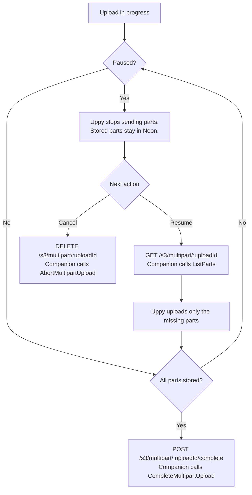

[Uppy Companion](https://uppy.io/docs/companion/) is Uppy's server component. Point its S3 settings at your Neon branch and it presigns every request `@uppy/aws-s3` needs, so you don't write a signing route yourself. The browser still sends file parts directly to Neon. Companion only handles the small signing requests.

Use Companion if you already run it, or if you also want users to [import files from URLs and cloud services](/docs/storage/uploads/uppy-remote-sources). If you only need uploads from the user's device, a [signing endpoint](/docs/storage/uploads/uppy-s3-multipart) is less to run.

## Prerequisites

- Node.js 22 or later for Companion 7
- A [bucket](/docs/storage/buckets) and a [credential](/docs/storage/authentication) with the `storage:write` scope
- A [CORS rule](/docs/storage/uploads/resumable-uploads#cors-configuration-for-browser-uploads) on the bucket that allows your app's origin and exposes `ETag`

<Steps>

## Package installation

```bash
npm install @uppy/companion express
npm install @uppy/core @uppy/aws-s3
```

## Companion configuration for Neon

Pass your branch's storage endpoint and credential in the `s3` options. Companion uses `key` and `secret`.

```typescript filename="companion.ts" collapse={1-4,7-11} shouldWrap
import express from 'express';
import * as companion from '@uppy/companion';
import { randomUUID } from 'node:crypto';
import { tmpdir } from 'node:os';

const options = {
  secret: process.env.COMPANION_SECRET!, // a long random string
  filePath: tmpdir(),
  server: { host: 'uploads.example.com', protocol: 'https', path: '/companion' },
  corsOrigins: ['https://app.example.com'],
  uploadUrls: ['https://app.example.com'],
  s3: {
    endpoint: process.env.AWS_ENDPOINT_URL_S3,
    region: process.env.AWS_REGION,
    forcePathStyle: true, // Neon uses path-style addressing only
    bucket: process.env.BUCKET,
    key: process.env.AWS_ACCESS_KEY_ID,
    secret: process.env.AWS_SECRET_ACCESS_KEY,
    awsClientOptions: {
      requestChecksumCalculation: 'WHEN_REQUIRED',
      responseChecksumValidation: 'WHEN_REQUIRED',
    },
    // Choose the object key. Companion calls this for every new upload.
    getKey: ({ filename }) => `uploads/${randomUUID()}-${filename}`,
  },
};

const app = express();
const { app: companionApp } = companion.app(options);
app.use('/companion', companionApp);

const server = app.listen(3020);
companion.socket(server, options); // progress events for remote imports
```

To run Companion standalone instead, set the same values as environment variables: `COMPANION_AWS_ENDPOINT`, `COMPANION_AWS_REGION`, `COMPANION_AWS_FORCE_PATH_STYLE=true`, `COMPANION_AWS_BUCKET`, `COMPANION_AWS_KEY`, and `COMPANION_AWS_SECRET`. See [Companion's configuration docs](https://uppy.io/docs/companion/).

## Uppy configuration

```typescript filename="uploader.ts" shouldWrap
import Uppy from '@uppy/core';
import AwsS3 from '@uppy/aws-s3';

const MiB = 1024 * 1024;

export const uppy = new Uppy().use(AwsS3, {
  companionEndpoint: 'https://uploads.example.com/companion',
  shouldUseMultipart: (file) => (file.size ?? 0) > 20 * MiB,
  getChunkSize: () => 5 * MiB,
});
```

## File upload

```typescript shouldWrap
uppy.addFile({ name: file.name, type: file.type, data: file });
await uppy.upload();
```

</Steps>

## Pause and resume behavior

`uppy.pauseResume(fileId)`, `pauseAll()`, `resumeAll()`, and `retryAll()` work the same as with a [signing endpoint](/docs/storage/uploads/uppy-s3-multipart#pause-resume-retry-and-cancellation). When an upload resumes, Uppy asks Companion for the stored parts (`GET /s3/multipart/:uploadId`), Companion calls `ListParts` on Neon, and Uppy uploads only the missing parts.



## Limitations

- **STS credentials aren't available:** Companion's `/s3/sts` route issues temporary credentials through AWS STS. Neon Object Storage doesn't provide STS, so this route isn't supported. For an alternative, see [Browser-side signing](/docs/storage/uploads/uppy-browser-signing).
- **Authorization is the application's responsibility:** Companion signs every upload request it receives. Place Companion behind your application's authentication, and use `getKey` to restrict each user's uploads to a dedicated key prefix, for example based on a header or cookie in `req`.
- **Incomplete uploads aren't removed automatically:** An upload that's never completed leaves its parts in the bucket. To remove them, see [Abandoned upload cleanup](/docs/storage/uploads/resumable-uploads#abandoned-upload-cleanup).

## Next steps

- [Import files from URLs and cloud services](/docs/storage/uploads/uppy-remote-sources)
- [Recover uploads after a reload](/docs/storage/uploads/uppy-golden-retriever)

<NeedHelp/>
