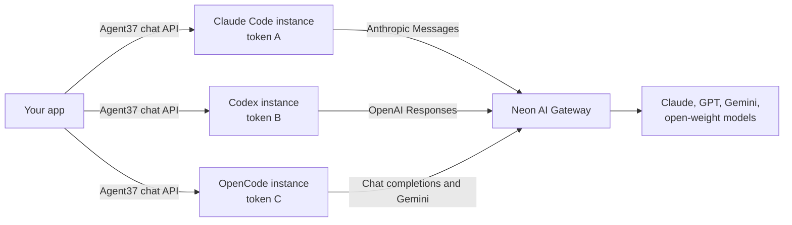

[Agent37](https://www.agent37.com) runs each coding agent on its own always-on computer, and its chat API carries your messages to that agent. The agent still needs a model provider: Claude Code expects an Anthropic key and Codex an OpenAI key, and the agent can read any key you place on its instance. [Neon AI Gateway](/docs/ai-gateway/overview) replaces those keys with one token per instance, a branch-scoped credential with the `ai_gateway:invoke` scope that reaches Claude, GPT, Gemini, and open-weight models.

In this guide, you'll build a Next.js app that creates Claude Code, Codex, and OpenCode agents, gives each one its own token, points each agent at the gateway in its own API format, and lets you rotate or revoke one agent's token without touching the rest:



Each token belongs to one instance, so revoking token B stops only the Codex agent from calling models.

You will use Agent37's `agent37-claude-code`, `agent37-codex`, and `agent37-opencode` templates, Neon AI Gateway, the [Neon TypeScript SDK](/docs/reference/typescript-sdk), and the [AI SDK](https://ai-sdk.dev) with [AI Elements](https://ai-sdk.dev/elements) for the chat UI.

## Demo

The tabs below show each part of the application:

<Tabs labels={["Agents", "Claude Code", "Codex", "OpenCode", "Revoked"]}>

<TabItem>

**Agents** lists every coding agent with its Neon AI Gateway credential: the token id, when it was created, and whether it's active. Each card can rotate or revoke that one credential.


</TabItem>

<TabItem>

**Claude Code** runs on the gateway's Anthropic Messages endpoint. The model picker maps Claude Code's `sonnet`, `opus`, `haiku`, and `fable` roles to gateway model ids.


</TabItem>

<TabItem>

**Codex** runs on the gateway's OpenAI Responses endpoint, including `gpt-5-3-codex`, which only that endpoint serves.


</TabItem>

<TabItem>

**OpenCode** can switch between Kimi, GLM, Qwen, gpt-oss, Claude, GPT, and Gemini between turns, all on the same agent.


</TabItem>

<TabItem>

**Revoked** shows an agent whose credential is revoked, so it can't call any model. The other two agents keep working, because each has its own credential.


</TabItem>

</Tabs>

## Prerequisites

- Node.js 22 or newer
- A [Neon](https://console.neon.tech) account with [AI Gateway prepaid credits](/docs/ai-gateway/prepaid-credits) ($5 minimum, on any plan, including Free)
- An [Agent37 API key](https://www.agent37.com/dashboard/cloud/api-keys), with at least $10 in your [Agent37 wallet](https://www.agent37.com/dashboard/cloud/billing)

## Create the Next.js application

There's a lot to cover in this application, so the easiest path is to clone the project, install its dependencies, and then walk through how each part connects Agent37 to Neon AI Gateway.

Run the following commands to clone and install the project:

```bash
git clone https://github.com/rishi-raj-jain/coding-agents-neon-ai-gateway
cd coding-agents-neon-ai-gateway
npm install
```

It installs the following important dependencies:

- `@neon/sdk` to mint, rotate, revoke, and list AI Gateway credentials
- `ai` and `@ai-sdk/react` to stream each agent turn into the browser with `useChat`
- AI Elements components (in `components/ai-elements`), built on [shadcn/ui](https://ui.shadcn.com), to render text, reasoning, and tool calls

Then, copy the environment variable file with the following command:

```bash
cp .env.example .env
```

The app needs three values in `.env`: `AGENT37_API_KEY`, `NEON_API_KEY`, and `NEON_PROJECT_ID`. The next section creates the Neon project.

## Create a Neon project with AI Gateway

This flow uses the Neon CLI. If you don't have it yet, refer to [Install and connect](/docs/cli/install).

First, authenticate with the Neon CLI. This opens a browser window to log in to (or sign up for) your Neon account:

```bash
neon login
```

Then create the project in a [region that supports AI Gateway](/docs/ai-gateway/overview):

```bash
neon projects create --name coding-agents --region-id aws-us-east-2
```

Copy the project id from the output into `NEON_PROJECT_ID`. AI Gateway is on by default for new projects, and it draws on your organization's prepaid credits. All agents share that balance: once it drops below $2, the gateway answers new requests from every agent with `429` until you add credits.

Finally, create a [project-scoped API key](/docs/manage/api-keys#create-project-scoped-organization-api-keys) for this project and paste it into `NEON_API_KEY`: in your organization's **Settings** > **API keys**, click **Create new** and select **Project-scoped**. The app uses it for one thing: managing the AI Gateway credentials it gives to agents. A project-scoped key can't reach your other projects, and the app never sends it to an agent.

## Understand AI Gateway credentials

A Neon AI Gateway credential is a bearer token (`nt_live_...`) tied to a branch. It works on that branch and on every branch created from it, and the `ai_gateway:invoke` scope limits it to model calls. See [AI Gateway authentication](/docs/ai-gateway/authentication) for details.

The app creates one credential per agent, so you can rotate or revoke each agent's access separately. The code is in `lib/neon.ts`:

```ts
export async function createCredential(name: string) {
  const { branchId } = await gateway();
  const created = await client.credentials.create({
    projectId,
    branchId,
    name,
    scopes: ['ai_gateway:invoke'],
    principal_type: 'user',
  });
  return { tokenId: created.token_id, token: created.api_token };
}
```

In the code above:

- `api_token` is shown once. The app writes it straight into the agent's environment and never stores it.
- `token_id` isn't a secret. The app keeps it in the agent's Agent37 metadata, which is how it finds the credential again to rotate or revoke it.

The `gateway()` helper looks up the branch's gateway host once, with `client.aiGateway.get()`. Each harness adds the path for its API to that host: `/anthropic`, `/openai/v1`, `/v1`, or `/gemini`.

## Give each agent its own credential

Creating an agent in `app/api/agents/route.ts` takes three steps: mint the credential, create the Agent37 instance with the token in its `env`, and, for the harnesses that read a config file, write that file and restart once.

```ts
const { baseUrl } = await neon.gateway();
const credential = await neon.createCredential(`agent37: ${name}`);

instance = await post<Instance>('/instances', {
  template: h.template,
  name,
  env: gatewayEnv(harness, credential.token, baseUrl),
  metadata: { app: APP_TAG, harness, neon_token_id: credential.tokenId },
});

if (h.setup) {
  await waitForReady(instance.id, harness);
  await exec(instance.id, h.setup(baseUrl));
  await restart(instance.id, harness);
}
```

Every instance starts with `NEON_AI_GATEWAY_TOKEN` and `NEON_AI_GATEWAY_BASE_URL`, plus the variables its harness needs. Agent37's `env` is write-only on the API, so you can't read the token back through Agent37 after it's set. If any step fails, the route deletes the instance and revokes the credential, so a failed create doesn't leave a working token behind.

The instance's Agent37 managed-model budget stays at its default of $0. Every model call goes to the gateway and is billed against your Neon AI Gateway credits.

## Point Claude Code at the gateway

Claude Code uses the Anthropic Messages API, which the gateway serves at `<base>/anthropic`. To route Claude Code's requests through the gateway instead of Anthropic, set `ANTHROPIC_BASE_URL` and `ANTHROPIC_AUTH_TOKEN`. You don't need an Anthropic account. The setup for all three harnesses is in `lib/harnesses.ts`:

```ts
const CLAUDE_ROLES = {
  sonnet: 'claude-sonnet-5-5',
  opus: 'claude-opus-5-5',
  haiku: 'claude-haiku-4-5',
  fable: 'claude-fable-5-1',
};

env: (token, baseUrl) => ({
  ANTHROPIC_BASE_URL: `${baseUrl}/anthropic`,
  ANTHROPIC_AUTH_TOKEN: token,
  ...Object.fromEntries(Object.entries(CLAUDE_ROLES).map(([role, id]) => [`ANTHROPIC_DEFAULT_${role.toUpperCase()}_MODEL`, id])),
}),
```

Claude Code picks a model per role, so the role variables set each role to a gateway model id. A turn sent with `"model": "opus"` then runs `claude-opus-5-5`. The Anthropic endpoint accepts Anthropic models only. See [Anthropic Messages API](/docs/ai-gateway/anthropic-messages) for the list.

## Point Codex at the gateway

Codex uses the OpenAI Responses API, which the gateway serves at `<base>/openai/v1`. The current Codex CLI no longer reads an `OPENAI_BASE_URL` environment variable, so the app adds the gateway as a model provider in `~/.codex/config.toml`:

```toml
model = "gpt-5-3-codex"
model_provider = "neon"

[model_providers.neon]
name = "Neon AI Gateway"
base_url = "https://<branch-host>/openai/v1"
wire_api = "responses"
env_key = "NEON_AI_GATEWAY_TOKEN"
requires_openai_auth = true
```

In the configuration above:

- `env_key` makes Codex send `NEON_AI_GATEWAY_TOKEN` as its bearer token, so a new token only has to change the environment.
- `requires_openai_auth` is required on Agent37. Agent37 checks that Codex is logged in before every turn. Without this flag, that check fails with "Codex has no account configured". With this flag, Codex reports the API-key login that the image creates at boot from `OPENAI_API_KEY`, which the app sets to the same token.
- A custom provider also uses plain HTTPS. The built-in OpenAI provider tries a WebSocket first, gets a `405` from the gateway, and then falls back to HTTPS.

The app writes this file with [exec](https://www.agent37.com/docs/agents-api/exec) once, after it creates the instance, and then restarts the instance. The `agent37-codex` image regenerates only its own keys in `config.toml` at boot and keeps these.

`gpt-5-3-codex` is available only on the Responses endpoint, so use Codex for that model. See [OpenAI Responses API](/docs/ai-gateway/openai-responses) for the other models on that endpoint.

## Point OpenCode at the gateway

OpenCode has a built-in `neon` provider (from [models.dev](https://models.dev)) that uses `<base>/v1`, the [chat completions](/docs/ai-gateway/chat-completions) endpoint, and lists the gateway's models. It shows up once `NEON_AI_GATEWAY_TOKEN` and `NEON_AI_GATEWAY_BASE_URL` are set on the instance. It needs two additions to `~/.config/opencode/opencode.json` to work, and the app also sets a default model:

```jq
.provider.neon = { options: { apiKey: "{env:NEON_AI_GATEWAY_TOKEN}" } }
| .provider["neon-gemini"] = {
    npm: "@ai-sdk/google",
    name: "Neon AI Gateway (Gemini)",
    options: {
      baseURL: "{env:NEON_AI_GATEWAY_BASE_URL}/gemini/v1beta",
      apiKey: "unused",
      headers: { Authorization: "Bearer {env:NEON_AI_GATEWAY_TOKEN}" }
    },
    models: { "gemini-3-1-pro": { name: "Gemini 3.1 Pro" }, "gemini-3-flash": { name: "Gemini 3 Flash" } }
  }
| .model = "neon/kimi-k3"
```

In the configuration above:

- `provider.neon.options.apiKey` names the token variable explicitly. The built-in entry lists `NEON_AI_GATEWAY_BASE_URL` first among its variables, and OpenCode would otherwise send the base URL as the key and get `401` back.
- `neon-gemini` calls Gemini through the gateway's [Gemini endpoint](/docs/ai-gateway/gemini) instead of chat completions. On chat completions, Gemini rejects the `$schema` keywords in OpenCode's tool definitions. The gateway takes a bearer token rather than the `x-goog-api-key` header the Google SDK sends, so the token goes in `headers` and `apiKey` is a placeholder the SDK requires.
- `.model` makes `neon/kimi-k3` the default for turns that don't pick a model.

The app applies this with `jq` over exec, then restarts the instance. The `agent37-opencode` image merges its own managed provider into the same file at boot and keeps these keys, including a default model that isn't one of its own.

With this config, one OpenCode agent can use Claude, GPT, Gemini, and open-weight models such as `neon/kimi-k3`, `neon/glm-5-3`, `neon/qwen35-122b-a10b`, and `neon/gpt-oss-120b`, all with one credential.

## Stream agent turns into useChat

Every Agent37 instance has the same chat API at `https://{instanceId}.agent37.app/v1/responses`, whichever harness it runs. With `stream: true`, it streams a turn as Server-Sent Events: `response.created`, text and reasoning deltas, `response.tool_call.started` and `response.tool_call.completed`, and one terminal event.

The chat route in `app/api/agents/[id]/chat/route.ts` translates those events into the AI SDK's UI message stream with `createUIMessageStream`, so `useChat` on the page can render the turn as it arrives:

```ts
case 'response.created':
  responseId = data.id;
  writer.write({ type: 'start', messageMetadata: { sessionId: data.session_id } });
  break;
case 'response.output_text.delta':
  sawText = true;
  writer.write({ type: 'text-delta', id: open('text'), delta: data.text });
  break;
case 'response.tool_call.started': {
  close();
  const toolCallId = `call-${running.length}-${Date.now().toString(36)}`;
  running.push({ toolCallId, tool: data.tool });
  writer.write({
    type: 'tool-input-available',
    toolCallId,
    toolName: data.tool,
    title: data.label?.split('\n')[0],
    input: data.arguments ?? { summary: data.label ?? data.tool },
    dynamic: true,
  });
  break;
}
```

A few details in this mapping are specific to the Agent37 stream:

- The route puts the session id in the assistant message's metadata. The harness keeps the whole conversation, so the next request sends only the new text and that session id.
- `response.tool_call.completed` names the tool but not the call, so the route closes the oldest running call of that tool.
- When the user presses **Stop**, `useChat` aborts the request, and the route calls `POST /v1/responses/{id}/cancel` so the turn stops on the instance too.

On the page, `components/agent-chat.tsx` keeps the request small with `prepareSendMessagesRequest`, and sends the model picked for each turn:

```tsx
const transport = useMemo(
  () =>
    new DefaultChatTransport<AgentUIMessage>({
      api: `/api/agents/${id}/chat`,
      prepareSendMessagesRequest: ({ messages, body }) => {
        const last = messages.at(-1);
        const text = last?.parts.map((part) => (part.type === 'text' ? part.text : '')).join('') ?? '';
        return { body: { ...body, text } };
      },
    }),
  [id]
);

sendMessage({ text }, { body: { model, sessionId } });
```

AI Elements then renders each part: `MessageResponse` for markdown text, `Reasoning` for thinking, and `Tool` for each dynamic tool part, with its status badge.

## Rotate and revoke a credential

Each card on the agents page can act on that agent's credential alone.

**Revoke** calls `neon.revokeCredential(tokenId)`. The gateway rejects the token from its next request on, so the agent can't call any model, while its instance keeps running. This also holds if the agent copied the token: the gateway rejects it from any caller, including the agent's own shell.


Claude Code retries a rejected token for about three minutes before it gives up with "Not logged in". So the chat route checks the credential first and refuses the turn with a clear message.

**Rotate** gives the agent a new token. The route in `app/api/agents/[id]/rotate/route.ts` rotates a live credential in place (same `token_id`, new token) or creates a new one if the old one is revoked, then restarts the instance with the new token:

```ts
const meta = (await neon.listCredentials()).get(tokenId);
const credential = meta && !meta.revoked_at ? await neon.rotateCredential(tokenId) : await neon.createCredential(`agent37: ${agent.name}`);

await patch(`/instances/${agent.id}`, {
  env: gatewayEnv(harness, credential.token, baseUrl),
  metadata: { ...agent.metadata, neon_token_id: credential.tokenId },
});
const before = HARNESSES[harness].beforeRestart;
if (before) await exec(agent.id, before);
await restart(agent.id, harness);
```

An instance reads its environment when its container starts, so the new token takes effect only after a restart. For Codex, `beforeRestart` runs `codex logout` first: the image logs Codex in only when it's logged out, so logging out makes it log in again with the new token.

**Delete** removes the instance and revokes its credential, so the token that was on its disk stops working for good.

## Run the application locally

Start the development server:

```bash
npm run dev
```

Open [http://127.0.0.1:3000](http://127.0.0.1:3000), pick a harness, and create an agent. A Claude Code agent is ready in about 30 seconds. Codex and OpenCode take about a minute, because the app writes their config and restarts the instance once. Then open **Chat**, pick a model, and give the agent a coding task.

## Deploy to Vercel

<a href="https://vercel.com/new/clone?repository-url=https://github.com/rishi-raj-jain/coding-agents-neon-ai-gateway&env=AGENT37_API_KEY,NEON_API_KEY,NEON_PROJECT_ID">
  
</a>

The repository is ready to deploy to Vercel **once you've added authentication** in front of it. Use the following steps to deploy:

- Fork [the GitHub repository](https://github.com/rishi-raj-jain/coding-agents-neon-ai-gateway).
- Add your own authentication.
- Navigate to the Vercel Dashboard and create a **New Project**.
- Link the new project to your fork.
- In **Settings**, update the **Environment Variables** to match those in your local `.env` file.
- Deploy.

Creating a Codex or OpenCode agent, and rotating a token, each take about a minute, so those routes set `maxDuration = 300`, the longest a function can run on the Vercel Hobby plan.

## Summary

You now have Claude Code, Codex, and OpenCode running on Agent37 with Neon AI Gateway as their only model provider. Each agent holds one branch-scoped credential with the `ai_gateway:invoke` scope, and each harness reaches the gateway in its own dialect: Anthropic Messages for Claude Code, OpenAI Responses for Codex, and chat completions plus Gemini for OpenCode. Because every agent has its own credential, you can rotate or revoke one agent's model access in a single call without touching the others, and no agent holds a provider key.
