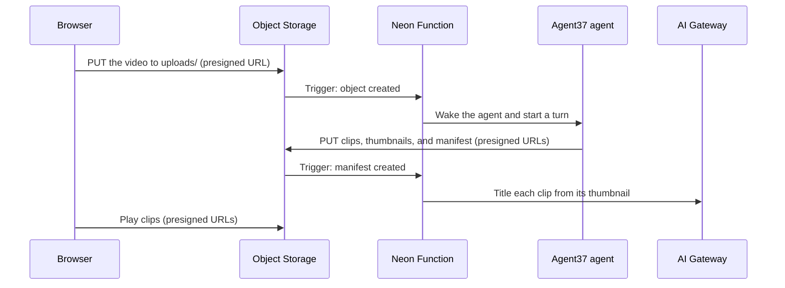

Cutting clips from a video takes a lot of CPU: ffmpeg has to decode the file, pick the moments to cut, and encode new files. In this guide, each user gets an [Agent37](https://www.agent37.com) agent, a computer of their own with ffmpeg installed that only remains awake until the process is complete. The user uploads a video directly to a [Neon Object Storage](/docs/storage/overview) bucket, a [Function Trigger](/docs/compute/functions/triggers/object-storage) on that upload wakes their agent, and the agent puts its clips back in the bucket for the app to serve with presigned URLs. When the agent finishes, [Neon AI Gateway](/docs/ai-gateway/overview) writes a title and caption for each clip from its thumbnail.



You will use Next.js with [shadcn/ui](https://ui.shadcn.com), Neon Object Storage, [Neon Functions](/docs/compute/functions/overview) and Function Triggers, Lakebase Postgres, Neon AI Gateway, [Agent37's `agent37-hermes` template](https://www.agent37.com/docs/agents-api/urls#what-agent37-hermes-serves), aws4fetch to sign storage requests, and the [Sintel trailer](https://durian.blender.org) (CC BY, Blender Foundation) as a test video.

## Demo

The tabs below show each part of the application:

<Tabs labels={["Upload and clips", "Agent chat", "Thumbnail", "Manifest"]}>

<TabItem>

**Upload and clips** takes a video, how many clips to cut, and what to look for. Each finished job shows its clips, with the title and caption AI Gateway wrote from each thumbnail. The sidebar lists every object the job has in the bucket.


</TabItem>

<TabItem>

**Agent chat** shows one job from the agent's side: the brief the function sent, every command the agent ran on its computer, and its reply. Here the agent built contact sheets of frames with ffmpeg and looked at them to find the movement.


</TabItem>

<TabItem>

**Thumbnail** opens one object from the bucket through a short-lived presigned URL.


</TabItem>

<TabItem>

**Manifest** is the file the agent uploads last. Uploading it fires the second trigger, which marks the job done.


</TabItem>

</Tabs>

## Prerequisites

- Node.js 22 or newer
- A [Neon](https://console.neon.tech) account with [AI Gateway prepaid credits](/docs/ai-gateway/prepaid-credits) ($5 minimum, on any plan, including Free)
- An [Agent37 API key](https://www.agent37.com/dashboard/cloud/api-keys), with at least $10 in your [Agent37 wallet](https://www.agent37.com/dashboard/cloud/billing)

## Create the Next.js application

There's a lot to cover in this application, so the easiest path is to clone the project, install its dependencies, and then walk through how each part connects Agent37 to Neon.

Run the following commands to clone and install the project:

```bash
git clone https://github.com/rishi-raj-jain/video-clips-neon-object-storage
cd video-clips-neon-object-storage
npm install
```

It installs the following important dependencies:

- `aws4fetch` to sign Object Storage requests and presigned URLs over `fetch`
- `@neondatabase/serverless` to query Postgres over HTTP, from both the app and the function
- `hono` and `@neon/functions` for the Neon Function that the triggers call
- `ai` and `@neon/ai-sdk-provider` to call AI Gateway with the credentials Neon injects into the function
- `react-dropzone`, `swr`, and `sonner` for the upload area, polling, and toasts, with shadcn/ui components

Then, copy the environment variable file with the following command:

```bash
cp .env.example .env
```

Add your Agent37 API key to `AGENT37_API_KEY` in `.env`. The Neon CLI writes every other value in the next two sections.

## Link the project with the Neon CLI

This flow uses the Neon CLI. If you don't have it yet, refer to [Install and connect](/docs/cli/install).

First, authenticate with the Neon CLI. This opens a browser window to log in to (or sign up for) your Neon account:

```bash
neon login
```

Now, create a new project and bind the application directory to it:

```bash
neon link
```

The CLI prompts you for an organization and a project. Choose **+ Create new project**, give it a name, and pick a region where [Neon Functions](/docs/compute/functions/overview) and AI Gateway are available (AWS US East (Ohio), `aws-us-east-2`, for this tutorial). It creates the project with a default branch, writes the `.neon` context file, and pulls the new branch's `DATABASE_URL` into your `.env` file.

## Declare the bucket, function, and triggers in neon.ts

Everything this app needs from Neon is declared in [`neon.ts`](/docs/reference/neon-ts): a private bucket, AI Gateway, one function, and two Object Storage triggers that call it. Postgres needs no declaration, because every branch has it.

```ts filename="neon.ts"
import { defineConfig } from '@neon/config/v1';

export default defineConfig({
  aiGateway: true,
  buckets: {
    videos: {},
  },
  functions: {
    clipper: {
      name: 'Video clipper',
      source: './functions/clipper.ts',
      env: {
        AGENT37_API_KEY: { value: process.env.AGENT37_API_KEY, required: true },
      },
    },
  },
  triggers: {
    'video-uploaded': {
      type: 'storage_object_created',
      function: 'clipper',
      bucket: 'videos',
      prefix: 'uploads/',
      functionPath: '/uploaded',
    },
    'clips-finished': {
      type: 'storage_object_created',
      function: 'clipper',
      bucket: 'videos',
      prefix: 'manifests/',
      functionPath: '/finished',
    },
  },
});
```

In the config above:

- The `prefix` decides which uploads fire each trigger. A video goes under `uploads/`, and the agent's manifest goes under `manifests/`. Clips and thumbnails go under `clips/`, which no trigger watches.
- Both triggers call the same function on different paths, so one Hono app handles both events.
- The function's `env` reads `AGENT37_API_KEY` when you deploy, so the function can wake the user's agent.

Apply the config to the linked branch with the following command. `--env .env` loads your `.env` file first, so `neon.ts` can read `AGENT37_API_KEY`:

```bash
neon deploy --env .env
```

This provisions the `videos` bucket, deploys the `clipper` function, creates both triggers, and writes the credentials into your `.env` file:

```bash
# .env
AWS_ENDPOINT_URL_S3=https://your-branch-id.storage.region.aws.neon.tech
AWS_ACCESS_KEY_ID=nak_...
AWS_SECRET_ACCESS_KEY=nsk_...
AWS_REGION=us-east-2
NEON_AI_GATEWAY_TOKEN=nt_live_...
NEON_AI_GATEWAY_BASE_URL=https://your-branch-id-api.ai.region.aws.neon.tech
```

The deployed function doesn't need these from you. Neon [injects the same variables](/docs/compute/functions/environment-variables) into it at runtime. The app uses them locally.

## Create the tables and allow browser uploads

To create the schema, run the following command:

```bash
npm run setup
```

It creates four tables in Postgres:

- `agents` (one Agent37 agent per user)
- `jobs` (one row per upload)
- `objects` (every object a job has in the bucket)
- `chat_messages` (each job's conversation with the agent)

It also sets CORS rules on the bucket. The browser uploads the video to a presigned URL and plays clips from presigned URLs, so the bucket has to answer requests from the app's origin. `scripts/setup.mjs` sends S3's `PutBucketCors` with `aws4fetch`:

```js
const res = await aws.fetch(`${process.env.AWS_ENDPOINT_URL_S3}/videos?cors`, {
  method: 'PUT',
  headers: { 'Content-Type': 'application/xml', 'Content-MD5': createHash('md5').update(cors).digest('base64') },
  body: cors,
});
```

The rules allow `http://127.0.0.1:3000` and `http://localhost:3000` by default. Set `APP_ORIGINS` to a comma-separated list and run the script again to allow other origins.

## Sign Object Storage requests with aws4fetch

[Neon Object Storage is S3-compatible](/docs/storage/s3-compatibility), so any SigV4 signer works with it. This app uses `aws4fetch`, which signs `fetch` requests and runs the same way in Next.js and in the Neon Function. The code in `lib/storage.ts` is shared by both.

```ts
async function presign(key: string, method: 'GET' | 'PUT', expiresIn: number, headers?: Record<string, string>, query?: Record<string, string>) {
  const url = new URL(objectUrl(key));
  url.searchParams.set('X-Amz-Expires', String(expiresIn));
  for (const [name, value] of Object.entries(query ?? {})) url.searchParams.set(name, value);
  // allHeaders signs Content-Type too, which aws4fetch otherwise leaves out, so a PUT
  // URL accepts only the content type it was made for.
  const signed = await aws.sign(url.toString(), { method, headers, aws: { signQuery: true, allHeaders: true } });
  return signed.url;
}
```

Every object key starts with a root folder, then the user's id and the job's id, such as `uploads/<user>/<job>/sintel-trailer-480p.mp4` and `clips/<user>/<job>/clip-1.mp4`. Each URL signs one key, so a job's URLs can only access that job's objects.

## Give each user an agent

This example has no sign-in. `proxy.ts` gives each browser a user id in a cookie, and each user gets one Agent37 agent. The code is in `lib/agent37.ts`:

```ts
export const createAgent = (userId: string) =>
  call<Instance>(`${API}/instances`, {
    method: 'POST',
    body: JSON.stringify({
      template: 'agent37-hermes',
      name: `clipper ${userId.slice(0, 8)}`,
      budget: { credit_micros: 1_000_000 },
      auto_sleep: true,
      idle_timeout_seconds: 1800,
      metadata: { app: APP_TAG, user_id: userId },
    }),
  });
```

In the code above:

- `agent37-hermes` runs Hermes, a general agent, on an image that has ffmpeg installed.
- `budget` gives the agent's managed model $1 to spend. The default is $0.
- `auto_sleep` drops the instance to disk-only billing after `idle_timeout_seconds` with no traffic, and an upload wakes it again. The timeout has to be longer than a job, because the agent's own work doesn't count as traffic.

## Upload the video to the bucket

The upload never passes through the app's server. The browser asks `app/api/jobs/route.ts` for a presigned PUT URL, and the route records the job before it signs:

```ts
const jobId = crypto.randomUUID();
// Keep the extension (ffmpeg uses it) and drop anything else that's not a plain name.
const safeName = filename.replace(/[^\w.-]+/g, '_').slice(-80) || 'video.mp4';
const inputKey = keys.upload(uid, jobId, safeName);
await sql`
  INSERT INTO jobs (id, user_id, filename, input_key, clip_count, instructions)
  VALUES (${jobId}, ${uid}, ${filename.slice(0, 200)}, ${inputKey}, ${count}, ${ask})`;

return Response.json({ jobId, uploadUrl: await presignPut(inputKey, contentType, 900) }, { status: 201 });
```

The browser then PUTs the file to that URL. `fetch` can't report upload progress, so `components/clipper-app.tsx` uses `XMLHttpRequest`, with the same `Content-Type` the URL was signed for:

```tsx
const xhr = new XMLHttpRequest();
xhr.open('PUT', url);
xhr.setRequestHeader('Content-Type', file.type);
xhr.upload.onprogress = (e) => e.lengthComputable && onProgress(Math.round((e.loaded / e.total) * 100));
```

That upload starts the job. The object is saved under `uploads/`, and the `video-uploaded` trigger fires.

## Wake the agent from a Function Trigger

The trigger calls `POST /uploaded` on the `clipper` function in `functions/clipper.ts`, with the bucket name and object key in the body. Trigger calls arrive without credentials, so the function checks for the `X-Neon-Trigger-Invocation-Id` header first: Neon removes `X-Neon-*` headers that clients set, so if the header is there, the call came from Neon.

A trigger can deliver the same event more than once, so the handler starts by claiming the job. Only the first delivery moves it out of `uploading`:

```ts
const [job] = (await sql`
  UPDATE jobs SET status = 'processing', updated_at = now()
  WHERE id = ${jobId} AND user_id = ${userId} AND status = 'uploading'
  RETURNING *`) as Job[];
if (!job) return c.json({ ok: true, skipped: 'job already claimed or unknown' });
```

Next, it signs URLs for this job's objects and writes them to the agent's disk:

```ts
const ttl = 2 * 3600;
const n = Array.from({ length: job.clip_count }, (_, i) => i + 1);
const jobFile = {
  input: await presignGet(job.input_key, ttl),
  clips: await Promise.all(n.map((i) => presignPut(keys.clip(userId, jobId, i), 'video/mp4', ttl))),
  thumbs: await Promise.all(n.map((i) => presignPut(keys.thumb(userId, jobId, i), 'image/jpeg', ttl))),
  manifest: await presignPut(keys.manifest(userId, jobId), 'application/json', ttl),
};

// Exec wakes a sleeping agent. Write the job's files, then start the turn.
const dir = `~/jobs/${jobId}`;
const b64 = (s: string) => Buffer.from(s).toString('base64');
await exec(
  agent.instance_id,
  `mkdir -p ${dir} && echo ${b64(JSON.stringify(jobFile))} | base64 -d > ${dir}/job.json && echo ${b64(PUT_SH)} | base64 -d > ${dir}/put.sh`
);
await waitHealthy(agent.instance_id);
const ext = (filename.match(/\.[a-z0-9]{2,5}$/i)?.[0] || '.mp4').toLowerCase();
const prompt = brief(job, dir, ext);
const turn = await startTurn(agent.instance_id, prompt);
```

In the code above:

- The agent never gets storage credentials. It gets one GET URL for the video and one PUT URL for each output, and they expire in two hours.
- [Exec](https://www.agent37.com/docs/agents-api/exec) runs a shell command on the instance and wakes it first if it's asleep. `waitHealthy` waits for the agent to answer before the function sends it work.
- The URLs go in `job.json`, and `put.sh` is a small script that reads the right URL and uploads a file to it with `curl`. The model only runs `sh put.sh clip 1 clip-1.mp4`, so it never has to copy a long signed URL into a command.
- `startTurn` sends the brief to the agent's [chat API](https://www.agent37.com/docs/agents-api/chat) and returns as soon as the turn starts.

The brief tells the agent what to cut and how to report back:

```text
2. Inspect it with ffprobe. To find good moments, use ffmpeg: scene changes with -vf "select='gt(scene,0.3)',showinfo" -f null -, and loudness with -af ebur128 or silencedetect.
3. Cut exactly ${job.clip_count} clip(s), each 3 to 20 seconds, no overlap, in time order:
   ffmpeg -y -ss START -t LENGTH -i input${ext} -c:v libx264 -preset veryfast -crf 23 -c:a aac -movflags +faststart clip-N.mp4
```

If waking the agent fails, the handler sets the job back to `uploading` and returns `503` with `Retry-After: 60`, so Neon delivers the event again a minute later. After three failed attempts, it marks the job failed.

## Title each clip with Neon AI Gateway

The agent uploads its manifest last: a JSON file with each clip's start, end, and why it picked it. That upload fires the `clips-finished` trigger, which calls `POST /finished`. The function checks that each clip is in the bucket, records it in `objects`, and asks a vision model for a title and caption from its thumbnail:

```ts
async function describe(thumbKey: string, reason: string) {
  const { output } = await generateText({
    model: gateway('gemini-3-flash'),
    output: Output.object({ schema: ClipText }),
    messages: [
      {
        role: 'user',
        content: [
          { type: 'text', text: `This is a frame from a video clip. The editor picked it because: ${reason}. Write a title and a caption for the clip.` },
          { type: 'image', image: await readObject(thumbKey), mediaType: 'image/jpeg' },
        ],
      },
    ],
  });
  return output;
}
```

In the code above:

- `gateway` is `neon` from `@neon/ai-sdk-provider`. It reads the AI Gateway credentials Neon injects into the function, so the call needs no keys.
- The thumbnail goes in as bytes, which the AI SDK sends as a base64 data URL. On the gateway, Gemini and Claude accept images inline but reject a link to an image, so the function reads the thumbnail from the bucket first.
- `Output.object` with a [Zod](https://zod.dev) schema returns a typed `{ title, caption }`.

Then it saves the clips on the job and marks it `done`.

## Serve clips with presigned URLs

The bucket is private, so `app/api/jobs/route.ts` signs short-lived GET URLs for each clip when it lists the user's jobs:

```ts
job.clips.map(async (clip) => ({
  ...clip,
  url: await presignGet(clip.clipKey),
  thumbUrl: await presignGet(clip.thumbKey),
  downloadUrl: await presignDownload(clip.clipKey, `clip-${clip.index}.mp4`),
}))
```

The page uses `url` for the `<video>` player and `thumbUrl` as its poster. `downloadUrl` signs a `response-content-disposition: attachment` override, so the browser saves the clip instead of playing it. A plain `download` attribute doesn't work here, because browsers ignore it on links to another origin, such as the bucket.

## Run the application locally

Start the development server:

```bash
npm run dev
```

Open [http://127.0.0.1:3000](http://127.0.0.1:3000) and click **Create my agent**. Then choose a video, pick how many clips you want, describe what to look for, and click **Upload and cut clips**.

## Deploy to Vercel

<a href="https://vercel.com/new/clone?repository-url=https://github.com/rishi-raj-jain/video-clips-neon-object-storage&env=AGENT37_API_KEY,DATABASE_URL,AWS_ENDPOINT_URL_S3,AWS_ACCESS_KEY_ID,AWS_SECRET_ACCESS_KEY,AWS_REGION">
  
</a>

The repository is ready to deploy to Vercel **once you've added authentication** in front of it. The cookie that identifies a user here is not a login. Use the following steps to deploy:

- Fork [the GitHub repository](https://github.com/rishi-raj-jain/video-clips-neon-object-storage).
- Add your own authentication, such as [Managed Better Auth](/docs/auth/overview).
- Navigate to the Vercel Dashboard and create a **New Project**.
- Link the new project to your fork.
- In **Settings**, update the **Environment Variables** to match those in your local `.env` file.
- Deploy.

After the first deploy, add the Vercel URL to `APP_ORIGINS` and run `npm run setup` again, so the bucket accepts uploads from the deployed app. The Neon Function and its triggers are already live from `neon deploy`, and they don't change when you deploy the app.

## Summary

You now have a video clipping app where an upload starts the work. The browser uploads directly to a Neon Object Storage bucket, a Function Trigger wakes the user's Agent37 agent, and the agent cuts clips with ffmpeg and uploads them back with presigned URLs it gets for that one job. A second trigger on the agent's manifest titles each clip through Neon AI Gateway, and Postgres keeps the jobs, the objects, and every command the agent ran, so the app can show all of it with a few queries.
