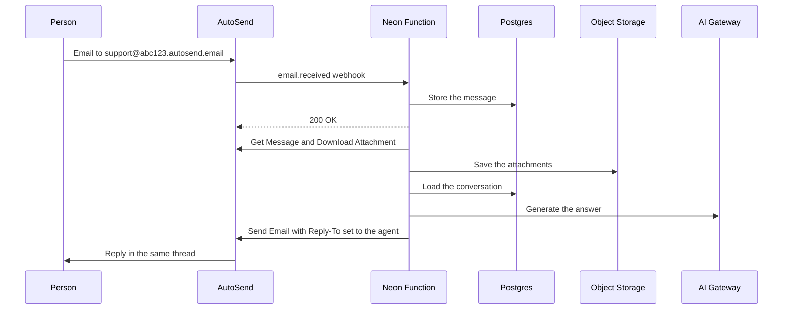

Email remains one of the main channels between businesses and their customers. Gartner predicts that by 2029, <a href="https://www.gartner.com/en/newsroom/press-releases/2025-03-05-gartner-predicts-agentic-ai-will-autonomously-resolve-80-percent-of-common-customer-service-issues-without-human-intervention-by-20290" target="_blank" rel="nofollow noopener noreferrer">agentic AI will resolve 80% of common customer service issues without human intervention</a>. To answer those requests, an AI agent needs an email address that it can receive messages on and reply from.

[AutoSend](https://autosend.com) gives every project a [default receiving domain](https://docs.autosend.com/inbound/introduction), so an agent can have its own email address with no DNS setup. In this guide, you'll connect that address to four Neon services:

- A [Neon Function](/docs/compute/functions/overview) that receives AutoSend's `email.received` webhook, fetches the message, and sends the reply in the same email thread.
- [Object Storage](/docs/storage/overview) that stores the attachments of each email.
- [AI Gateway](/docs/ai-gateway/overview) that writes the answer from the conversation history.
- Lakebase Postgres that stores the agents, conversations, and messages.

## Prerequisites

- Node.js 22 or later
- The [Neon CLI](/docs/cli/install), logged in with `neon login`
- A [Neon](https://console.neon.tech/signup) project in a region where [Neon Functions are available](/docs/compute/functions/overview)
- An [AutoSend](https://autosend.com) account on a plan that includes Inbound, with a [verified sending domain](https://docs.autosend.com/domain) and a project API key

## Architecture



The agent uses two addresses:

- It **receives** email on the default receiving domain, such as `support@abc123.autosend.email`.
- It **sends** replies from your verified sending domain, such as `support@example.com`, because AutoSend only sends from verified domains.

Replies go through the [Send Email API](https://docs.autosend.com/api-reference/mails/send) with `Reply-To` set to the receiving address, so the person's next email goes back to the agent. The function doesn't use [Reply to Message](https://docs.autosend.com/api-reference/inbound-emails/reply-to-message), because it can't set `Reply-To`.

<Steps>

## Clone the repository

Clone the project and install its dependencies:

```bash
git clone https://github.com/rishi-raj-jain/autosend-agent-inbox
cd autosend-agent-inbox
npm install
```

The important dependencies are:

- `@neon/functions` for `waitUntil` and `attachDatabasePool`
- `@neon/ai-sdk-provider` and `ai` to call AI Gateway
- `aws4fetch` to sign Object Storage requests with `fetch`
- `pg` to query Postgres

Copy the environment variable file and add your AutoSend API key to it:

```bash
cp .env.example .env.local
```

```bash filename=".env.local"
AUTOSEND_API_KEY=your-autosend-api-key
```

## Link the Neon project

Link the directory to a Neon project in a region where Neon Functions are available:

```bash
neon link
```

The CLI pulls the branch's `DATABASE_URL` into `.env.local`.

## Retrieve the receiving address

In AutoSend, open **Email Activity** > **Inbound**. The default receiving domain has the form `{uniquesubdomain}.autosend.email`. Any prefix on it receives email, so you can create an address for each agent, such as `support@abc123.autosend.email` or `billing@abc123.autosend.email`.

## Create the database schema

`schema.sql` creates four tables:

- `agents` has one row per agent: the address it receives on, the name and address it sends from, and its instructions.
- `conversations` groups the messages of one email thread with one person.
- `messages` stores each email the agent receives, keyed by AutoSend's `inboundEmailId`, and each reply, keyed by its `emailId`.
- `attachments` stores the Object Storage key of each attachment and the contents of small text files.

Run it on the linked branch with [`neon psql`](/docs/cli/psql):

```bash
neon psql -- -f schema.sql
```

Then open `neon psql` and add your first agent. Use your receiving address and an address on your verified sending domain:

```sql
INSERT INTO agents (address, name, from_email, instructions)
VALUES (
  'support@abc123.autosend.email',
  'Ada from Acme Support',
  'support@example.com',
  'You are the support agent for Acme, a project management app. Plans: Free (3 projects), Team ($12 per user per month, unlimited projects), and Enterprise (custom pricing, SSO). Answer briefly, using only these facts. If you do not know the answer, say a human will follow up.'
);
```

Store `address` and `from_email` in lowercase. The function compares them with the lowercase addresses of each email.

## Configure the Neon services

[`neon.ts`](/docs/reference/neon-ts) declares everything the agent uses on the branch:

```ts filename="neon.ts"
import { defineConfig } from '@neon/config/v1';

export default defineConfig({
  aiGateway: true,
  buckets: {
    'inbox-attachments': {},
  },
  functions: {
    agentinbox: {
      name: 'Agent inbox',
      source: './functions/agent-inbox.ts',
      env: {
        AUTOSEND_API_KEY: { value: process.env.AUTOSEND_API_KEY, required: true },
        AUTOSEND_WEBHOOK_SECRET: { value: process.env.AUTOSEND_WEBHOOK_SECRET, required: false },
      },
    },
  },
});
```

- `aiGateway: true` turns on AI Gateway and injects its credentials into the function.
- `buckets` creates the private `inbox-attachments` bucket and injects the Object Storage credentials.
- `functions` declares the `agentinbox` function and its AutoSend variables.

`AUTOSEND_WEBHOOK_SECRET` is optional because the webhook, and its secret, need the function URL from the first deploy. Until the secret is set, the function returns `500`. See [Environment variables](/docs/compute/functions/environment-variables) for the variables Neon injects.

## Review the agent function

`functions/agent-inbox.ts` answers the webhook first and does the slow work after the response.

### Signature verification and routing

AutoSend sends a hex HMAC-SHA256 of the raw body, keyed with the webhook secret, in the `X-Webhook-Signature` header. The handler verifies it before parsing the body:

```ts
function isValidSignature(rawBody: string, signature: string | null, secret: string): boolean {
  if (!signature) return false;
  const expected = crypto.createHmac('sha256', secret).update(rawBody).digest('hex');
  const given = Buffer.from(signature);
  return given.length === expected.length && crypto.timingSafeEqual(given, Buffer.from(expected));
}
```

It then looks up the agent by the email's `to` and `cc` addresses, and ignores email to an address with no agent:

```ts
const recipients = [...data.to, ...(data.cc ?? [])].map((address) => address.email.toLowerCase());
const { rows: agents } = await pool.query<Agent>('SELECT * FROM agents WHERE address = ANY($1)', [
  recipients,
]);
const agent = agents[0];
if (!agent) return new Response(null, { status: 200 });
```

### Conversation matching

A reply to the agent includes `inReplyToEmailActivityId`, the `emailId` of the agent's reply, which the handler uses to find the conversation. A new email starts a new conversation:

```ts
const sender = data.from.email.toLowerCase();
const parentId = data.inReplyToEmailActivityId ?? data.inReplyToInboundEmailId;
const { rows: parents } = parentId
  ? await pool.query<{ conversation_id: string }>(
      `SELECT m.conversation_id
       FROM messages m JOIN conversations c ON c.id = m.conversation_id
       WHERE m.id = $1 AND c.agent_address = $2`,
      [parentId, agent.address]
    )
  : { rows: [] };
const conversationId = parents[0]?.conversation_id ?? data.inboundEmailId;
```

AutoSend's `threadId` isn't used, because AutoSend gives a reply to an outbound email a new `threadId`.

### Idempotency and background processing

The `inboundEmailId` is the primary key of `messages`, so a repeated event adds no row and gets no second answer. Spam, viruses, and email from the agent's own sending address are skipped.

AutoSend waits 10 seconds for the response, and a model call can take longer, so [`waitUntil`](/docs/compute/functions/reference/runtime-limits#timeouts) runs `answer()` after the function returns `200`:

```ts collapse={13-17}
const blocked = data.spamVerdict === 'FAIL' || data.virusVerdict === 'FAIL' || sender === agent.from_email;
const { rowCount } = await pool.query(
  `INSERT INTO messages (id, conversation_id, direction, from_email, to_email, subject, status)
   VALUES ($1, $2, 'inbound', $3, $4, $5, $6)
   ON CONFLICT (id) DO NOTHING`,
  [data.inboundEmailId, conversationId, sender, agent.address, data.subject ?? null, blocked ? 'skipped' : 'received']
);

// A retry of a delivery that was already stored inserts no row, so the agent answers each email once.
if (rowCount === 1 && !blocked) {
  waitUntil(
    answer(agent, conversationId, data.inboundEmailId).catch(async (error: unknown) => {
      console.error(error);
      await pool.query(`UPDATE messages SET status = 'failed', error = $2 WHERE id = $1`, [
        data.inboundEmailId,
        String(error),
      ]);
    })
  );
}

return new Response(null, { status: 200 });
```

AutoSend doesn't retry after a `200`, so a failed `answer()` is recorded in the message's `status` and `error`.

### Attachment storage

`aws4fetch` signs requests to the branch's S3-compatible endpoint with the `AWS_*` credentials that Neon injects. `objectUrl()` encodes each part of the key, so file names with spaces or accents still sign correctly:

```ts collapse={2-5}
const s3 = new AwsClient({
  accessKeyId: process.env.AWS_ACCESS_KEY_ID!,
  secretAccessKey: process.env.AWS_SECRET_ACCESS_KEY!,
  region: process.env.AWS_REGION,
  service: 's3',
});

const BUCKET = 'inbox-attachments';

function objectUrl(key: string): string {
  return `${process.env.AWS_ENDPOINT_URL_S3}/${BUCKET}/${key.split('/').map(encodeURIComponent).join('/')}`;
}
```

`answer()` fetches the message with [Get Message](https://docs.autosend.com/api-reference/inbound-emails/get-message), downloads each attachment with [Download Attachment](https://docs.autosend.com/api-reference/inbound-emails/download-attachment), and uploads it with a signed `PUT`:

```ts collapse={13-15}
for (const attachment of message.attachments) {
  const file = await autosend(
    `/inbound/messages/${inboundId}/attachments/${attachment.attachmentId}?download=true`
  );
  const bytes = Buffer.from(await file.arrayBuffer());
  const key = `${conversationId}/${inboundId}/${attachment.index}-${attachment.filename}`;
  const upload = await s3.fetch(objectUrl(key), {
    method: 'PUT',
    body: bytes,
    headers: { 'Content-Type': attachment.contentType },
  });
  if (!upload.ok) throw new Error(`Object Storage PUT ${key} returned ${upload.status}`);

  // Keep the contents of small text files, such as CSV or JSON, so the model can read them.
  const isText = /^text\/|^application\/json/.test(attachment.contentType) && bytes.length <= 20_000;
```

### Response generation with AI Gateway

`answer()` sends the conversation to `gpt-5-mini` through AI Gateway, with inbound emails as `user` messages, replies as `assistant` messages, and the agent's `instructions` as the system prompt:

```ts
const messages: ModelMessage[] = history.map((row) =>
  row.direction === 'inbound'
    ? {
        role: 'user',
        content: row.attachments ? `${row.body}\n\n${row.attachments}` : row.body,
      }
    : { role: 'assistant', content: row.body }
);

const { text } = await generateText({
  model: neon('gpt-5-mini'),
  system: `${agent.instructions}\n\nYou are answering an email. Reply in plain text, without a subject line. Sign the email as ${agent.name}.`,
  messages,
});
```

The `neon` provider reads the AI Gateway credentials that Neon injects, so no model API key is needed. Any model in the [AI Gateway catalog](/docs/ai-gateway/models) works in place of `gpt-5-mini`.

### Reply threading

The `In-Reply-To` and `References` headers point at the person's email, so the reply appears in the same thread:

```ts
const subject = message.subject ?? '';
const sent = (await (
  await autosend('/mails/send', {
    method: 'POST',
    body: JSON.stringify({
      from: { email: agent.from_email, name: agent.name },
      to: { email: message.from.email, name: message.from.name ?? undefined },
      replyTo: { email: agent.address },
      subject: /^re:/i.test(subject) ? subject : `Re: ${subject}`,
      text,
      headers: {
        'In-Reply-To': message.messageId,
        References: referencesHeader(message.headers['references'], message.messageId),
      },
    }),
  })
).json()) as { data: { emailId: string } };
```

The function stores the reply under the returned `emailId`, which the person's next email refers to as `inReplyToEmailActivityId`.

## Deploy and register the webhook

Deploy the function, the bucket, and AI Gateway:

```bash
neon deploy --env .env.local
```

Create a webhook for `email.received` with the [Create Webhook API](https://docs.autosend.com/api-reference/webhooks/create-webhook), and append its secret to `.env.local`. If AutoSend rejects the request, `jq` prints the error and writes nothing:

```bash shouldWrap
export AUTOSEND_API_KEY=your-autosend-api-key
FUNCTION_URL=$(neon functions get agentinbox -o json | jq -r .invocation_url)

curl -s https://api.autosend.com/v1/webhooks \
  -H "Authorization: Bearer $AUTOSEND_API_KEY" \
  -H 'Content-Type: application/json' \
  -d "{ \"url\": \"$FUNCTION_URL\", \"events\": [\"email.received\"] }" > webhook.json

jq -r '"AUTOSEND_WEBHOOK_SECRET=" + (.data.webhook.secret // error(.error.message))' webhook.json >> .env.local
```

`webhook.json` holds the webhook's ID and secret, and `.gitignore` excludes it.

Deploy again so the function has the secret:

```bash
neon deploy --env .env.local
```

Wait a minute before you send a test email, because requests can reach the previous deployment for about a minute.

## Test the agent end to end

Email the agent's address with a small CSV attached. The reply arrives in the same thread a few seconds later. Reply to it, and the agent answers with the earlier messages in mind.

The conversation is in Postgres. Run this in `neon psql`:

```sql
SELECT m.direction, m.status, m.from_email, left(m.body, 80) AS body
FROM messages m
JOIN conversations c ON c.id = m.conversation_id
ORDER BY c.created_at DESC, m.created_at;
```

The attachments are in the bucket:

```bash
neon buckets object list inbox-attachments --recursive
```

If no reply arrives, check the inbound message's `status` and `error` in `messages`. If there's no row, list the webhook's recent attempts with the [List Delivery Logs API](https://docs.autosend.com/api-reference/webhooks/list-delivery-logs):

```bash shouldWrap
curl -s "https://api.autosend.com/v1/webhooks/$(jq -r .data.webhook.id webhook.json)/logs" \
  -H "Authorization: Bearer $AUTOSEND_API_KEY" | jq '.data.logs[] | {event, statusCode, errorMessage}'
```

A `401` means `AUTOSEND_WEBHOOK_SECRET` belongs to a different webhook, and a `500` means the secret isn't set on the deployment. Read the function's logs with [`neon logs`](/docs/cli/logs):

```bash
neon logs query --source function --service-name neon-function/agentinbox --since 30m
```

</Steps>

## Query conversation data

Run these queries in `neon psql`. List the conversations that need a human, where the last message is from the person because the agent skipped it, failed, or is still answering:

```sql
SELECT c.id, c.contact_email, c.subject, last.status, last.error
FROM conversations c
JOIN LATERAL (
  SELECT m.direction, m.status, m.error
  FROM messages m
  WHERE m.conversation_id = c.id
  ORDER BY m.created_at DESC
  LIMIT 1
) last ON true
WHERE last.direction = 'inbound';
```

Count the emails each agent received and answered in the last week:

```sql
SELECT c.agent_address,
       count(*) FILTER (WHERE m.direction = 'inbound')  AS received,
       count(*) FILTER (WHERE m.direction = 'outbound') AS replies,
       count(*) FILTER (WHERE m.status = 'failed')      AS failed
FROM messages m
JOIN conversations c ON c.id = m.conversation_id
WHERE m.created_at > now() - interval '7 days'
GROUP BY c.agent_address;
```

To give a human a link to an attachment, create a [presigned URL](/docs/storage/objects#presigned-urls) for its `storage_key` with the same `aws4fetch` client. The bucket is private, so the URL is the only way to open the file without credentials:

```ts
const signed = await s3.sign(`${objectUrl(storageKey)}?X-Amz-Expires=3600`, { aws: { signQuery: true } });
const url = signed.url;
```

## Configure additional agents

Each agent is a row in `agents`. Insert a row with another prefix on the receiving domain, and the same function answers it:

```sql
INSERT INTO agents (address, name, from_email, instructions)
VALUES (
  'billing@abc123.autosend.email',
  'Acme Billing',
  'billing@example.com',
  'You answer billing questions for Acme. Never promise a refund. Say the billing team will review the request.'
);
```

## Test changes on a Neon branch

Each Neon branch has its own database, bucket, and function URL, so you can change the instructions or the code without touching production conversations.

<Steps>

Create a branch and switch to it. The CLI pulls the branch's `DATABASE_URL` into your local env file:

```bash
neon branches create --name preview/agent-inbox
neon checkout preview/agent-inbox
```

The branch starts with a copy of the tables and their data.

---

AutoSend sends each `email.received` event to every webhook that subscribes to it, so the branch function also receives the email sent to your production agents. Give the branch's agents their own addresses, so that only the branch answers them:

```bash
neon psql -- -c "UPDATE agents SET address = replace(address, '@', '-preview@')"
```

The production function ignores these addresses, because its `agents` table doesn't have them.

---

Remove the production secret, deploy to the branch, and create a webhook for the branch's function URL:

```bash shouldWrap collapse={5-8}
sed -i.bak '/^AUTOSEND_WEBHOOK_SECRET=/d' .env.local
neon deploy --env .env.local

FUNCTION_URL=$(neon functions get agentinbox -o json | jq -r .invocation_url)
curl -s https://api.autosend.com/v1/webhooks \
  -H "Authorization: Bearer $AUTOSEND_API_KEY" \
  -H 'Content-Type: application/json' \
  -d "{ \"url\": \"$FUNCTION_URL\", \"events\": [\"email.received\"] }" > webhook-preview.json
jq -r '"AUTOSEND_WEBHOOK_SECRET=" + (.data.webhook.secret // error(.error.message))' webhook-preview.json >> .env.local

neon deploy --env .env.local
```

---

Wait a minute after the deploy, then email the preview address, such as `support-preview@abc123.autosend.email`. The conversation appears in the branch's tables, not in production.

---

When you're done, delete the branch webhook. Then switch back to your production branch and delete the test branch, which also deletes its tables and bucket:

```bash shouldWrap
curl -s -X DELETE "https://api.autosend.com/v1/webhooks/$(jq -r .data.webhook.id webhook-preview.json)" \
  -H "Authorization: Bearer $AUTOSEND_API_KEY"

neon checkout production
neon branches delete preview/agent-inbox
```

`neon checkout` pulls the production `DATABASE_URL` back into `.env.local`. Put the production webhook's secret back before you deploy to production again:

```bash shouldWrap
sed -i.bak '/^AUTOSEND_WEBHOOK_SECRET=/d' .env.local
jq -r '"AUTOSEND_WEBHOOK_SECRET=" + .data.webhook.secret' webhook.json >> .env.local
```

</Steps>

## Production considerations

- **Untrusted input:** Anyone who knows the address can email the agent, and an email can contain instructions meant for the model. Keep the agent's instructions narrow, and don't give it tools that change data or send email to other addresses without a review step.
- **Attachment handling:** The function passes the contents of text attachments up to 20 KB to the model, and only the file name of other attachments. Every attachment is saved in the bucket either way.
- **Message body truncation:** Get Message truncates long `text` and `html` bodies, so the model sees only the start of a very long email.
- **Custom receiving domain:** To receive email on your own domain instead of `autosend.email`, enable Inbound on it in AutoSend and add the MX record that AutoSend shows. The [List Domains API](https://docs.autosend.com/api-reference/domains/list) (`GET /v1/domains`) also returns it in `dnsRecords.inboundMx`. A domain's MX records point to one mail provider, so use a domain that doesn't already receive email elsewhere. The function doesn't change: set each agent's `address` to the new domain.

<NeedHelp/>
