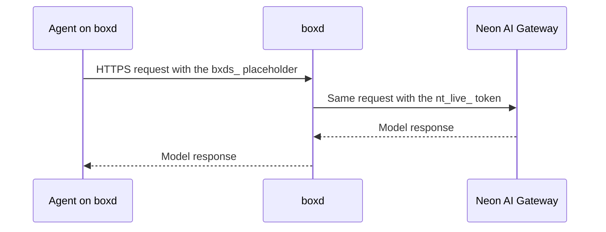

[boxd](https://boxd.sh) machines come with coding agents like Claude Code, Codex, and OpenCode installed. Each agent normally needs its own provider key, such as an Anthropic key for Claude Code and an OpenAI key for Codex, each with its own account and bill, but with [Neon AI Gateway](/docs/ai-gateway/overview), all three agents share one credential for Claude, GPT, Gemini, and open-weight models. You pay for every model from one [prepaid balance](/docs/ai-gateway/prepaid-credits), and switching models doesn't need a new key. Any code on the machine could read that credential, so boxd [host-bound secrets](https://docs.boxd.sh/guides/env-secrets#host-bound-secrets) keep it out of the machine. The machine gets a `bxds_...` placeholder, and boxd swaps in the token only on HTTPS requests to your branch's gateway host.

In this guide, you'll store one AI Gateway credential in boxd, create a machine where Claude Code, Codex, and OpenCode all use it, and then rotate and revoke the credential while the machine keeps running:



## Demo

The tabs below show each part of the flow. `$TASK` is a prompt that asks the agent to write and run a script that prints the first 10 prime numbers:

<Tabs labels={["Claude Code", "Codex", "OpenCode", "Placeholder", "Rotate", "Revoke"]}>

<TabItem>

**Claude Code** runs on the gateway's Anthropic Messages endpoint. Its `sonnet`, `opus`, and `haiku` roles map to gateway model ids.

```bash filename="Terminal"
$ npm run agent -- agents-1 claude "$TASK"
2,3,5,7,11,13,17,19,23,29

$ npm run agent -- agents-1 claude 'Reply with only the name of the model you are.' haiku
Haiku 5.5
```

</TabItem>

<TabItem>

**Codex** runs on the gateway's OpenAI Responses endpoint, with no OpenAI key on the machine.

```bash filename="Terminal"
$ npm run agent -- agents-1 codex "$TASK"
2,3,5,7,11,13,17,19,23,29

$ npm run agent -- agents-1 codex "$TASK" gpt-6-1-sol
2, 3, 5, 7, 11, 13, 17, 19, 23, 29
```

</TabItem>

<TabItem>

**OpenCode** runs open-weight models such as Kimi K3 on chat completions, and Gemini on the gateway's native Gemini endpoint.

```bash filename="Terminal"
$ npm run agent -- agents-1 opencode "$TASK"
2,3,5,7,11,13,17,19,23,29

$ npm run agent -- agents-1 opencode "$TASK" neon-gemini/gemini-3-5-flash
2, 3, 5, 7, 11, 13, 17, 19, 23, 29
```

</TabItem>

<TabItem>

**Placeholder** shows what the machine holds and what another host receives. Only requests to the gateway carry the token.

```bash filename="Terminal"
$ boxd machine exec agents-1 -- printenv NEON_AI_GATEWAY_TOKEN
bxds_b32a8763625527b192148024acfe980b

$ boxd machine exec agents-1 -- 'curl -s https://httpbin.org/anything -H "Authorization: Bearer $NEON_AI_GATEWAY_TOKEN" | jq -r .headers.Authorization'
Bearer bxds_b32a8763625527b192148024acfe980b
```

</TabItem>

<TabItem>

**Rotate** replaces the token behind the same placeholder. The agent keeps working without a restart.

```bash filename="Terminal"
$ npm run rotate
{
  "tokenId": "nak_live_1ec2b71a53324ca1a40bbbe8201ec3f4",
  "revoked": ["nak_live_696c2b7de42242818ad380b51eef747a"]
}

$ npm run agent -- agents-1 claude 'Reply with only: still working' haiku
still working
```

</TabItem>

<TabItem>

**Revoke** stops model access for every agent with one call. The machine keeps running.

```bash filename="Terminal"
$ npm run revoke
{
  "revoked": ["nak_live_1ec2b71a53324ca1a40bbbe8201ec3f4"]
}

$ npm run agent -- agents-1 opencode 'Reply with only: ok'
Error: invalid or missing credential. Use an active AI Gateway credential in the Authorization: Bearer or x-api-key header. https://neon.com/docs/ai-gateway/authentication
```

</TabItem>

</Tabs>

## Prerequisites

- Node.js 24 or later
- A [Neon](https://console.neon.tech/signup) account with [AI Gateway prepaid credits](/docs/ai-gateway/prepaid-credits) ($5 minimum, on any plan, including Free)
- A [boxd](https://app.boxd.sh) account

<Steps>

## Clone and configure the example project

Clone the example project and install its dependencies:

```bash
git clone https://github.com/rishi-raj-jain/boxd-coding-agents-neon-ai-gateway
cd boxd-coding-agents-neon-ai-gateway
npm install
```

It installs the [Neon](/docs/reference/typescript-sdk) and [boxd](https://docs.boxd.sh/reference/typescript-sdk) TypeScript SDKs, and `tsx` to run the scripts. Then, copy the environment variable file:

```bash
cp .env.example .env
```

The scripts need four values in `.env`: `NEON_API_KEY`, `NEON_PROJECT_ID`, `BOXD_API_KEY`, and `BOXD_REGION`. `src/clients.ts` sets up both clients for the scripts to share:

```typescript filename="src/clients.ts"
import { Boxd } from '@boxd-sh/sdk';
import { createNeonClient } from '@neon/sdk';

// Reads BOXD_API_KEY and BOXD_REGION from the environment.
export const boxd = new Boxd();

// throwOnError turns every failed Neon call into a thrown error.
export const neon = createNeonClient({ apiKey: process.env.NEON_API_KEY!, throwOnError: true });

export const projectId = process.env.NEON_PROJECT_ID!;
```

## Create a Neon project and API keys

This step uses the Neon CLI. If you don't have it yet, see [Install and connect](/docs/cli/install). Log in, then create a project in a [region that supports AI Gateway](/docs/ai-gateway/overview):

```bash
neon login
neon projects create --name boxd-coding-agents --region-id aws-us-east-2
```

Copy the project ID from the output into `NEON_PROJECT_ID`. AI Gateway is on by default for new projects.

Next, create a [project-scoped API key](/docs/manage/api-keys#create-project-scoped-organization-api-keys) for this project and paste it into `NEON_API_KEY`: in your organization's **Settings** > **API keys**, click **Create new** and select **Project-scoped**. The scripts use it to mint, rotate, and revoke the gateway credential, and it can't reach your other projects. It stays on your computer and never goes to a boxd machine.

Finally, create a boxd API key with the [boxd CLI](https://docs.boxd.sh/quickstart) and paste it into `BOXD_API_KEY`:

```bash
boxd auth keys create boxd-coding-agents
```

Set `BOXD_REGION` to the region your machines should run in, such as `nyc`.

## Store the AI Gateway credential as a boxd secret

A Neon AI Gateway credential is a bearer token (`nt_live_...`) tied to a branch. It works on that branch and on every branch created from it. See [AI Gateway authentication](/docs/ai-gateway/authentication) for details. The credential code is in `src/gateway.ts`:

```typescript filename="src/gateway.ts"
import { boxd, neon, projectId } from './clients.ts';

export const SECRET_NAME = 'NEON_AI_GATEWAY_TOKEN';
export const CREDENTIAL_NAME = 'boxd-agents';

export async function gateway() {
  const branchId = process.env.NEON_BRANCH_ID || (await neon.branches.getDefault({ projectId })).id;
  const { enabled, base_url } = await neon.aiGateway.get({ projectId, branchId });
  if (!enabled) throw new Error(`AI Gateway is not enabled on branch ${branchId}`);
  return { branchId, baseUrl: base_url, host: new URL(base_url).hostname };
}

export async function liveCredentials(branchId: string) {
  const list = await neon.credentials.list({ projectId, branchId });
  return list
    .filter((c) => c.name === CREDENTIAL_NAME && !c.revoked_at)
    .sort((a, b) => a.created_at.localeCompare(b.created_at));
}

export async function mintAndStore(branchId: string, host: string) {
  const created = await neon.credentials.create({
    projectId,
    branchId,
    name: CREDENTIAL_NAME,
    scopes: ['ai_gateway:invoke'],
    principal_type: 'user',
  });
  try {
    await boxd.secrets.set(SECRET_NAME, created.api_token, { scope: 'unattached', domains: [host] });
  } catch (err) {
    await neon.credentials.revoke({ projectId, branchId, tokenId: created.token_id });
    throw err;
  }
  return created.token_id;
}
```

In the code above:

- `gateway()` looks up the default branch's gateway URL, such as `https://br-muddy-bonus-bddl5fum-api.ai.c-8.us-east-2.aws.neon.tech`. Each branch has its own gateway host.
- `liveCredentials()` finds this project's credentials by name, so the scripts don't need to store a token id.
- `domains: [host]` binds the secret to that exact host. A request to any other host carries the placeholder.
- `scope: 'unattached'` means the secret reaches no machine on its own, only the machines whose spec lists it. Your other boxd machines never get the variable.
- `api_token` is shown once. The script passes it to boxd and never prints or stores it. If boxd refuses the secret, the script revokes the credential, so a failed run doesn't leave a working token behind.

`scripts/connect.ts` calls these helpers:

```typescript filename="scripts/connect.ts"
import { CREDENTIAL_NAME, SECRET_NAME, gateway, liveCredentials, mintAndStore } from '../src/gateway.ts';

const { branchId, host } = await gateway();

if ((await liveCredentials(branchId)).length > 0) {
  throw new Error(`a ${CREDENTIAL_NAME} credential already exists. Run scripts/rotate.ts to replace its token.`);
}

const tokenId = await mintAndStore(branchId, host);

console.log(JSON.stringify({ tokenId, secret: SECRET_NAME, boundTo: host }, null, 2));
```

Run it:

```bash
npm run connect
```

```json
{
  "tokenId": "nak_live_696c2b7de42242818ad380b51eef747a",
  "secret": "NEON_AI_GATEWAY_TOKEN",
  "boundTo": "br-muddy-bonus-bddl5fum-api.ai.c-8.us-east-2.aws.neon.tech"
}
```

`boxd env list` now shows the secret, sealed, with the host it's bound to. An `unattached` secret set without an org is your own, so it's listed as `private-unattached`:

```text
NAME                   VALUE     SCOPE               HOSTS
NEON_AI_GATEWAY_TOKEN  (sealed)  private-unattached  br-muddy-bonus-bddl5fum-a…
```

## Create a boxd machine for the agents

Each agent reaches the gateway in its own API format, so each one needs its own setting. `src/agents.ts` has the env vars and config files for all three:

```typescript filename="src/agents.ts"
import { SECRET_NAME } from './gateway.ts';

const CLAUDE_ROLES = {
  sonnet: 'claude-sonnet-5-5',
  opus: 'claude-opus-5-5',
  haiku: 'claude-haiku-5-5',
};

export function agentEnv(baseUrl: string): Record<string, string> {
  return {
    NEON_AI_GATEWAY_BASE_URL: baseUrl,
    ANTHROPIC_BASE_URL: `${baseUrl}/anthropic`,
    ...Object.fromEntries(Object.entries(CLAUDE_ROLES).map(([role, id]) => [`ANTHROPIC_DEFAULT_${role.toUpperCase()}_MODEL`, id])),
  };
}

export function agentFiles(baseUrl: string): Record<string, string> {
  return {
    '/home/boxd/.claude/settings.json': JSON.stringify({ apiKeyHelper: `printenv ${SECRET_NAME}` }, null, 2),

    '/home/boxd/.codex/config.toml': [
      'model = "gpt-5-3-codex"',
      'model_provider = "neon"',
      '',
      '[model_providers.neon]',
      'name = "Neon AI Gateway"',
      `base_url = "${baseUrl}/openai/v1"`,
      'wire_api = "responses"',
      `env_key = "${SECRET_NAME}"`,
      '',
    ].join('\n'),

    '/home/boxd/.config/opencode/opencode.json': JSON.stringify(
      {
        $schema: 'https://opencode.ai/config.json',
        model: 'neon/kimi-k3',
        provider: {
          neon: { options: { apiKey: `{env:${SECRET_NAME}}` } },
          'neon-gemini': {
            npm: '@ai-sdk/google',
            name: 'Neon AI Gateway (Gemini)',
            options: {
              baseURL: `${baseUrl}/gemini/v1beta`,
              apiKey: 'unused',
              headers: { Authorization: `Bearer {env:${SECRET_NAME}}` },
            },
            models: { 'gemini-3-1-pro': { name: 'Gemini 3.1 Pro' }, 'gemini-3-5-flash': { name: 'Gemini 3.5 Flash' } },
          },
        },
      },
      null,
      2,
    ),
  };
}
```

In the code above:

- **Claude Code** uses the gateway's [Anthropic Messages endpoint](/docs/ai-gateway/anthropic-messages) at `<base>/anthropic`, set with `ANTHROPIC_BASE_URL`. Its `apiKeyHelper` runs `printenv NEON_AI_GATEWAY_TOKEN` to get its key, so it sends the placeholder, and boxd replaces it. The `ANTHROPIC_DEFAULT_*_MODEL` variables map Claude Code's `sonnet`, `opus`, and `haiku` roles to gateway model ids.
- **Codex** ignores `OPENAI_BASE_URL`, so the gateway goes into `~/.codex/config.toml` as a `neon` model provider on the [OpenAI Responses endpoint](/docs/ai-gateway/openai-responses). `env_key` tells Codex which variable holds its key.
- **OpenCode** already knows Neon AI Gateway as the `neon` provider, with every model on the [chat completions endpoint](/docs/ai-gateway/chat-completions). Gemini rejects OpenCode's tool definitions on chat completions, so `neon-gemini` sends Gemini requests to the gateway's [native Gemini endpoint](/docs/ai-gateway/gemini) instead.

All three read the same `NEON_AI_GATEWAY_TOKEN` variable, so one secret covers them.

`scripts/create-machine.ts` creates the machine from a [machine spec](https://docs.boxd.sh/guides/machine-specs) and writes the config files:

```typescript filename="scripts/create-machine.ts"
import { dirname } from 'node:path';
import { Machine, secrets } from '@boxd-sh/sdk';
import { boxd } from '../src/clients.ts';
import { SECRET_NAME, gateway } from '../src/gateway.ts';
import { agentEnv, agentFiles } from '../src/agents.ts';

const [name] = process.argv.slice(2);
const { baseUrl } = await gateway();

const spec = Machine.spec().env(agentEnv(baseUrl)).with(secrets(SECRET_NAME)).label('neon-ai-gateway', 'true');

const machine = await boxd.machines.create({ name, spec });
try {
  await boxd.machines.waitUntilReady(machine.id);
  for (const [path, content] of Object.entries(agentFiles(baseUrl))) {
    await boxd.machines.fs.mkdir(machine.id, dirname(path));
    await boxd.machines.fs.write(machine.id, path, content);
  }
} catch (err) {
  await boxd.machines.delete(machine.id);
  throw err;
}

console.log(JSON.stringify({ name, url: machine.access.url }, null, 2));
```

The spec's `env` holds the gateway URLs, which aren't secrets, and `secrets(SECRET_NAME)` gives this machine the unattached secret. If any step fails, the script deletes the machine.

<Admonition type="warning" title="Don't create the machine as isolated">
An `isolated: true` machine doesn't get the certificate boxd uses for host-bound secrets, so HTTPS requests to the gateway fail with `self-signed certificate in certificate chain`. Create the agent machine without it.
</Admonition>

Create a machine named `agents-1`:

```bash
npm run create-machine -- agents-1
```

```json
{
  "name": "agents-1",
  "url": "https://agents-1.nyc.boxd.sh"
}
```

Check what the machine sees:

```bash
boxd machine exec agents-1 -- printenv NEON_AI_GATEWAY_TOKEN
```

```text
bxds_b32a8763625527b192148024acfe980b
```

The machine has the placeholder, not the `nt_live_...` token.

## Run Claude Code, Codex, and OpenCode

Each agent runs with a non-interactive command. The commands are in `src/agents.ts`:

```typescript filename="src/agents.ts"
const shellQuote = (value: string) => `'${value.replaceAll("'", `'\\''`)}'`;

export const AGENTS = {
  claude: (task: string, model = 'sonnet') =>
    `claude -p ${shellQuote(task)} --model ${shellQuote(model)} --allowedTools 'Read,Write,Edit,Bash(node *)'`,
  codex: (task: string, model = 'gpt-5-3-codex') =>
    `codex exec --skip-git-repo-check --sandbox workspace-write -m ${shellQuote(model)} ${shellQuote(task)}`,
  opencode: (task: string, model = 'neon/kimi-k3') => `opencode run -m ${shellQuote(model)} ${shellQuote(task)}`,
};
```

In `-p` mode, Claude Code can't ask for permission, so `--allowedTools` lists what it may do: edit files and run `node`. The prompt comes right after `-p`, because `--allowedTools` takes every argument after it. Codex runs in its `workspace-write` sandbox, so it can only write to its working directory and temporary directories.

`scripts/agent.ts` runs one task with one agent, in its own directory under `~/work`:

```typescript filename="scripts/agent.ts"
import { boxd } from '../src/clients.ts';
import { AGENTS, type AgentName } from '../src/agents.ts';

const [name, agent, task, model] = process.argv.slice(2);
if (!(agent in AGENTS)) throw new Error(`agent must be one of: ${Object.keys(AGENTS).join(', ')}`);

const { id } = await boxd.machines.get(name);
const command = AGENTS[agent as AgentName](task, model);

const result = await boxd.machines.exec(id, {
  command: ['bash', '-lc', `mkdir -p ~/work/${agent} && cd ~/work/${agent} && ${command} < /dev/null`],
  timeout: 600_000,
});

console.log(result.stdout);
if (result.exitCode !== 0) console.error(result.stderr);
process.exit(result.exitCode ?? 1);
```

`machines.exec` runs the command with the machine's env vars and secrets, so each agent finds the gateway URL and the placeholder. `< /dev/null` closes stdin, so an agent doesn't wait for input.

Give all three agents the same task:

```bash
TASK='Create primes.mjs that prints the first 10 prime numbers as a comma-separated list, run it with node, and reply with only its output.'
npm run agent -- agents-1 claude "$TASK"
npm run agent -- agents-1 codex "$TASK"
npm run agent -- agents-1 opencode "$TASK"
```

Each one writes the script, runs it, and replies with the same output:

```text
2,3,5,7,11,13,17,19,23,29
```

Claude Code ran on `claude-sonnet-5-5`, Codex on `gpt-5-3-codex`, and OpenCode on the open-weight `kimi-k3`. To pick another model, pass it as the last argument: a Claude Code role, a gateway model id for Codex, or `provider/model` for OpenCode. The [models page](/docs/ai-gateway/models) lists every model id.

```bash
npm run agent -- agents-1 claude 'Reply with only the name of the model you are.' haiku
npm run agent -- agents-1 codex "$TASK" gpt-6-1-sol
npm run agent -- agents-1 opencode "$TASK" neon-gemini/gemini-3-5-flash
```

## Verify what other hosts receive

To see what a host other than the gateway receives, send the variable to httpbin, which echoes requests back:

```bash
boxd machine exec agents-1 -- 'curl -s https://httpbin.org/anything -H "Authorization: Bearer $NEON_AI_GATEWAY_TOKEN" | jq -r .headers.Authorization'
```

```text
Bearer bxds_b32a8763625527b192148024acfe980b
```

httpbin receives the placeholder, not the token. The same header sent to the gateway arrives with the token and returns `200`.

## Rotate the AI Gateway credential

`scripts/rotate.ts` replaces the token without a gap. It mints a new credential, stores it under the same secret, and only then revokes the old one:

```typescript filename="scripts/rotate.ts"
import { neon, projectId } from '../src/clients.ts';
import { CREDENTIAL_NAME, gateway, liveCredentials, mintAndStore } from '../src/gateway.ts';

const { branchId, host } = await gateway();

const old = await liveCredentials(branchId);
if (old.length === 0) throw new Error(`no live ${CREDENTIAL_NAME} credential. Run scripts/connect.ts first.`);

const tokenId = await mintAndStore(branchId, host);
for (const credential of old) {
  await neon.credentials.revoke({ projectId, branchId, tokenId: credential.token_id });
}

console.log(JSON.stringify({ tokenId, revoked: old.map((c) => c.token_id) }, null, 2));
```

Run it, then run an agent on the same machine:

```bash
npm run rotate
npm run agent -- agents-1 claude 'Reply with only: still working' haiku
```

```json
{
  "tokenId": "nak_live_1ec2b71a53324ca1a40bbbe8201ec3f4",
  "revoked": ["nak_live_696c2b7de42242818ad380b51eef747a"]
}
```

```text
still working
```

The machine still has the same `bxds_...` placeholder. boxd adds whichever token the secret holds when each request goes out, so the machine doesn't restart and none of its config files change.

## Revoke the AI Gateway credential

To cut off every agent at once, `scripts/revoke.ts` revokes the live credential:

```bash
npm run revoke
npm run agent -- agents-1 opencode 'Reply with only: ok'
```

From the next request on, the gateway rejects the token, and the agent fails right away:

```text
Error: invalid or missing credential. Use an active AI Gateway credential in the Authorization: Bearer or x-api-key header. https://neon.com/docs/ai-gateway/authentication
```

The machine keeps running. To give the agents model access again, run `npm run connect`, which mints a new credential and stores it under the same secret.

When you're done, delete the machine:

```bash
boxd machine remove agents-1 -y
```

</Steps>

## Next steps

- Forks of `agents-1` keep the secret, the env vars, and the agent config files, so you can [fork the machine](https://docs.boxd.sh/guides/fork) to run several agents on the same task side by side. The guide on [forking a boxd machine with its own Neon branch](/guides/boxd-fork-neon-branching) gives each fork its own database too.
- Add an [egress allowlist](https://docs.boxd.sh/guides/egress-allowlist) to the spec with `.egress(...)`, so the agents can reach only the hosts you list, such as your package registry. Hosts that a secret is bound to stay reachable.
- To make the credential stop working on a set date, pass `expires_at` when you create it. See [AI Gateway authentication](/docs/ai-gateway/authentication#pull-credentials-with-neon).
- All agents share your organization's AI Gateway balance. Once it drops below $2, the gateway answers new requests with `429` until you [add credits](/docs/ai-gateway/prepaid-credits).

<NeedHelp />
