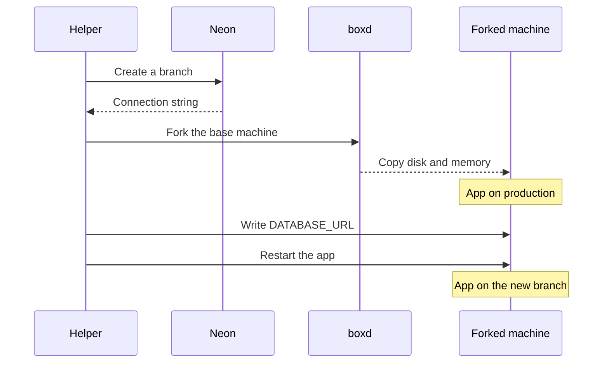

Giving a coding agent or a pull request its own copy of your app often means rebuilding the app and sharing one database, so a migration on one copy can break the others. With [boxd](https://boxd.sh), you can fork a running machine, disk, memory, and processes included, and [Neon branching](/docs/introduction/branching) gives the fork a copy-on-write copy of your database.

In this guide, you'll fork a notes API on boxd with its own Neon branch, let a coding agent change the schema on the fork, and then delete both. Because the fork starts with the parent's `DATABASE_URL`, a small helper points its app at the new branch:



## Prerequisites

- Node.js 24 or later
- A [Neon](https://console.neon.tech/signup) project and a [Neon API key](/docs/manage/api-keys)
- A [boxd](https://app.boxd.sh) account and API key
- An Anthropic API key, if you want to run the coding agent

<Steps>

## Set up the project

Create a new directory and install the [Neon](/docs/reference/typescript-sdk) and [boxd](https://docs.boxd.sh/reference/typescript-sdk) TypeScript SDKs:

```bash
mkdir neon-boxd-forks && cd neon-boxd-forks
npm init -y --init-type=module
npm install @neon/sdk @boxd-sh/sdk
npm install -D tsx typescript @types/node
mkdir app src scripts
```

Then, set your API keys and the boxd region as environment variables:

```bash
export NEON_API_KEY=your_neon_api_key
export NEON_PROJECT_ID=your_neon_project_id
export BOXD_API_KEY=your_boxd_api_key
export BOXD_REGION=nyc
```

You can copy the project ID from your project's **Settings** page in the Neon Console.

Create `scripts/clients.ts`, which sets up both clients for the other scripts to share:

```typescript
import { Boxd } from '@boxd-sh/sdk';
import { createNeonClient } from '@neon/sdk';

// Reads BOXD_API_KEY and BOXD_REGION from the environment.
export const boxd = new Boxd();

export const neon = createNeonClient({ apiKey: process.env.NEON_API_KEY!, throwOnError: true });

export const projectId = process.env.NEON_PROJECT_ID!;
```

## Write the notes app

The app is a small notes API that reads `DATABASE_URL` once when it starts, as most apps do, and queries Postgres over HTTP with the [Neon serverless driver](/docs/serverless/serverless-driver). Every response includes the database host it's connected to. Each Neon branch has a separate endpoint host, so the host tells you which branch a machine is using.

Create `app/server.mjs`:

```javascript
import http from 'node:http';
import { neon } from '@neondatabase/serverless';

const sql = neon(process.env.DATABASE_URL);
const host = new URL(process.env.DATABASE_URL).hostname;
await sql`CREATE TABLE IF NOT EXISTS notes (id serial PRIMARY KEY, body text NOT NULL)`;

http
  .createServer(async (req, res) => {
    try {
      if (req.method === 'POST' && req.url === '/notes') {
        let body = '';
        for await (const chunk of req) body += chunk;
        await sql`INSERT INTO notes (body) VALUES (${body})`;
      }
      const [db] = await sql`SELECT current_database() AS name`;
      const notes = await sql`SELECT body FROM notes ORDER BY id`;
      res.setHeader('content-type', 'application/json');
      res.end(JSON.stringify({ host, database: db.name, notes: notes.map((r) => r.body) }));
    } catch (err) {
      res.statusCode = 500;
      res.end(String(err));
    }
  })
  .listen(8000);
```

The app runs as a systemd service on port 8000, which is the port boxd serves at the machine's HTTPS URL. Create `app/notes.service`:

```ini
[Unit]
Description=Notes API
After=network-online.target

[Service]
User=boxd
WorkingDirectory=/home/boxd/app
EnvironmentFile=/home/boxd/app/.env
ExecStart=/usr/local/bin/node server.mjs
Restart=always

[Install]
WantedBy=multi-user.target
```

## Create the base machine

Create `src/setup-app.ts`, which uploads the app to a machine, writes its `.env` file, installs the Neon serverless driver, and starts the service:

```typescript collapse={1-4, 6-9}
import { readFile } from 'node:fs/promises';
import type { Boxd } from '@boxd-sh/sdk';

/** Install the notes app on a machine as a systemd service on port 8000, connected to `databaseUrl`. */
export async function setupApp(boxd: Boxd, machineId: string, databaseUrl: string): Promise<void> {
  await boxd.machines.files.mkdir(machineId, '/home/boxd/app');
  const appDir = new URL('../app/', import.meta.url);
  await boxd.machines.files.upload(machineId, '/home/boxd/app/server.mjs', await readFile(new URL('server.mjs', appDir)));
  await boxd.machines.files.upload(machineId, '/home/boxd/app/notes.service', await readFile(new URL('notes.service', appDir)));
  await boxd.machines.fs.write(machineId, '/home/boxd/app/.env', `DATABASE_URL=${databaseUrl}\n`, { mode: 0o600 });
  const script = [
    'set -e',
    'cd /home/boxd/app',
    'npm init -y >/dev/null',
    'npm install --silent @neondatabase/serverless',
    'sudo cp notes.service /etc/systemd/system/notes.service',
    'sudo systemctl daemon-reload',
    'sudo systemctl enable --now notes',
    'for i in $(seq 1 30); do curl -fsS localhost:8000 && exit 0; sleep 1; done; exit 1',
  ].join('\n');
  const r = await boxd.machines.exec(machineId, {
    command: ['bash', '-c', script],
    timeout: 300_000,
  });
  if (r.exitCode !== 0) throw new Error(`app setup failed: ${r.stderr.trim()}`);
}
```

Then, create `scripts/create-base.ts`, which creates the base machine and sets up the app on it. `isolated: true` keeps the machine off your private boxd network and away from your boxd credentials, since a coding agent runs on its fork later in this guide. Forks keep this setting.

```typescript
import { boxd } from './clients.ts';
import { setupApp } from '../src/setup-app.ts';

const [name] = process.argv.slice(2);

const machine = await boxd.machines.create({ name, isolated: true });
console.error(`created ${name}, installing the app`);
await boxd.machines.waitUntilReady(machine.id);
await setupApp(boxd, machine.id, process.env.DATABASE_URL!);

console.log(JSON.stringify({ name, url: machine.access.url }, null, 2));
```

Run it with the connection string of your `production` branch, which you can copy from **Connect** in the Neon Console:

```bash
DATABASE_URL='postgresql://[user]:[password]@[neon_hostname]/[dbname]' npx tsx scripts/create-base.ts notes-production
```

The script prints the machine's name and URL:

```json
{
  "name": "notes-production",
  "url": "https://notes-production.nyc.boxd.sh"
}
```

Add a note on the base machine:

```bash
curl -X POST https://notes-production.nyc.boxd.sh/notes -d "Buy milk"
```

The response shows the note and the host of the `production` branch:

```json
{ "host": "ep-sweet-frog-bd2ihfzb-pooler.c-8.us-east-2.aws.neon.tech", "database": "neondb", "notes": ["Buy milk"] }
```

## Fork the machine with a Neon branch

Create `src/fork-with-branch.ts`. Its `forkWithBranch` function runs the steps in the diagram at the top of this guide. It creates the branch from `production` with `branches.createAndConnect`, then [forks the base machine](https://docs.boxd.sh/guides/fork) with the same name and a `neon-branch` label that holds the branch id.

<Admonition type="warning" title="The fork uses the parent's data until the app restarts">
The fork has a URL from the moment it exists, so for a second or two, until the app restarts, requests to the fork still go to the parent branch, including writes. If your app runs background jobs that write on their own, stop them on the base machine before you fork, or make them wait for the restart.
</Admonition>

```typescript collapse={1-17}
import type { Boxd, Machine } from '@boxd-sh/sdk';
import type { NeonClient } from '@neon/sdk';

export interface ForkWithBranchOptions {
  /** The machine to fork. It runs your app with DATABASE_URL pointing at the parent branch. */
  baseMachineId: string;
  /** Neon project that holds the parent branch. */
  projectId: string;
  /** Name for both the boxd machine and the Neon branch. */
  name: string;
}

export interface ForkedEnvironment {
  machine: Machine;
  branchId: string;
  url: string;
}

/** Fork a running boxd machine and give the fork its own Neon branch. */
export async function forkWithBranch(
  boxd: Boxd,
  neon: NeonClient<true>,
  opts: ForkWithBranchOptions,
): Promise<ForkedEnvironment> {
  const { branch, connectionString } = await neon.branches.createAndConnect({
    projectId: opts.projectId,
    name: opts.name,
  });

  let machine: Machine | undefined;
  try {
    machine = await boxd.machines.fork(opts.baseMachineId, {
      name: opts.name,
      labels: { 'neon-branch': branch.id },
    });
    machine = await boxd.machines.waitUntilReady(machine.id);

    await boxd.machines.fs.write(machine.id, '/home/boxd/app/.env', `DATABASE_URL=${connectionString}\n`, { mode: 0o600 });

    const script = [
      'set -e',
      'sudo systemctl restart notes',
      'for i in $(seq 1 30); do if curl -fsS -o /dev/null localhost:8000; then exit 0; fi; sleep 1; done',
      'echo "the app did not answer after the restart" >&2; exit 1',
    ].join('\n');
    const result = await boxd.machines.exec(machine.id, { command: ['bash', '-c', script], timeout: 60_000 });
    if (result.exitCode !== 0) {
      throw new Error(`could not point ${machine.name} (${machine.id}) at branch ${branch.id}: ${result.stderr.trim()}`);
    }
  } catch (err) {
    machine ??= await boxd.machines.get(opts.name).then(
      (found) => (found.labels['neon-branch'] === branch.id ? found : undefined),
      () => undefined,
    );
    await Promise.allSettled([
      machine ? boxd.machines.delete(machine.id) : Promise.resolve(),
      neon.branches.delete({ projectId: opts.projectId, branchId: branch.id }),
    ]);
    throw err;
  }

  return {
    machine,
    branchId: branch.id,
    url: machine.access.url,
  };
}
```

In the code above:

- The connection string goes into `.env` through the boxd file API with mode `0600`, so it never shows up in a command line, and only the file's owner can read it.
- If any step fails, the function deletes the fork and the branch and rethrows the error. If `fork()` throws after boxd has already created the machine, the cleanup finds the fork by name and deletes it only if its `neon-branch` label matches. The cleanup is best effort, so check for leftovers after a failed run.

Next, create `scripts/fork.ts` to call the helper from the command line. boxd's `machines.get()` accepts a machine name, so the script takes names and looks up the base machine's id:

```typescript
import { boxd, neon, projectId } from './clients.ts';
import { forkWithBranch } from '../src/fork-with-branch.ts';

const [baseName, name] = process.argv.slice(2);

const base = await boxd.machines.get(baseName);
const env = await forkWithBranch(boxd, neon, { baseMachineId: base.id, projectId, name });

console.log(JSON.stringify({ name, branchId: env.branchId, url: env.url }, null, 2));
```

Fork `notes-production` into an environment named `feature-tags`:

```bash
npx tsx scripts/fork.ts notes-production feature-tags
```

The script prints the fork's name, branch id, and URL:

```json
{
  "name": "feature-tags",
  "branchId": "br-calm-dawn-bdbyl8dc",
  "url": "https://feature-tags.nyc.boxd.sh"
}
```

The fork already has the note from production, and the host shows that it's on the new branch's endpoint:

```bash
curl https://feature-tags.nyc.boxd.sh
```

```json
{ "host": "ep-silent-dust-bdljr9ey-pooler.c-8.us-east-2.aws.neon.tech", "database": "neondb", "notes": ["Buy milk"] }
```

Add a note on the fork, then read from the base machine:

```bash
curl -X POST https://feature-tags.nyc.boxd.sh/notes -d "Only on the fork"
curl https://notes-production.nyc.boxd.sh
```

```json
{ "host": "ep-sweet-frog-bd2ihfzb-pooler.c-8.us-east-2.aws.neon.tech", "database": "neondb", "notes": ["Buy milk"] }
```

The base machine still returns only the first note, because the new note went to the fork's branch. In the Neon Console, your project now has a `feature-tags` branch.

## Run a coding agent on a fork

In this step, Claude Code adds a `done` column to the notes table on the fork. The agent uses the fork's `DATABASE_URL`, so the migration runs on the fork's branch.

<Admonition type="warning" title="The fork's credentials also work on production">
A new branch has the same roles and passwords as its parent, so the credentials in the fork's `.env` can connect to the production branch's endpoint. The agent also runs with `--dangerously-skip-permissions`, so it can run any command on the fork without asking. If you don't trust an agent with production, [create a role](/docs/manage/roles#create-a-role) on the fork's branch only and put that role's connection string in the fork's `.env`.
</Admonition>

Create `scripts/agent.ts`. It runs one Claude Code task on a machine with the `claude` CLI, which boxd machines include, and passes your Anthropic API key only to that command:

```typescript
import { boxd } from './clients.ts';

const [name] = process.argv.slice(2);
const { id } = await boxd.machines.get(name);

const task =
  'In /home/boxd/app, write and run migrate.mjs, a Node script that uses @neondatabase/serverless and DATABASE_URL from .env ' +
  'to add a boolean column done, default false, to the notes table. Then change server.mjs so GET returns ' +
  'notes as [{ body, done }]. Restart the app with: sudo systemctl restart notes.';

const shellQuote = (value: string) => `'${value.replaceAll("'", `'\\''`)}'`;

const result = await boxd.machines.exec(id, {
  command: ['bash', '-lc', `cd /home/boxd/app && claude -p --model haiku --dangerously-skip-permissions ${shellQuote(task)} < /dev/null`],
  env: { ANTHROPIC_API_KEY: process.env.ANTHROPIC_API_KEY! },
  timeout: 400_000,
});

console.log(result.stdout);
process.exit(result.exitCode ?? 1);
```

Run it on the fork:

```bash
ANTHROPIC_API_KEY=your_anthropic_key npx tsx scripts/agent.ts feature-tags
```

When the agent finishes, the fork returns each note with a `done` field:

```json
{
  "host": "ep-silent-dust-bdljr9ey-pooler.c-8.us-east-2.aws.neon.tech",
  "database": "neondb",
  "notes": [
    { "body": "Buy milk", "done": false },
    { "body": "Only on the fork", "done": false }
  ]
}
```

The base machine still returns plain strings, because the `production` branch doesn't have the new column.

To review the schema change, [compare the fork's branch with its parent](/docs/guides/schema-diff) in the Neon Console. To do it from code, create `scripts/diff.ts`, which reads the branch id from the fork's `neon-branch` label and calls `branches.compareSchema`:

```typescript
import { boxd, neon, projectId } from './clients.ts';

const [name] = process.argv.slice(2);
const machine = await boxd.machines.get(name);

const { diff } = await neon.branches.compareSchema({ projectId, branchId: machine.labels['neon-branch'], databaseName: 'neondb' });
console.log(diff);
```

Run it on the fork:

```bash
npx tsx scripts/diff.ts feature-tags
```

The diff shows the new column:

```diff
--- a/neondb
+++ b/neondb
-    body text NOT NULL
+    body text NOT NULL,
+    done boolean DEFAULT false NOT NULL
```

## Delete the fork and its branch

When you merge or discard the work, delete the fork and its branch. Create `scripts/delete.ts`, which reads the branch id from the fork's `neon-branch` label and deletes both:

```typescript
import { boxd, neon, projectId } from './clients.ts';

const [name] = process.argv.slice(2);
const machine = await boxd.machines.get(name);
const branchId = machine.labels['neon-branch'];

const results = await Promise.allSettled([
  boxd.machines.delete(machine.id),
  neon.branches.delete({ projectId, branchId }),
]);
const failed = results.find((r): r is PromiseRejectedResult => r.status === 'rejected');
if (failed) throw failed.reason;

console.log(`deleted machine ${name} and branch ${branchId}`);
```

Run it on the fork:

```bash
npx tsx scripts/delete.ts feature-tags
```

```text
deleted machine feature-tags and branch br-calm-dawn-bdbyl8dc
```

</Steps>

## Next steps

- To create one fork per pull request, call `scripts/fork.ts` from a GitHub Actions workflow when a pull request opens, and `scripts/delete.ts` when it closes. The [Neon GitHub Actions guide](/docs/guides/branching-github-actions) covers the branch side.
- You don't have to delete a fork as soon as you stop using it. boxd hibernates idle machines after 4 hours by default and wakes them, with the app's processes intact, when you open the URL or call `boxd.machines.wake(id)`. The branch's compute [scales to zero](/docs/introduction/scale-to-zero) after 5 minutes of inactivity.
- Set an [expiration time](/docs/guides/branch-expiration) on the branches you create, so a forgotten branch is deleted automatically.
- If an agent breaks the data on a fork, [reset its branch from the parent](/docs/guides/reset-from-parent) and restart the app on the fork.

<NeedHelp />
