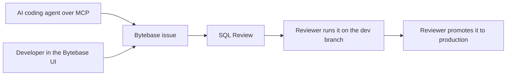

AI coding agents (Claude Code, Codex, etc.) write migrations in seconds, faster than anyone can read them, and their SQL can look fine but still fail on production data. With [Bytebase](https://www.bytebase.com), you can check every change an agent proposes against [SQL Review rules](https://docs.bytebase.com/sql-review/review-rules), run it on a copy of production in a [Neon branch](/docs/introduction/branching), and promote it to production only when you're ready.

In this guide, you'll:

- Connect an AI coding agent to Bytebase over [MCP](https://docs.bytebase.com/integrations/mcp), so the schema changes it writes become issues you review, not SQL it runs on your database.
- Add a Neon `dev` branch and your `production` branch to Bytebase, with `dev` in the `Test` environment and `production` in `Prod`.
- Put the agent's change and a developer's change through the same steps: SQL Review checks the SQL, a reviewer runs it on `dev`, then promotes it to `production`.



## Prerequisites

- A [Bytebase Cloud](https://cloud.bytebase.com) account
- A [Neon](https://console.neon.tech/signup) account and [Neon CLI](/docs/cli) installed
- A coding agent (Claude Code, Codex, etc.) or another MCP client that supports remote HTTP servers

<Steps>

## Create the dev branch

The examples use a small shop schema. If your project is empty, save this SQL as `seed.sql`:

```sql collapse={16-21}
CREATE TABLE customers (
  id bigint GENERATED ALWAYS AS IDENTITY PRIMARY KEY,
  email text NOT NULL UNIQUE,
  name text NOT NULL,
  created_at timestamptz NOT NULL DEFAULT now()
);

CREATE TABLE orders (
  id bigint GENERATED ALWAYS AS IDENTITY PRIMARY KEY,
  customer_id bigint NOT NULL REFERENCES customers (id),
  total_cents integer NOT NULL,
  status text NOT NULL DEFAULT 'pending',
  created_at timestamptz NOT NULL DEFAULT now()
);

INSERT INTO customers (email, name)
SELECT 'customer' || g || '@example.com', 'Customer ' || g FROM generate_series(1, 1000) g;

INSERT INTO orders (customer_id, total_cents, status)
SELECT (random() * 999 + 1)::bigint, (random() * 10000)::int, (ARRAY['pending', 'paid', 'shipped'])[1 + g % 3]
FROM generate_series(1, 20000) g;
```

Then, run it on `production` with [`neon psql`](/docs/cli/psql), which doesn't need a local `psql` install:

```bash
neon psql production -- -f seed.sql
```

Create a branch named `dev` from `production`:

```bash
neon branches create --name dev
```

- `dev` starts as a copy-on-write copy of the schema and data in `production`.
- A change you test on `dev` runs against the same data as `production`.

Then, create a [project-scoped API key](/docs/manage/api-keys#create-project-scoped-organization-api-keys) for Bytebase. Run `neon projects list` to find your project ID:

```bash
neon api-keys create --name bytebase --project-id <project_id>
```

- The command prints the key, which starts with `napi_`, only once. Copy it for the next step.
- A project-scoped key can't reach your other projects.
- Bytebase uses the key once to find your branches, and doesn't save it.

## Add both branches to Bytebase

Bytebase can find the branches of a Neon project with your API key and import each one as a PostgreSQL instance.

1. Sign in at [cloud.bytebase.com](https://cloud.bytebase.com) and click **Create workspace**. The workspace comes with `Test` and `Prod` environments and a first project, called `Shop` in this guide.
2. If you use [IP Allow](/docs/introduction/ip-allow) on your Neon project, add the Bytebase Cloud IP, `34.27.188.162`, to the allowlist. Bytebase Cloud connects over the public internet.
3. Open **Database** > **Instances** and click **Connect instance**.

   

4. Set **Engine** to **PostgreSQL**, **Hosted on** to **Neon**, and **Setup method** to **Discover branches with a Neon API key**. Paste your API key and your Neon project ID, which a project-scoped key requires, then click **Find branches**.

   

5. Select both `production` and `dev`, then click **Configure 2 instances**.

   

6. For each instance, set the **Environment** and **Connection role** in its row of the **Instances** table. Leave the shared **Environment** at the top empty, since the two instances go in different environments.
   - `dev`: environment `Test`
   - `production`: environment `Prod`
   - **Connection role** for both: the role that owns your tables, which is `neondb_owner` in a new Neon project. Bytebase runs each change as this role, and only a table's owner can alter it.

   

7. Click **Import 2 instances**, then confirm.

   

8. On the Community plan, Bytebase doesn't sync imported instances on a schedule, so they start with no databases. Open each instance and click **Sync instance** > **Sync all databases**. The `neondb` database appears under **Databases**, already in the `Shop` project, since an imported instance is bound to the project it was imported into.

   

<Admonition type="note" title="This instance has not been bound to the environment">
If an instance shows this warning, it was imported without an environment. Edit the instance and set its environment to `Test` or `Prod`. A database with no environment can't be part of a rollout stage.
</Admonition>

## Decide who can deploy a change

In Bytebase, a change runs only when someone runs it:

- Each environment's [rollout policy](https://docs.bytebase.com/change-database/environment-policy/rollout-policy) decides who can. By default, `Test` and `Prod` both wait for a person to click **Run**.
- Only **Workspace Admin**, **Workspace DBA**, **Project Owner**, and **Project Releaser** can run a rollout.

In the `Shop` project, open **Members** and grant:

- **Project Developer** to people who write changes. They can create a change and edit its SQL, but can't run it.
- **Project Releaser** to people who review changes. They can run a change on `dev`, then on `production`.

An AI coding agent connected over MCP signs in as the person using it and gets that person's permissions. An agent run by a developer can propose a change but can't deploy it.

## Set up SQL Review

[SQL Review](https://docs.bytebase.com/concepts/sql-review) is Bytebase's set of lint rules for SQL. Each rule checks for one known problem, such as a `CREATE INDEX` that blocks writes or an `UPDATE` without a `WHERE` clause:

- It runs each time a change is created or its SQL is edited.
- An **Error** finding blocks the rollout until the SQL is fixed.
- A **Warning** finding is shown to the reviewer.

SQL Review policies belong to the entire workspace and are not limited to a project. To create one:

1. Click your workspace name in the top bar to open the workspace sidebar, then open **CI/CD** > **SQL Review** and click **Create**.
2. Set **Display name** to `Neon branches`, choose **Start from scratch**, and click **Next**.

   

3. Open the rule list, select the **PostgreSQL** tab, and turn on the following rules that catch changes that block writes on a table or delete data.

   | Rule                                                                  | Level   |
   | --------------------------------------------------------------------- | ------- |
   | Enforce concurrent index creation                                     | Error   |
   | Enforce inclusion of primary key in a table                           | Error   |
   | Enforce the presence of "WHERE" condition in UPDATE/DELETE statements | Error   |
   | Prohibit modifying column types                                       | Error   |
   | Enforce including "NOT VALID" option when adding foreign keys         | Warning |
   | Enforce including "NOT VALID" option when adding "CHECK" constraints  | Warning |
   | Restrict adding "NOT NULL" constraint to existing columns             | Warning |
   | Check application backward compatibility                              | Warning |
   | Prohibit using CASCADE when removing a table                          | Warning |

   

4. A new rule starts at **Warning**. Change the level of each rule marked **Error** in the table.

   

5. Attach the policy to resources: check both `Test` and `Prod` under **Environment**, then click **Confirm**.

   

## Open a change as a developer

Say a developer needs a `shipped_at` column on `orders` and an index on it for an order-tracking dashboard.

1. In the `Shop` project, open **CI/CD** > **Plans** and click **+ New Plan**.
2. Select the `neondb` database on both `Neon dev` and `Neon production`, then click **Confirm**.
3. Enter the SQL and click **Create**:

   ```sql
   ALTER TABLE orders ADD COLUMN shipped_at timestamptz;
   CREATE INDEX orders_shipped_at_idx ON orders (shipped_at);
   ```


Bytebase saves the plan and its issue, then runs SQL Review on both databases. The SQL doesn't run yet. The review returns an error on both targets:

```text
Enforce concurrent index creation
Creating indexes will block writes on the table, unless use CONCURRENTLY
```


- A plain `CREATE INDEX` blocks inserts and updates on `orders` until the index is built.
- `CREATE INDEX CONCURRENTLY` builds it without blocking writes.

Edit the SQL in the plan:

```sql
ALTER TABLE orders ADD COLUMN shipped_at timestamptz;
CREATE INDEX CONCURRENTLY orders_shipped_at_idx ON orders (shipped_at);
```

- Bytebase reviews the new SQL, and both targets pass.
- Click **Ready for Review**.
- The rollout has two stages: `Test` runs on `dev`, and `Prod` runs on `production`. Neither runs until a reviewer clicks **Run**.

## Propose a change from an AI coding agent

Connect the agent to Bytebase:

1. In the workspace sidebar, open **Integration** > **MCP**. Bytebase Cloud serves its MCP server at `https://cloud.bytebase.com/mcp`.

   

2. A new workspace allows only reads over MCP. Under **Access policy**, click **Edit policy**, select **Read-write**, and click **Save policy**.
3. On the same page, copy the command for Claude Code:

   ```bash
   claude mcp add --transport http bytebase https://cloud.bytebase.com/mcp
   ```

4. Start Claude Code, run `/mcp`, select `bytebase`, and choose **Authenticate**.
5. Sign in to Bytebase in the browser, check the workspace and permissions on the authorization page, and click **Allow access**.

<Admonition type="warning" title="Read-write also allows direct SQL">
Under **Read-write**, an agent can also run DDL and DML statements directly with the `query_database` tool, without an issue, on databases where the signed-in person is allowed to run them directly. Don't give people whose agents connect permission to run DDL or DML directly on `Test` or `Prod`, so that every change goes through an issue.
</Admonition>

Ask the agent for a change:

```text shouldWrap
Using Bytebase, propose a change on the neondb database in the Neon dev instance of the Shop project that adds a refunds table for partial refunds on orders.
```

The agent would then find the database with the `call_api` tool, reads its schema with the `get_schema` tool and then only call the `propose_database_change` tool with the SQL.

In this run, the agent proposed this SQL, following the column types and defaults of `orders`:

```sql
CREATE TABLE refunds (
  id bigint GENERATED ALWAYS AS IDENTITY,
  order_id bigint NOT NULL,
  amount_cents integer NOT NULL,
  reason text NOT NULL DEFAULT '',
  created_at timestamptz NOT NULL DEFAULT now(),
  CONSTRAINT refunds_pkey PRIMARY KEY (id),
  CONSTRAINT refunds_order_id_fkey FOREIGN KEY (order_id) REFERENCES orders (id),
  CONSTRAINT refunds_amount_cents_positive CHECK (amount_cents > 0)
);

CREATE INDEX refunds_order_id_idx ON refunds (order_id);
```

The tool response tells the agent that the review passed and that the issue waits for a person:

```json
{
  "database": "projects/shop/instances/neon-dev/databases/neondb",
  "plan": "projects/shop/plans/102",
  "planChecks": {
    "status": "DONE",
    "summary": { "error": 0, "warning": 0 }
  },
  "issue": "projects/shop/issues/102",
  "rolloutCreated": false,
  "nextAction": "AWAIT_HUMAN_APPROVAL"
}
```

The tool returns `AWAIT_HUMAN_APPROVAL` whether or not the review passes. A passing review doesn't run the SQL: it runs only when a reviewer runs the rollout.

## Review the change and promote it to production

1. The reviewer, with the releaser role, opens the issue. It shows the SQL, the review findings, and who created it.

   

2. In the **Deploy** section, click **Run · Test**. Bytebase runs the change on `dev` and shows **Deployed** when it finishes.

   

3. Compare the schema of `dev` with `production`:

   ```bash
   neon diff production --branch dev
   ```

   For the agent's change, the diff shows the new `refunds` table on `dev` only, with its primary key, its foreign key to `orders`, an index on `order_id`, and a check that `amount_cents` is positive:

   ```diff collapse={6-8, 20-45, 51-56, 58-67, 73-78}
   → Comparing schema production → dev
   diff --neon database neondb
   --- production (br-green-forest-bdf1j7g3) // [!code --]
   +++ dev (br-gentle-grass-bdi9rb4j) // [!code ++]
   @@ -79,6 +79,36 @@


   --
   +-- Name: refunds; Type: TABLE; Schema: public; Owner: neondb_owner // [!code ++]
   +-- // [!code ++]
   + // [!code ++]
   +CREATE TABLE public.refunds ( // [!code ++]
   +    id bigint NOT NULL, // [!code ++]
   +    order_id bigint NOT NULL, // [!code ++]
   +    amount_cents integer NOT NULL, // [!code ++]
   +    reason text DEFAULT ''::text NOT NULL, // [!code ++]
   +    created_at timestamp with time zone DEFAULT now() NOT NULL, // [!code ++]
   +    CONSTRAINT refunds_amount_cents_positive CHECK ((amount_cents > 0)) // [!code ++]
   +); // [!code ++]
   + // [!code ++]
   + // [!code ++]
   +ALTER TABLE public.refunds OWNER TO neondb_owner; // [!code ++]
   + // [!code ++]
   +-- // [!code ++]
   +-- Name: refunds_id_seq; Type: SEQUENCE; Schema: public; Owner: neondb_owner // [!code ++]
   +-- // [!code ++]
   + // [!code ++]
   +ALTER TABLE public.refunds ALTER COLUMN id ADD GENERATED ALWAYS AS IDENTITY ( // [!code ++]
   +    SEQUENCE NAME public.refunds_id_seq // [!code ++]
   +    START WITH 1 // [!code ++]
   +    INCREMENT BY 1 // [!code ++]
   +    NO MINVALUE // [!code ++]
   +    NO MAXVALUE // [!code ++]
   +    CACHE 1 // [!code ++]
   +); // [!code ++]
   + // [!code ++]
   + // [!code ++]
   +-- // [!code ++]
   -- Name: customers customers_email_key; Type: CONSTRAINT; Schema: public; Owner: neondb_owner
   --

   @@ -103,6 +133,21 @@


   --
   +-- Name: refunds refunds_pkey; Type: CONSTRAINT; Schema: public; Owner: neondb_owner // [!code ++]
   +-- // [!code ++]
   + // [!code ++]
   +ALTER TABLE ONLY public.refunds // [!code ++]
   +    ADD CONSTRAINT refunds_pkey PRIMARY KEY (id); // [!code ++]
   + // [!code ++]
   + // [!code ++]
   +-- // [!code ++]
   +-- Name: refunds_order_id_idx; Type: INDEX; Schema: public; Owner: neondb_owner // [!code ++]
   +-- // [!code ++]
   + // [!code ++]
   +CREATE INDEX refunds_order_id_idx ON public.refunds USING btree (order_id); // [!code ++]
   + // [!code ++]
   + // [!code ++]
   +-- // [!code ++]
   -- Name: orders orders_customer_id_fkey; Type: FK CONSTRAINT; Schema: public; Owner: neondb_owner
   --

   @@ -111,6 +156,14 @@


   --
   +-- Name: refunds refunds_order_id_fkey; Type: FK CONSTRAINT; Schema: public; Owner: neondb_owner // [!code ++]
   +-- // [!code ++]
   + // [!code ++]
   +ALTER TABLE ONLY public.refunds // [!code ++]
   +    ADD CONSTRAINT refunds_order_id_fkey FOREIGN KEY (order_id) REFERENCES public.orders(id); // [!code ++]
   + // [!code ++]
   + // [!code ++]
   +-- // [!code ++]
   -- Name: DEFAULT PRIVILEGES FOR SEQUENCES; Type: DEFAULT ACL; Schema: public; Owner: cloud_admin
   --

   ```

   You can also run your app or its tests against the `dev` connection string. Then promote the change:
   - **Agent's change:** ask the agent to propose the same SQL on the `neondb` database in the `Neon production` instance. SQL Review runs again on `production`, and the reviewer clicks **Run · Prod** in the new issue.

   - **Developer's change:** click **Run · Prod** in the same issue. Bytebase runs the reviewed SQL on `production`.

   

   In both cases, the SQL that runs on `production` has passed review and already run on `dev`.

## Reset the dev branch for the next change

After a change reaches `production`, reset [`dev` from the parent](/docs/guides/reset-from-parent) so the next change starts from current production data:

```bash
neon branches reset dev --parent
```

</Steps>

## Next steps

- **A branch per change:** instead of a shared `dev`, create a branch for each developer or agent and add it to Bytebase as its own instance in `Test`. Set an [expiration time](/docs/guides/branch-expiration) so these branches are deleted automatically.
- **Migrations in Git:** the [Bytebase GitOps workflow](https://docs.bytebase.com/gitops/overview) runs the same SQL Review on pull requests and rolls out a change when the pull request is merged.
- **Neon from the agent:** connect the [Neon MCP Server](/docs/ai/neon-mcp-server) next to Bytebase's so the agent can create and inspect branches.

<NeedHelp />
