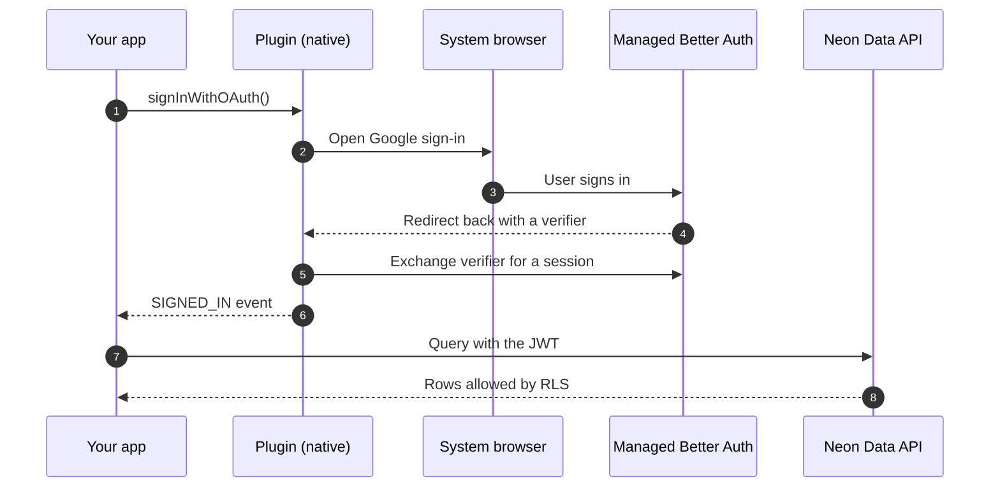

Capacitor runs your web app inside a WebView on iOS and Android, where the [Managed Better Auth](/docs/auth/overview) browser SDK doesn't work well, because it depends on an HTTP-only session cookie and browser redirects.

The [`@capgo/capacitor-neon`](https://github.com/Cap-go/capacitor-neon) plugin solves this by running the auth flow in native code, where it signs users in with URLSession on iOS and OkHttp on Android, stores the session in the iOS Keychain or in app-private storage on Android, and gives your JavaScript a JWT that the [Neon Data API](/docs/data-api/overview) accepts.

<Admonition type="important" title="Community-maintained plugin">
`@capgo/capacitor-neon` is a community-maintained plugin published by [Capgo](https://capgo.app), not an official Neon SDK. Report bugs and feature requests in the [plugin's GitHub repository](https://github.com/Cap-go/capacitor-neon/issues). For the full API reference, see the [Capgo plugin docs](https://capgo.app/docs/plugins/neon/).
</Admonition>

In this guide, you'll build a React and Capacitor todo app for iOS and Android with [email and password](/docs/auth/quick-start/react) and [Google](/docs/auth/guides/setup-oauth) sign-in, and store each user's todos in Neon behind [Row-Level Security (RLS)](/docs/guides/row-level-security), with everything on Neon set up from the Neon CLI. The complete source code for the app is available in the [neon-capacitor-todos-app](https://github.com/rishi-raj-jain/neon-capacitor-todos-app) repository on GitHub.

## Demo

<Video sources={[{ src: '/guides/images/capgo-capacitor-neon/finished-app.mp4', type: 'video/mp4' }]} width={1674} height={1578} />

## Prerequisites

To follow along with this guide, you will need the following:

- [Node.js](https://nodejs.org/) 24 or later
- [Xcode](https://developer.apple.com/xcode/) with an iOS simulator runtime (install one in **Xcode** > **Settings** > **Components**) to run the app on iOS, and [Android Studio](https://developer.android.com/studio) to run it on Android.
- [A Neon account](https://console.neon.tech/signup) and the [Neon CLI](/docs/cli/install)

## How the authentication flow works

Here's the order of requests between your app, the plugin, and Neon during a Google sign-in:



1. Your React code calls a plugin method, such as `signInWithPassword()` or `signInWithOAuth()`.
2. For email and password, the plugin calls Managed Better Auth directly from native code. For Google, it opens the system browser, where the user signs in with Google.
3. After Google sign-in, Managed Better Auth redirects the browser to your `redirectTo` URL with a `neon_auth_session_verifier` query parameter. That URL opens your app, and the plugin exchanges the verifier for a session.
4. The plugin stores the session natively and emits a `SIGNED_IN` event to your JavaScript.
5. Your app reads the JWT with `getSession()` and sends it to the Data API, where Postgres applies your RLS policies using the user ID in that JWT.

The session cookie stays out of the WebView's cookie store, but your JavaScript receives two tokens: a 15-minute JWT that the plugin refreshes for you, and the Neon Auth session token as `session.refreshToken`, which stays valid until `session.sessionExpiresAt` (7 days by default). Treat the session token as a credential (so don't log it, send it to analytics, or save it in `localStorage`).

<Steps>

## Create the React app

Create a React and TypeScript app with Vite:

```bash
npm create vite@latest capacitor-neon-todos -- --template react-ts
cd capacitor-neon-todos
npm install
```

Install Capacitor and the plugin:

```bash
npm install @capacitor/core @capgo/capacitor-neon
npm install -D @capacitor/cli
```

Use the plugin version that matches your Capacitor version, for example plugin v8 with Capacitor 8.

## Provision Neon with the Neon CLI

Install the [Neon CLI](/docs/cli/install) and sign in to your Neon account, which opens a browser window:

```bash
npm i -g neon@latest
neon login
```

From the `capacitor-neon-todos` folder, create a Neon project and link the folder to it:

```bash
neon link --project-name capacitor-neon-todos --region-id aws-us-east-2 --no-env-pull
```

[`neon link`](/docs/cli/link) saves the project and branch in a `.neon` context file, so the commands that follow target this project without a `--project-id` flag. If your account belongs to more than one organization, add `--org-id` with an ID from `neon orgs list`. The `--no-env-pull` flag keeps `DATABASE_URL` out of the app folder, since the app never connects to Postgres directly.

Enable Managed Better Auth and the Data API on the project's default branch:

```bash
neon neon-auth enable
neon data-api create --auth-provider neon_auth --add-default-grants
```

`--auth-provider neon_auth` makes the Data API accept the JWTs that Managed Better Auth issues, and `--add-default-grants` lets the `authenticated` role read and write tables in the `public` schema.

Write the Auth URL and the Data API URL to a `.env` file with [`neon env pull`](/docs/cli/env), then add the redirect URL that Google sign-in uses later:

```bash
neon env pull --service auth,data-api --file .env
echo "VITE_OAUTH_REDIRECT_URL=http://localhost:8787/auth/callback" >> .env
```

Your `.env` file now contains values like these:

```bash filename=".env"
NEON_AUTH_BASE_URL=https://ep-xxx.neonauth.us-east-2.aws.neon.tech/neondb/auth
NEON_AUTH_JWKS_URL=https://ep-xxx.neonauth.us-east-2.aws.neon.tech/neondb/auth/.well-known/jwks.json
NEON_DATA_API_URL=https://ep-xxx.apirest.us-east-2.aws.neon.tech/neondb/rest/v1
VITE_OAUTH_REDIRECT_URL=http://localhost:8787/auth/callback
```

Pulling again only updates the Neon variables, so `VITE_OAUTH_REDIRECT_URL`, which the [Google sign-in redirect](#configure-the-google-sign-in-redirect) uses, stays in place.

Since Vite only exposes variables that start with `VITE_` to your app, update `vite.config.ts` to also expose the two Neon URLs by name:

```ts filename="vite.config.ts"
import react from '@vitejs/plugin-react';
import { defineConfig } from 'vite';

export default defineConfig({
  plugins: [react()],
  // Expose only the two public Neon URLs, never other NEON_ variables such as tokens
  envPrefix: ['VITE_', 'NEON_AUTH_BASE_URL', 'NEON_DATA_API_URL'],
});
```

Both URLs are safe to include in your app bundle, because access to your data is controlled by the JWT and your RLS policies, not by keeping these URLs secret. Listing the two names instead of the `NEON_` prefix keeps any other Neon variable you pull later out of the bundle.

## Create the todos table with RLS

Save the following SQL as `db/schema.sql`:

```sql filename="db/schema.sql"
CREATE TABLE todos (
  id bigint GENERATED BY DEFAULT AS IDENTITY PRIMARY KEY,
  user_id text NOT NULL DEFAULT (auth.user_id()),
  task text NOT NULL,
  is_complete boolean NOT NULL DEFAULT false,
  created_at timestamptz NOT NULL DEFAULT now()
);

GRANT SELECT, INSERT, UPDATE, DELETE ON todos TO authenticated;

ALTER TABLE todos ENABLE ROW LEVEL SECURITY;

CREATE POLICY "Users manage their own todos" ON todos
  FOR ALL
  TO authenticated
  USING ((select auth.user_id()) = user_id)
  WITH CHECK ((select auth.user_id()) = user_id);
```

Run it against your branch with [`neon psql`](/docs/cli/psql), which uses the `psql` on your `PATH` or a built-in client when you don't have one installed:

```bash
neon psql --role-name neondb_owner -- -f db/schema.sql
```

Here's what each part does:

- `auth.user_id()` reads the user ID (the `sub` claim) from the JWT of the current Data API request. As the default value of `user_id`, it assigns every new row to the user who created it, so the app never sends a user ID.
- The `GRANT` lets the `authenticated` role use the table. `--add-default-grants` already covers new tables in the `public` schema, and the explicit grant makes the script work either way.
- The policy limits every `SELECT`, `INSERT`, `UPDATE`, and `DELETE` to rows where `user_id` matches the signed-in user.

To learn more about the `user_id` pattern and the roles the Data API uses, see [Access control](/docs/data-api/access-control).

## Add Capacitor to the project

Initialize Capacitor with an app name, an app ID, and Vite's build folder:

```bash
npx cap init "Neon Todos" com.example.neontodos --web-dir dist
```

The app ID is also the custom URL scheme you'll use later to return to the app after Google sign-in, so pick the reverse-domain ID you'll publish with.

Build the web app once, since `npx cap add` copies the `dist` folder into each native project, then add the native platforms you want to run:

```bash
npm run build
npm install @capacitor/ios @capacitor/android
npx cap add ios
npx cap add android
```

Email and password sign-in needs no extra native setup, because the plugin has no third-party dependencies on iOS and works with Capacitor's default Android minimum SDK of 24. Capacitor 8 adds the plugin to the iOS project through Swift Package Manager, so you don't need CocoaPods.

## Initialize the plugin

Create `src/lib/neon.ts`, which calls `initialize()` once with your branch URLs and reuses the same promise on later calls:

```ts filename="src/lib/neon.ts"
import { Capacitor } from '@capacitor/core';
import { CapacitorNeon } from '@capgo/capacitor-neon';

let ready: Promise<void> | null = null;

export function initNeon(): Promise<void> {
  if (!Capacitor.isNativePlatform()) {
    return Promise.reject(new Error('@capgo/capacitor-neon runs on iOS and Android only.'));
  }

  if (!ready) {
    ready = CapacitorNeon.initialize({
      authUrl: import.meta.env.NEON_AUTH_BASE_URL,
      dataApiUrl: import.meta.env.NEON_DATA_API_URL,
    }).catch((error) => {
      ready = null;
      throw error;
    });
  }

  return ready;
}
```

`initialize()` restores a stored session and emits an `INITIAL_SESSION` event, so a user who signed in earlier stays signed in after the app restarts.

<Admonition type="note" title="The plugin has no web implementation">
Every plugin method throws on the web, so if you also deploy this app as a website, check `Capacitor.isNativePlatform()` and use [`@neondatabase/neon-js`](/docs/reference/javascript-sdk) in the browser instead.
</Admonition>

## Share the session with React

Create `src/auth/AuthProvider.tsx`, which listens for auth state changes from native code and exposes the current session to your components:

```tsx filename="src/auth/AuthProvider.tsx" collapse={1-13, 43-48}
import { createContext, useContext, useEffect, useState, type ReactNode } from 'react';
import type { PluginListenerHandle } from '@capacitor/core';
import { CapacitorNeon, type Session } from '@capgo/capacitor-neon';
import { initNeon } from '../lib/neon';

type AuthContextValue = {
  session: Session | null;
  loading: boolean;
  error: string | null;
};

const AuthContext = createContext<AuthContextValue | null>(null);

export function AuthProvider({ children }: { children: ReactNode }) {
  const [session, setSession] = useState<Session | null>(null);
  const [loading, setLoading] = useState(true);
  const [error, setError] = useState<string | null>(null);

  useEffect(() => {
    let listener: PluginListenerHandle | undefined;

    async function start() {
      // Listen first, so the SIGNED_IN event after Google sign-in isn't missed
      listener = await CapacitorNeon.addListener('authStateChange', ({ session }) => {
        setSession(session);
      });
      await initNeon();
      const { session } = await CapacitorNeon.getSession();
      setSession(session);
    }

    start()
      .catch((e) => setError(e instanceof Error ? e.message : String(e)))
      .finally(() => setLoading(false));

    return () => {
      void listener?.remove();
    };
  }, []);

  return <AuthContext.Provider value={{ session, loading, error }}>{children}</AuthContext.Provider>;
}

export function useAuth() {
  const context = useContext(AuthContext);
  if (!context) throw new Error('useAuth must be used inside AuthProvider');
  return context;
}
```

The `authStateChange` event fires with `INITIAL_SESSION`, `SIGNED_IN`, `SIGNED_OUT`, or `TOKEN_REFRESHED`. Every component that calls `useAuth()` re-renders when the session changes, so you don't need to handle each event separately.

## Build the sign-in screen

Create `src/components/LoginPanel.tsx` with an email and password form and a Google button:

```tsx filename="src/components/LoginPanel.tsx" collapse={1-21, 42-54}
import { useState, type FormEvent } from 'react';
import { CapacitorNeon } from '@capgo/capacitor-neon';

export function LoginPanel() {
  const [email, setEmail] = useState('');
  const [password, setPassword] = useState('');
  const [message, setMessage] = useState<string | null>(null);
  const [busy, setBusy] = useState(false);

  async function run(action: () => Promise<unknown>) {
    setBusy(true);
    setMessage(null);
    try {
      await action();
    } catch (e) {
      setMessage(e instanceof Error ? e.message : 'Sign-in failed');
    } finally {
      setBusy(false);
    }
  }

  function signIn(event: FormEvent) {
    event.preventDefault();
    run(() => CapacitorNeon.signInWithPassword({ email, password }));
  }

  function signUp() {
    run(async () => {
      const { session } = await CapacitorNeon.signUp({ email, password, name: email.split('@')[0] });
      if (!session) setMessage('Check your email for a verification code.');
    });
  }

  function signInWithGoogle() {
    run(() =>
      CapacitorNeon.signInWithOAuth({
        provider: 'google',
        redirectTo: import.meta.env.VITE_OAUTH_REDIRECT_URL,
      })
    );
  }

  return (
    <form onSubmit={signIn}>
      <h1>Neon Todos</h1>
      <input type="email" placeholder="Email" value={email} onChange={(e) => setEmail(e.target.value)} required />
      <input type="password" placeholder="Password" value={password} onChange={(e) => setPassword(e.target.value)} required />
      <button type="submit" disabled={busy}>Sign in</button>
      <button type="button" disabled={busy} onClick={signUp}>Create account</button>
      <button type="button" disabled={busy} onClick={signInWithGoogle}>Continue with Google</button>
      {message ? <p role="alert">{message}</p> : null}
    </form>
  );
}
```

None of these handlers set the session themselves, because when sign-in succeeds, the plugin emits `SIGNED_IN`, and `AuthProvider` updates the session for the whole app.

This guide assumes **Verify email at sign-up** is off for your branch, which is the default. If you [turn it on](/docs/auth/guides/email-verification), `signUp()` returns a `null` session until the user enters the code from the email, so add a code field to `LoginPanel` and confirm it with `CapacitorNeon.verifyOtp({ email, token, type: 'signup' })`. The plugin also supports passwordless sign-in with `signInWithOtp()` and `verifyOtp()`, and the [Capgo plugin docs](https://capgo.app/docs/plugins/neon/) cover both flows.

## Read and write todos through the Data API

Create `src/components/TodoList.tsx`, which uses the plugin's native `select()`, `insert()`, `update()`, and `delete()` methods, which send the session's JWT to the Data API for you:

```tsx filename="src/components/TodoList.tsx" collapse={1-11, 58-70, 82-85}
import { useEffect, useState, type FormEvent } from 'react';
import { CapacitorNeon } from '@capgo/capacitor-neon';
import { useAuth } from '../auth/AuthProvider';

type Todo = { id: number; task: string; is_complete: boolean };

export function TodoList() {
  const { session } = useAuth();
  const [todos, setTodos] = useState<Todo[]>([]);
  const [task, setTask] = useState('');
  const [error, setError] = useState<string | null>(null);
  const [deletingId, setDeletingId] = useState<number | null>(null);

  async function load() {
    const { data, error } = await CapacitorNeon.select({
      table: 'todos',
      columns: 'id, task, is_complete',
      orderBy: 'created_at',
      ascending: true,
    });
    setError(error);
    setTodos((data as Todo[] | null) ?? []);
  }

  useEffect(() => {
    void load();
  }, []);

  async function addTodo(event: FormEvent) {
    event.preventDefault();
    if (!task.trim()) return;
    const { error } = await CapacitorNeon.insert({ table: 'todos', values: { task } });
    if (error) return setError(error);
    setTask('');
    await load();
  }

  async function toggleTodo(todo: Todo) {
    const { error } = await CapacitorNeon.update({
      table: 'todos',
      values: { is_complete: !todo.is_complete },
      filter: { id: todo.id },
    });
    if (error) return setError(error);
    await load();
  }

  async function deleteTodo(todo: Todo) {
    setDeletingId(todo.id);
    try {
      const { error } = await CapacitorNeon.delete({ table: 'todos', filter: { id: todo.id } });
      if (error) return setError(error);
      await load();
    } finally {
      setDeletingId(null);
    }
  }

  return (
    <section>
      <header>
        <p>Signed in as {session?.user.email}</p>
        <button onClick={() => CapacitorNeon.signOut()}>Sign out</button>
      </header>
      <form onSubmit={addTodo}>
        <input placeholder="What needs to be done?" value={task} onChange={(e) => setTask(e.target.value)} />
        <button type="submit">Add</button>
      </form>
      {error ? <p role="alert">{error}</p> : null}
      <ul>
        {todos.map((todo) => (
          <li key={todo.id} aria-busy={deletingId === todo.id}>
            <label>
              <input type="checkbox" checked={todo.is_complete} onChange={() => toggleTodo(todo)} />
              {todo.task}
            </label>
            <button onClick={() => deleteTodo(todo)} disabled={deletingId === todo.id}>
              {deletingId === todo.id ? 'Deleting...' : 'Delete'}
            </button>
          </li>
        ))}
      </ul>
    </section>
  );
}
```

The `select()` call has no `user_id` filter and `insert()` doesn't send a `user_id`, because RLS returns only the signed-in user's rows and the `user_id` default assigns new rows to that user.

While a delete is in progress, `deletingId` marks that row with `aria-busy` and disables its Delete button, so the row shows its own progress and the rest of the list stays usable.

The `filter` option on these methods matches columns by equality, which covers most CRUD screens. For ranges, joins, or full-text search, use `@neondatabase/neon-js` with the same JWT, as shown in [Run advanced queries with neon-js](#run-advanced-queries-with-neon-js).

Replace the contents of `src/App.tsx` to show the sign-in screen or the todo list, based on the session:

```tsx filename="src/App.tsx"
import { AuthProvider, useAuth } from './auth/AuthProvider';
import { LoginPanel } from './components/LoginPanel';
import { TodoList } from './components/TodoList';

function Screen() {
  const { session, loading, error } = useAuth();
  if (loading) return <p>Loading...</p>;
  if (error) return <p role="alert">{error}</p>;
  return session ? <TodoList /> : <LoginPanel />;
}

export default function App() {
  return (
    <AuthProvider>
      <main>
        <Screen />
      </main>
    </AuthProvider>
  );
}
```

At this point, email and password sign-in works end to end, and the next step sets up the redirect that returns the user to your app after Google sign-in.

## Configure the Google sign-in redirect

Google sign-in works during development without creating an OAuth app, because Managed Better Auth enables it with [shared credentials](/docs/auth/guides/setup-oauth#about-shared-credentials), so the only setup left is the redirect back into your app.

Managed Better Auth only redirects to `http` or `https` URLs on a [trusted domain](/docs/auth/guides/configure-domains), so it rejects a custom scheme such as `com.example.neontodos://`. You have two ways to get back into the app:

- **A bounce page:** a small page on a trusted domain that forwards the query string to your app's custom URL scheme. `localhost` is trusted by default, so this works during development without changing any Neon settings.
- **Universal Links (iOS) and App Links (Android):** an `https` URL on your own domain that the operating system opens in your app directly, which is the option to use in production.

This guide uses the bounce page for development and covers Universal Links and App Links in [Prepare for production](#prepare-for-production).

### Run a bounce page

Create `oauth-bounce.mjs` in the project root:

```js filename="oauth-bounce.mjs"
import { createServer } from 'node:http';

const scheme = 'com.example.neontodos';
const port = 8787;

createServer((req, res) => {
  const url = new URL(req.url, `http://localhost:${port}`);
  if (url.pathname !== '/auth/callback') {
    res.writeHead(404).end('Not found');
    return;
  }

  // Forward ?neon_auth_session_verifier=... to the app's custom URL scheme
  const target = `${scheme}://auth/callback${url.search}`;
  const safeTarget = JSON.stringify(target).replaceAll('<', '\\u003c');
  res.writeHead(200, { 'Content-Type': 'text/html; charset=utf-8' });
  res.end(`<!doctype html>
<meta name="viewport" content="width=device-width, initial-scale=1">
<p>Signed in. <a id="open" href="#">Return to the app</a>.</p>
<script>
  const target = ${safeTarget};
  document.getElementById('open').href = target;
  location.href = target;
</script>`);
}).listen(port, () => console.log(`Bounce page running on http://localhost:${port}/auth/callback`));
```

The page redirects to the app as soon as it loads, and shows a link as a fallback in case the browser asks the user to confirm before opening the app.

Start it in a separate terminal and keep it running while you test:

```bash
node oauth-bounce.mjs
```

The iOS simulator reaches your computer's `localhost` directly. On a physical iPhone or Android phone, `localhost` is the phone itself, so test Google sign-in on a simulator or emulator, or host the bounce page on a trusted domain as described in [Prepare for production](#prepare-for-production). On the Android emulator, forward the port first so `localhost` inside the emulator points to your computer:

```bash
adb reverse tcp:8787 tcp:8787
```

### Register the custom URL scheme on iOS

Open `ios/App/App/Info.plist` and add the scheme inside the top-level `<dict>`:

```xml filename="ios/App/App/Info.plist"
<key>CFBundleURLTypes</key>
<array>
  <dict>
    <key>CFBundleURLName</key>
    <string>com.example.neontodos</string>
    <key>CFBundleURLSchemes</key>
    <array>
      <string>com.example.neontodos</string>
    </array>
  </dict>
</array>
```

You can also add it in Xcode under the **Info** tab of the **App** target, in **URL Types**.

Capacitor's iOS template forwards opened URLs to plugins, so the plugin receives the callback without any Swift changes. If you've customized `AppDelegate.swift` or `SceneDelegate.swift`, make sure they still pass opened URLs to `ApplicationDelegateProxy` or `SceneDelegateProxy`.

### Register the custom URL scheme on Android

Open `android/app/src/main/AndroidManifest.xml` and add an intent filter inside the main `<activity>`:

```xml filename="android/app/src/main/AndroidManifest.xml"
<intent-filter>
  <action android:name="android.intent.action.VIEW" />
  <category android:name="android.intent.category.DEFAULT" />
  <category android:name="android.intent.category.BROWSABLE" />
  <data android:scheme="@string/custom_url_scheme" />
</intent-filter>
```

`custom_url_scheme` is defined in `android/app/src/main/res/values/strings.xml`, and `npx cap add android` sets it to your app ID.

The plugin handles the callback both when the app is already running and when the redirect starts it from a cold launch, in which case it holds the URL until `initialize()` runs, then exchanges the verifier and emits `SIGNED_IN`.

## Run the app on iOS and Android

Build the web app and copy it into the native projects:

```bash
npm run build
npx cap sync
```

Run `npm run build` and `npx cap sync` again after every change to your React code or `.env` file, since Vite inlines the environment variables at build time.

Run the app on a simulator, an emulator, or a connected device:

```bash
npx cap run ios
```

```bash
npx cap run android
```

To debug native code, open the project in Xcode or Android Studio with `npx cap open ios` or `npx cap open android`.

Create an account with email and password, add a few todos, then sign out and sign in with Google.


Google shows Neon's name on the consent screen, since the shared credentials belong to Neon's OAuth app.


If you close the app completely and open it again, you stay signed in, because `initialize()` restores the session the plugin stored in the Keychain or in app-private storage.

</Steps>

## Run advanced queries with neon-js

The plugin's native database methods cover basic CRUD with equality filters, and for range filters, joins, or full-text search, the plugin's docs recommend [`@neondatabase/neon-js`](/docs/reference/javascript-sdk) in the WebView with the JWT from the native session.

Install `@neondatabase/neon-js` in your project:

```bash
npm install @neondatabase/neon-js
```

Create a Data API client without an `auth` block, and give it a `getToken` function that reads the JWT from the plugin:

```ts filename="src/lib/data-api.ts"
import { createClient } from '@neondatabase/neon-js';
import { CapacitorNeon } from '@capgo/capacitor-neon';

export const neon = createClient({
  dataApi: {
    url: import.meta.env.NEON_DATA_API_URL,
    getToken: async () => (await CapacitorNeon.getSession()).session?.accessToken ?? null,
  },
});
```

`neon-js` calls `getToken` on every request, and `getSession()` returns the cached JWT or mints a new one when it's within a minute of expiring, so requests don't fail when the 15-minute JWT runs out.

With this client, you can use the full query builder, for example to list incomplete todos created in the last 7 days:

```ts
const { data } = await neon
  .from('todos')
  .select('id, task, created_at')
  .eq('is_complete', false)
  .gte('created_at', new Date(Date.now() - 7 * 24 * 60 * 60 * 1000).toISOString())
  .order('created_at', { ascending: false });
```

You can also send the same JWT as a `Bearer` token to [Neon Functions](/docs/compute/functions/overview) or your own API, and verify it against your branch's JWKS.

## Test auth changes on a branch

Each [Neon branch](/docs/introduction/branching) gets its own copy of your auth state: users, sessions, and auth configuration, next to a copy of your data, as described in [Branching authentication](/docs/auth/branching-authentication).

To test a change to sign-in or to your RLS policies without touching production users, create a branch, enable the Data API on it (each branch has its own Data API configuration), and pull the branch's URLs into `.env`:

```bash
neon branches create --name dev-auth
neon data-api create --branch dev-auth --auth-provider neon_auth --add-default-grants
neon env pull --branch dev-auth --service auth,data-api --file .env
npm run build && npx cap sync
```

The app on your simulator now signs in against the `dev-auth` branch, with realistic users and todos, while the production app keeps using the production branch. Sessions only work on the branch that issued them, so sign in again after you switch URLs, and run `neon env pull --service auth,data-api --file .env` without `--branch` to switch back.

## Prepare for production

Complete these steps before you publish the app to the App Store or Google Play.

<CheckList title="Capacitor app production checklist">

<CheckItem title="1. Use your own Google OAuth app" href="/docs/auth/guides/setup-oauth#production-setup">
  Replace the shared development credentials with your own Google OAuth credentials so users see your app's name on the consent screen, using:
  
  ```bash
  neon neon-auth oauth-provider update --provider-id google --oauth-client-id <client-id> --oauth-client-secret <client-secret>
  ```
  
  GitHub and Vercel sign-in have no shared credentials, so add your own OAuth apps for them with:
  
  ```bash
  neon neon-auth oauth-provider add
  ```
</CheckItem>

<CheckItem title="2. Switch the redirect to Universal Links and App Links" href="/docs/auth/guides/configure-domains">
  Add your domain as a trusted domain:

```bash
neon neon-auth domain add https://app.example.com
```

On iOS, add the domain to the **Associated Domains** capability and host an Apple App Site Association file on it. On Android, add an auto-verified intent filter for the domain and host a Digital Asset Links file on it. Then point the OAuth redirect URL in your environment file at the domain:

```bash filename=".env"
VITE_OAUTH_REDIRECT_URL=https://app.example.com/auth/callback
```

If you prefer to keep a custom URL scheme, host the bounce page on your trusted domain instead of on your computer.
</CheckItem>

<CheckItem title="3. Keep RLS on every table the app reads or writes" href="/docs/guides/row-level-security">
  A table without RLS is readable by every signed-in user through the Data API.
</CheckItem>

<CheckItem title="4. Keep database connection strings out of the app">
  The app only needs the Auth URL and the Data API URL, so keep connection strings in your backend and your migration tooling.
</CheckItem>

<CheckItem title="5. Review the Managed Better Auth production checklist" href="/docs/auth/production-checklist">
  Work through the remaining auth settings, including email delivery for verification codes.
</CheckItem>

</CheckList>

## Troubleshooting

<details>
<summary>Sign-in fails with an untrusted origin error</summary>

Managed Better Auth only accepts requests from trusted origins, and the plugin sends `Origin: https://localhost`, which is trusted by default. If you've removed `localhost` from your trusted domains, add your own domain and pass it to `initialize()` as the `origin` option.

</details>

<details>
<summary>Google sign-in finishes in the browser but the app never signs in</summary>

Check that the scheme in `oauth-bounce.mjs` matches the one registered in `Info.plist` and `AndroidManifest.xml`, and that the URL that opens the app still has the `neon_auth_session_verifier` query parameter. On the Android emulator, run `adb reverse tcp:8787 tcp:8787` again after every emulator restart.

</details>

<details>
<summary>Managed Better Auth rejects the redirect URL</summary>

`redirectTo` must be an `http` or `https` URL on a trusted domain, so instead of a custom scheme such as `com.example.neontodos://`, point `redirectTo` at the bounce page or at a Universal Link or App Link.

</details>

<details>
<summary>The todo list is always empty</summary>

Make sure the RLS policy targets the `authenticated` role and compares `auth.user_id()` with `user_id`, and that the rows you expect were created by the user who is signed in, since each user only sees their own todos.

</details>

<details>
<summary>Data API calls fail with `permission denied for table todos`</summary>

This happens when no one is signed in. The plugin's database methods then use an anonymous JWT for the `anonymous` role, and `--add-default-grants` only gives the `authenticated` role access to `todos`, so Postgres rejects the request. Sign in first, or, if signed-out users should read rows, grant the `anonymous` role access to the table and add an RLS policy for it.

</details>

<details>
<summary>Plugin calls throw `Web implementation not available`</summary>

This error means the app is running in a desktop browser through `npm run dev`, where the plugin has no implementation, so run it on a simulator, an emulator, or a device with `npx cap run` instead.

</details>

## Frequently asked questions

<Faq>

<FaqItem question="Is @capgo/capacitor-neon an official Neon SDK?">
No, it's a community-maintained plugin published by Capgo. Report issues in the [plugin's GitHub repository](https://github.com/Cap-go/capacitor-neon/issues), and see the [Capgo plugin docs](https://capgo.app/docs/plugins/neon/) for the API reference.
</FaqItem>

<FaqItem question="Can I use @neondatabase/neon-js for auth inside a Capacitor app?">
`neon-js` works in a Capacitor WebView for Data API queries. Its auth flow depends on an HTTP-only session cookie and browser redirects, which don't behave well inside a WebView. The plugin runs that part natively, then passes the JWT to `neon-js` for queries.
</FaqItem>

<FaqItem question="Which sign-in methods does the plugin support?">
Email and password, sign up, email one-time codes with `signInWithOtp()` and `verifyOtp()`, and OAuth with Google, GitHub, and Vercel.
</FaqItem>

<FaqItem question="Where does the plugin store the session?">
The plugin stores the session in the Keychain on iOS and in app-private storage on Android, and keeps the session cookie out of the WebView's cookie store. JavaScript still receives the session token as `session.refreshToken` (valid for 7 days by default) next to the 15-minute JWT, so treat it as a credential and don't log it or persist it in the WebView.
</FaqItem>

<FaqItem question="Does the plugin work in the browser?">
No, the plugin supports only iOS and Android.
</FaqItem>

</Faq>
