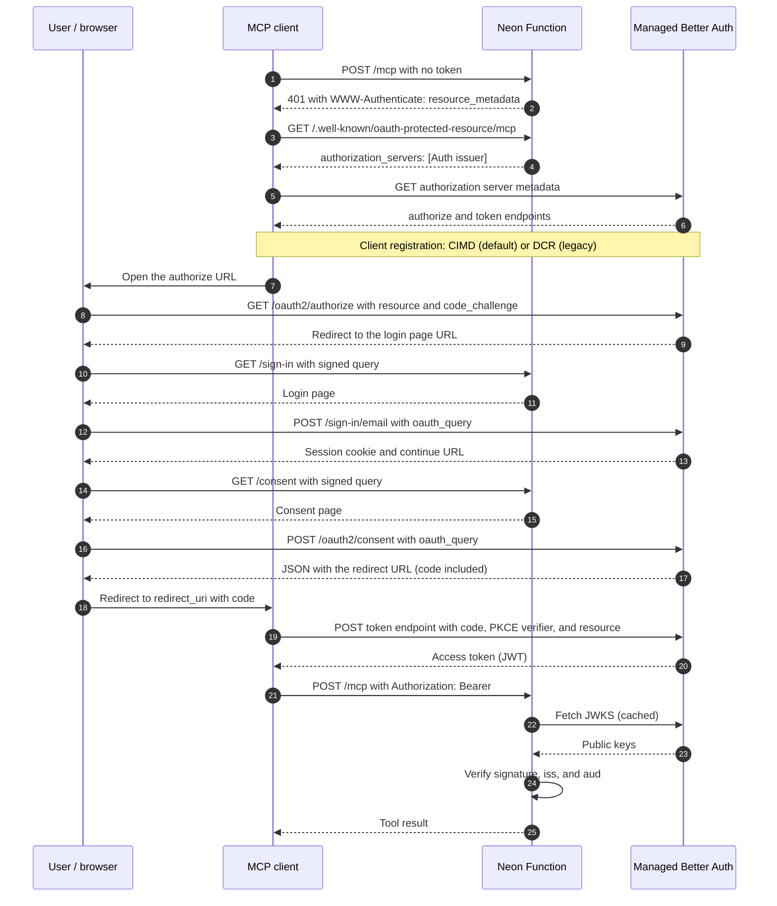

An AI assistant like Cursor or Claude needs tools it can call over the internet to work with your APIs, your backend, or your data. [Model Context Protocol](https://modelcontextprotocol.io/) (MCP) is the standard for providing those tools. An MCP server advertises a set of tools, each with a description the model reads and a schema for its arguments. When the user asks for something, the model picks a tool, fills in the arguments, and the client sends the call to your server. Your server runs the code and returns a result the assistant can read.

For example, you ask the assistant to "Add Ada Lovelace to my contacts." The assistant picks a tool named `create_contact`, fills in the values it can infer from your message, and sends the call to your server. Your server inserts the row in Postgres, replies with the created contact, and the assistant confirms it. The model never touches the database; it only sees the tool descriptions and the results.

In this guide, you'll build a contacts app served over MCP. The server is a [Neon Function](/docs/compute/functions/overview) running in the same region as Lakebase Postgres on Neon, so queries stay fast.

Here's what you'll build:

- A **Hono app** on Neon Functions that exposes three tools (create, search, and delete contacts) over the streamable HTTP transport, using the MCP TypeScript SDK
- **Postgres-backed tools** with Drizzle ORM
- A **stable URL on your own domain** with [custom domains for Neon Functions](/docs/compute/functions/custom-domains)
- **Authentication**, either a shared API key or OAuth 2.1 through the [Managed Better Auth OAuth provider](/docs/auth/guides/plugins/oauth-provider) (beta), so a client can sign the user in through the browser

<CopyPrompt
  src="/prompts/deploy-mcp-server-on-neon-functions-prompt.md"
  description="Use this prompt to customize the guide and build it with your AI agent."
  buttonText="Copy prompt"
/>

<Callout title="This page hosts your own MCP server">
The [Neon MCP Server](/docs/ai/neon-mcp-server) lets an assistant manage Neon itself (projects, branches, SQL against a project you connect). This guide hosts a different server: your tools, your API, your data.
</Callout>

## How it works

An MCP setup has two parts. The **MCP client** is the app where the user chats, such as Cursor or Claude Code, and it holds the connection to your server. Your code is the **MCP server**: it advertises the tools and runs them when asked. The two talk over HTTP using [JSON-RPC 2.0](https://www.jsonrpc.org/specification), a request/response format where every message names a method such as `tools/list`. The MCP SDK handles the protocol details, so your code is just the tool functions and their schemas.

Here's the typical flow of a request from the client to your server:

1. **Request**: The MCP client sends JSON-RPC requests to your MCP server (`https://mcp.example.com/mcp`).
2. **Authentication**: The function checks the caller before any tool runs. With an API key, that's a string compare on the `Authorization` header. With OAuth, it verifies the access token against the Managed Better Auth JWKS endpoint and reads the user identity from the claims.
3. **Tool execution**: The SDK matches the method to a tool handler, which queries Postgres through Drizzle.
4. **Response**: The handler returns a `content` array, the SDK wraps it in a JSON-RPC result, and the client hands the text to the model.

## Prerequisites

Before you begin, make sure you have the following:

1. **Node.js**: Version 22 or later. Download from [nodejs.org](https://nodejs.org/).
2. **Neon account**: Sign up for a free account at [console.neon.tech](https://console.neon.tech/signup).
3. **Neon CLI**: Installed globally (`npm i -g neon@latest`) and authenticated (`neon login`). Check out the [Neon CLI Quickstart](/docs/cli/quickstart) for details.
4. **A domain (optional)**: A domain lets you serve the function from a URL you control. Without one, deploy and test on the native Neon Function URL instead, and skip [Serve it from your own domain](#serve-it-from-your-own-domain); both authentication options work on that URL. The one case that needs a domain you control is a custom MCP client whose [Client ID Metadata Document](/docs/auth/guides/plugins/oauth-provider#client-id-metadata-documents) you host yourself, because that document can't be served from a Neon domain.

<Admonition type="important" title="Replace the example domain">
This guide uses `mcp.example.com` in place of your domain, so replace it with your own domain or the native function URL wherever it appears.
</Admonition>

<Steps>

## Set up the project

Create a directory for your project and initialize it:

```bash
mkdir contacts-mcp && cd contacts-mcp
npm init -y
```

Install the Neon agent skills so AI agents like Claude Code and Cursor have the context to help you build and deploy. This project uses the `neon`, `neon-functions`, `neon-postgres`, and `neon-auth` skills:

```bash
neon skills -s neon -s neon-postgres -s neon-functions -s neon-auth
```

When prompted, select the AI assistant you'd like to use (for example, Claude Code or Cursor) and confirm the recommended skills. That gives your agent the context it needs to help you with Neon.

Next, link your local workspace to a Neon project. Run the following command:

```bash
neon link
```

You'll be prompted to select your organization, then a project. **Create a new project** named `contacts-mcp` (or pick an existing one), then select a region. Neon Functions are currently available in AWS US East (Ohio) (`aws-us-east-2`), AWS US East (N. Virginia) (`aws-us-east-1`), AWS Europe (Frankfurt) (`aws-eu-central-1`), and AWS Asia Pacific (Singapore) (`aws-ap-southeast-1`); this guide uses US East (Ohio). Support is expanding toward [all regions](/docs/introduction/regions).

Confirm that you want to manage your setup as code, which generates a `neon.ts` file in your project root. Then, when asked which Neon services you need, select **Functions**:

```text
$ neon link
✔ Which organization would you like to link? › MyOrg (org-example-12345678)
✔ Which project would you like to link? › ＋ Create new project…
✔ Name for the new project: … contacts-mcp
✔ Which region should the new project run in? › AWS US East 2 (Ohio) (aws-us-east-2)
Created project quiet-fog-09491284 ("contacts-mcp") in aws-us-east-2.
Linked ~/contacts-mcp/.neon:
  orgId:     org-example-12345678
  projectId: quiet-fog-09491284
  branch:    main

✔ Manage this project's Neon setup as code? Adds a neon.ts you can edit and apply with `neon config apply`. … yes
✔ Which Neon services should neon.ts declare? (space to toggle, enter to confirm) › Functions

INFO: Pulled 3 Neon variables into ~/contacts-mcp/.env.local: NEON_BRANCH, DATABASE_URL, DATABASE_URL_UNPOOLED
INFO: Created neon.ts declaring functions.
INFO: Created hello.ts - the source of the hello function.
INFO: Installing @neon/config, @neon/env with npm…
```

The `neon link` command also creates a placeholder function, `hello.ts`, at your project root. You'll build the MCP server in your own files, so delete the placeholder:

```bash
rm hello.ts
```

It also creates a `.env.local` file with your Neon project variables, including `DATABASE_URL` and `DATABASE_URL_UNPOOLED`. Your function uses these to connect to the database.

Next, install the dependencies you'll need for the MCP server:

```bash
npm install hono @neon/functions @modelcontextprotocol/server drizzle-orm pg zod dotenv
npm install --save-dev drizzle-kit @types/node @types/pg typescript esbuild
```

Here's what each package does:

- `hono`: A lightweight web framework for routing. Neon Functions support Hono by default.
- `@neon/functions`: Neon's package for Postgres pool management in functions.
- `@modelcontextprotocol/server`: The MCP server SDK used to register tools and handle JSON-RPC requests.
- `drizzle-orm` and `pg`: The ORM and the Node.js Postgres driver it uses to query your database.
- `zod`: Schema validation for tool input and output, which the MCP SDK uses to validate arguments before they reach your handlers.
- `dotenv`: Loads `.env.local` into the environment for local scripts like Drizzle Kit.

You'll also need a `tsconfig.json` file to tell TypeScript how to compile the function. Create it in the project root:

```json filename="tsconfig.json"
{
  "compilerOptions": {
    "target": "ES2022",
    "module": "NodeNext",
    "moduleResolution": "NodeNext",
    "types": ["node"],
    "strict": true,
    "esModuleInterop": true,
    "skipLibCheck": true,
    "forceConsistentCasingInFileNames": true
  }
}
```

## Build the contacts MCP server

You'll build a simple contacts app with three tools: `create_contact`, `search_contacts`, and `delete_contact`.

Every tool declares its `inputSchema` as a zod object, and the SDK validates arguments against it before your handler runs, so every value the handler receives is present and correctly typed. Each contact has a name, email, phone number, company, and free-form notes. The model can call `create_contact` to add a new row, `search_contacts` to find rows by substring, and `delete_contact` to remove a row by id.

### Define the database schema

Create `src/schema.ts` to define the `contacts` table. Drizzle Kit reads this file to create the table in Postgres, and the MCP handlers import it to build queries.

```typescript filename="src/schema.ts"
import { pgTable, serial, text, timestamp } from 'drizzle-orm/pg-core';

export const contacts = pgTable('contacts', {
  id: serial('id').primaryKey(),
  name: text('name').notNull(),
  email: text('email'),
  phone: text('phone'),
  company: text('company'),
  notes: text('notes'),
  createdAt: timestamp('created_at').defaultNow().notNull(),
  updatedAt: timestamp('updated_at').defaultNow().notNull(),
});
```

### Create the database client

Create `src/db.ts` to export a Drizzle client that connects to the branch on Neon. The MCP handlers import this client to run queries.

```typescript filename="src/db.ts"
import { attachDatabasePool } from '@neon/functions';
import { drizzle } from 'drizzle-orm/node-postgres';
import { Pool } from 'pg';

const pool = new Pool({ connectionString: process.env.DATABASE_URL, max: 5 });
attachDatabasePool(pool);

export const db = drizzle(pool);
```

The pool is created once at module scope, so requests on the same instance reuse its connections. Call `attachDatabasePool(pool)` once after creating the pool so an idle disconnect can't crash the isolate with an uncaught pool error. See [Connecting to Postgres](/docs/compute/functions/get-started#connect-to-postgres) for why that happens and what happens on shutdown.

### Create the Hono app with the MCP route

Create an `index.ts` file at the project root. It has three parts: a helper that shapes results, a factory that creates the MCP server and registers the three tools, and a Hono app that exposes them at the `/mcp` route.

```typescript shouldWrap filename="index.ts"
import { Hono } from 'hono';
import { and, eq, ilike, or } from 'drizzle-orm';
import { z } from 'zod';
import { McpServer, createMcpHandler } from '@modelcontextprotocol/server';
import { db } from './src/db';
import { contacts } from './src/schema';

function asTextResult(payload: unknown, isError = false) {
  return {
    content: [{ type: 'text' as const, text: JSON.stringify(payload, null, 2) }],
    isError,
  };
}

function createServer() {
  const server = new McpServer({ name: 'contacts-mcp', version: '1.0.0' });

  server.registerTool(
    'create_contact',
    {
      title: 'Create contact',
      description: 'Create a new contact in the contacts database.',
      inputSchema: z.object({
        name: z.string().min(1).describe('Full name of the contact.'),
        email: z.string().optional().describe('Email address.'),
        phone: z.string().optional().describe('Phone number.'),
        company: z.string().optional().describe('Company or organization.'),
        notes: z.string().optional().describe('Free-form notes.'),
      }),
    },
    async ({ name, email, phone, company, notes }) => {
      const [row] = await db
        .insert(contacts)
        .values({ name, email, phone, company, notes })
        .returning();
      return asTextResult({ created: row });
    },
  );

  server.registerTool(
    'search_contacts',
    {
      title: 'Search contacts',
      description:
        'Search contacts by name, email, company, or notes. Omit the query to list all contacts.',
      inputSchema: z.object({
        query: z
          .string()
          .optional()
          .describe('Case-insensitive substring to match; omit to list everyone.'),
        limit: z
          .number()
          .int()
          .positive()
          .max(100)
          .default(20)
          .describe('Maximum number of contacts to return.'),
      }),
    },
    async ({ query, limit }) => {
      const where = query
        ? or(
            ilike(contacts.name, `%${query}%`),
            ilike(contacts.email, `%${query}%`),
            ilike(contacts.company, `%${query}%`),
            ilike(contacts.notes, `%${query}%`),
          )
        : undefined;
      const rows = await db
        .select()
        .from(contacts)
        .where(and(where))
        .orderBy(contacts.name)
        .limit(limit);
      return asTextResult({ count: rows.length, contacts: rows });
    },
  );

  server.registerTool(
    'delete_contact',
    {
      title: 'Delete contact',
      description: 'Delete a contact by ID.',
      inputSchema: z.object({
        id: z.number().int().positive().describe('ID of the contact to delete.'),
      }),
    },
    async ({ id }) => {
      const [row] = await db.delete(contacts).where(eq(contacts.id, id)).returning();
      if (!row) {
        return asTextResult({ error: `No contact found with id ${id}.` }, true);
      }
      return asTextResult({ deleted: row });
    },
  );

  return server;
}

const mcpHandler = createMcpHandler(() => createServer());

const app = new Hono();

app.get('/', (c) => c.text('Contacts MCP server. Connect an MCP client to /mcp'));

app.all('/mcp', (c) => mcpHandler.fetch(c.req.raw));

export default app;
```

Here's what the code does:

- **`asTextResult()`**: Wraps each result in the MCP `content` array. When a tool reports a problem such as a missing id, it sets `isError: true`; the JSON-RPC response still succeeds, so the model can tell the user. An exception thrown out of a handler is a server error instead, and its stack trace shows up in the [function logs](/docs/compute/functions/logs).
- **`createServer()`**: Builds a new `McpServer` and registers the three tools. The pool from `src/db.ts` is shared across the process.
- **`registerTool()` with `inputSchema`**: Each `inputSchema` is a `z.object()`, and every field has a `.describe()` call. The client shows those descriptions to the model, which uses them to pick the tool and fill in the arguments.
- **`createMcpHandler()`**: The SDK's HTTP entry point. It returns a web-standard handler with a `fetch(request)` method, the same shape a Neon Function exports through Hono. It calls the factory per request, so every request gets a fresh `McpServer`. It serves the `2026-07-28` revision, where each request is self-contained, and falls back to stateless serving for older clients.

### Configure neon.ts

The `neon link` command created a `neon.ts` file in your project root. Replace its contents with the following:

```typescript filename="neon.ts"
import { defineConfig } from '@neon/config/v1';

export const config = defineConfig({
  functions: {
    mcp: {
      name: 'Contacts MCP server',
      source: './index.ts',
    },
  },
});

export default config;
```

The key `mcp` names the function, and `source` points to the `index.ts` file you just created. The `name` field is the human-readable label shown in the Neon Console and CLI.

## Generate and apply the migrations

Create a `drizzle.config.ts` file in the project root. The config loads `.env.local` and points Drizzle Kit at your schema.

```typescript filename="drizzle.config.ts"
import { config } from 'dotenv';
import { defineConfig } from 'drizzle-kit';

config({ path: '.env.local' });

export default defineConfig({
  out: './drizzle',
  schema: './src/schema.ts',
  dialect: 'postgresql',
  dbCredentials: {
    url: process.env.DATABASE_URL_UNPOOLED!,
  },
});
```

Generate and apply the migration to create the `contacts` table in Postgres. Run the following commands:

```bash
npx drizzle-kit generate
npx drizzle-kit migrate
```

The first command creates a migration file in the `drizzle` folder, and the second applies it to the database using the `DATABASE_URL_UNPOOLED` connection string.

## Run the server locally and test it

Start the function locally with `neon dev`. It injects the linked branch's variables and prints the URL (`http://localhost:8787`). The MCP route is at `/mcp`, so the full URL is `http://localhost:8787/mcp`.

```bash
neon dev
```

In a second terminal, use `mcporter` (a CLI for inspecting and calling MCP servers) to confirm the server is running and the tools are registered. The `--schema` flag shows the input schema for each tool, which is what the model sees.

```bash
npx mcporter list http://localhost:8787/mcp --schema --allow-http
```

The `--allow-http` flag is required for local testing, because the MCP spec requires HTTPS in production.

The `mcporter list` command initializes the server with a JSON-RPC request, then calls `tools/list` to fetch the catalog. The output shows the three tools you registered, along with their descriptions and input schemas.

Create a contact with `mcporter call`:

```bash
npx mcporter call "http://localhost:8787/mcp.create_contact" --allow-http \
  name="Ada Lovelace" email="ada@example.com" company="Analytical Engines"
```

```json filename="Output"
{
  "created": {
    "id": 1,
    "name": "Ada Lovelace",
    "email": "ada@example.com",
    "phone": null,
    "company": "Analytical Engines",
    "notes": null,
    "createdAt": "2026-09-22T10:00:00.000Z",
    "updatedAt": "2026-09-22T10:00:00.000Z"
  }
}
```

Search for the contact you just created:

```bash
npx mcporter call "http://localhost:8787/mcp.search_contacts" --allow-http query="ada"
```

The tool matches `ada` against name, email, company, and notes, so the response returns the contact you created along with a `count` of the matches.

Finally, delete it:

```bash
npx mcporter call "http://localhost:8787/mcp.delete_contact" --allow-http id=1
```

Search again to confirm the row is deleted. This time the response contains no contacts.

You can also connect the local server to a coding agent. Run the `add-mcp` command for your agent:

<CodeTabs labels={["Claude Code", "Cursor"]}>

```bash
npx add-mcp http://localhost:8787/mcp -a claude-code
```

```bash
npx add-mcp http://localhost:8787/mcp -a cursor
```

</CodeTabs>

`add-mcp` works with other MCP-capable coding agents too. See the [add-mcp supported agents](https://github.com/neon-solutions/add-mcp#supported-agents) list for the full set.

`add-mcp` writes the MCP config file for your agent: `.mcp.json` in your project root for Claude Code, or `.cursor/mcp.json` for Cursor. The agent reads that file to discover the tools and their schemas, so it can call them when you ask it to do something. You can now ask the agent to create, search, and delete contacts through the local server.

Open your AI agent and ask it to create a contact. It picks the `create_contact` tool, fills in the arguments, and sends the call to your local server. The server runs the query and returns the result, which the agent shows you.

In Claude Code, for example, you can ask:

```text
Create 10 random contacts with placeholder values
```

and the agent will call `create_contact` ten times, returning the created rows.


You now have a working MCP server running locally. Next, you'll deploy it so any MCP client can reach it over HTTPS.

## Deploy the function

Deploy the function to Neon Functions with the `neon deploy` command. The CLI builds the function, uploads it to Neon, and provisions a public HTTPS URL for it.

```bash
neon deploy
```

You'll see output like this:

```text
Function URLs
  • mcp: https://br-cool-forest-a1b2c3d4-mcp.compute.c-2.us-east-2.aws.neon.tech
```

The host is `<branch_id>-<slug>.compute.<cell>.<region>.aws.neon.tech`. In the above example, `br-cool-forest-a1b2c3d4` is the branch, `mcp` is the slug, and `us-east-2` is the project region. Redeploys of this branch keep the same host, while a new branch gets a new host and runs against that branch's data. If you need the URL later, run `neon functions get mcp`.

You can now test the deployed function with `mcporter list`:

```bash
npx mcporter list https://br-cool-forest-a1b2c3d4-mcp.compute.c-2.us-east-2.aws.neon.tech/mcp --schema
```

You should see the same three tools you registered locally, along with their descriptions and input schemas. You can also call the tools with `mcporter call` just like you did locally.

Your server is now live on the public internet.

Connect it to your coding agent too. The local server entry you added earlier is still in your agent's config file. Replace its URL with the deployed one, or rerun the `add-mcp` command for your agent with the deployed URL.

Ask your agent to create, search, or delete a contact to confirm it reaches the deployed server over HTTPS.

<Admonition type="warning" title="The function URL is public">
A Neon Function gets a public HTTPS URL that anyone can reach. Right now, anyone who finds this URL can create, search, and delete your contacts. The next section adds authentication so only authorized clients can call the tools.
</Admonition>

## Serve it from your own domain

Neon Functions supports [custom domains](/docs/compute/functions/custom-domains), so you can serve the function from a hostname you control.

Add the `customDomains` field to the function in `neon.ts`:

```typescript filename="neon.ts" {8}
import { defineConfig } from '@neon/config/v1';

export const config = defineConfig({
  functions: {
    mcp: {
      name: 'Contacts MCP server',
      source: './index.ts',
      customDomains: ['mcp.example.com'],
    },
  },
});

export default config;
```

Replace `mcp.example.com` with a hostname you control. A static `customDomains` entry applies to the default branch only. Child branches don't inherit the hostname and serve from their own native Function URL.

Deploy the function again. The output shows the CNAME hostname you need to point your DNS record at:

```bash
neon deploy
```

You'll see output like this:

```text
INFO: → Applying to branch main (br-odd-darkness-auvxtp3p)
Applied changes
  ~ function mcp

Custom domains
  CNAME mcp.example.com -> fn-custom-domains.us-east-2.aws.neon.tech
  Point each hostname at the CNAME target. Neon does not create DNS records.

Function URLs
  • mcp: https://br-cool-forest-a1b2c3d4-mcp.compute.c-2.us-east-2.aws.neon.tech/
```

Create a CNAME record at your DNS provider. Follow [Configure DNS](/docs/compute/functions/custom-domains#configure-dns) for the full steps, including removing conflicting records:

- **Type:** `CNAME`
- **Name:** `mcp.example.com` (some providers expect only the host label, `mcp`)
- **Value:** The exact CNAME hostname from the deploy output, such as `fn-custom-domains.us-east-2.aws.neon.tech`. Don't include `https://` or a path.
- **TTL:** Your provider's default.

For example, on Cloudflare, create a CNAME record with `mcp` as the name and `fn-custom-domains.us-east-2.aws.neon.tech` as the target, and set it to **DNS only** (grey cloud). Neon can't validate the domain through a proxied record.


DNS changes can take a few minutes to propagate. Neon checks the record, provisions a TLS certificate, and flips the domain status to `active`. Verify with an HTTPS request:

```bash
curl -i https://mcp.example.com/
```

```text
HTTP/2 200
content-type: text/plain;charset=UTF-8

Contacts MCP server. Connect an MCP client to /mcp
```

The first request can trigger certificate issuance, so it may take a few seconds. See [Custom domains for Neon Functions](/docs/compute/functions/custom-domains) for the Neon Console, CLI, and API steps to register a domain, along with status codes and troubleshooting.

Although the function is now available at your custom domain, the native URL remains functional. Update your agent's config file to use the custom domain, or rerun the `add-mcp` command with the new URL. Then test that the agent can still access and use the tools.

## Secure the server

Right now, anyone who reaches `/mcp` can create, search, and delete contacts. You can secure the server with either a shared API key or OAuth 2.1 through Managed Better Auth. Choose the option that fits your use case:

- **API key**: You generate one secret, and every client sends it with each request. Every caller presents the same key, so the server can't tell them apart. Use it if you're the only user or you don't need to know who made a call.
- **OAuth**: Each client gets its own tokens, so you can tell which user made a call and revoke one client without affecting the others. It's the path the [MCP authorization spec](https://modelcontextprotocol.io/specification/2026-07-28/basic/authorization) describes. Use it if you have multiple users or need per-user access control.

### Option 1: API key

Generate a random 32-byte base64 string to use as the API key. Run the following command in your terminal:

```bash
openssl rand -base64 32
```

Copy the output and add it to your `.env.local` file as `MCP_API_KEY`. For example:

```bash filename=".env.local"
# ...other Neon credentials...
MCP_API_KEY=<the-value-you-generated>
```

You'll also need to add the key to the `neon.ts` file so the function can read it from the environment:

```typescript filename="neon.ts"
import { defineConfig } from '@neon/config/v1';

export const config = defineConfig({
  functions: {
    mcp: {
      name: 'Contacts MCP server',
      source: './index.ts',
      customDomains: ['mcp.example.com'],
      env: { // [!code ++]
        MCP_API_KEY: process.env.MCP_API_KEY! // [!code ++]
      }, // [!code ++]
    },
  },
});

export default config;
```

Add a check to the `/mcp` route in `index.ts` that reads the `Authorization` header and compares it to the secret. If the header is missing or doesn't match, return a `401 Unauthorized` response before calling the MCP handler.

```typescript filename="index.ts"
// other imports...
import { parseEnv } from '@neon/env'; // [!code ++]
import { config } from './neon'; // [!code ++]

const env = parseEnv(config, 'mcp'); // [!code ++]

// ...existing code...
app.all('/mcp', (c) => {
  if (c.req.header('authorization') !== `Bearer ${env.function.MCP_API_KEY}`) { // [!code ++]
    return c.json({ error: 'Unauthorized' }, 401); // [!code ++]
  } // [!code ++]
  return mcpHandler.fetch(c.req.raw)
});
```

You now have a shared secret that only your function knows. Any client that wants to call the tools must send it in the `Authorization` header as `Bearer <your-api-key>`.

Redeploy the function to apply the changes. Run the following command with the `--env` flag to include the `.env.local` file:

```bash
neon deploy --env .env.local
```

After the deploy, test the server with `mcporter list` using the API key:

```bash
npx mcporter list https://mcp.example.com/mcp --schema
```

You'll get a `401 Unauthorized` response because the request is missing the `Authorization` header. Add the header with your API key and try again:

```bash
npx mcporter list https://mcp.example.com/mcp --schema \
  --header "Authorization=Bearer <your-api-key>"
```

You should see the same three tools you registered, along with their descriptions and input schemas. You can call the tools with `mcporter call` just like you did locally, as long as each request includes the `Authorization` header. Every client shares the same key, so share it with anyone you want to authorize.

To add the server to Claude Code or Cursor, run the `add-mcp` command for your agent:

<CodeTabs labels={["Claude Code", "Cursor"]}>

```bash
npx add-mcp https://mcp.example.com/mcp -a claude-code \
  --header "Authorization: Bearer <your-api-key>"
```

```bash
npx add-mcp https://mcp.example.com/mcp -a cursor \
  --header "Authorization: Bearer <your-api-key>"
```

</CodeTabs>

### Option 2: OAuth with Managed Better Auth

With OAuth, each client signs the user in through a browser and sends an access token with every request. [Managed Better Auth](/docs/auth/overview) supports the [OAuth provider plugin](/docs/auth/guides/plugins/oauth-provider) (beta), including MCP server protection. You enable the provider on the branch, and Managed Better Auth acts as the authorization server.

The two main components are:

- **Authorization server**: Managed Better Auth on your branch. It signs users in and issues tokens.
- **Protected resource**: your `/mcp` route. It checks the token before any tool runs.

A typical flow looks like this:



The tokens and PKCE pair are the key pieces of data that make this flow secure:

- **Authorization code**: a one-time ticket issued when the user clicks Allow. The client trades it at the token endpoint for an access token.
- **Access token**: a JWT signed by Managed Better Auth. Its `aud` claim includes `https://mcp.example.com/mcp`, so a token issued for another resource is rejected here. The client sends it as `Authorization: Bearer` on every `/mcp` request.
- **PKCE pair**: two related strings (a verifier and a challenge) the client generates before opening the browser. Managed Better Auth checks that they match when the code is exchanged, so someone who steals the code can't use it.

#### Enable the OAuth provider

Enable Managed Better Auth on the branch by setting `auth: true` in `neon.ts`. The CLI provisions the auth service and injects its URL into the function at runtime.

```typescript filename="neon.ts"
import { defineConfig } from '@neon/config/v1';

export const config = defineConfig({
  auth: true, // [!code ++]
  functions: {
    mcp: {
      name: 'Contacts MCP server',
      source: './index.ts',
      customDomains: ['mcp.example.com'],
    },
  },
});

export default config;
```

Apply the change to the branch by running `neon deploy`:

```bash
neon deploy
```

Next, enable the OAuth provider in the [Neon Console](https://console.neon.tech). Open your project, go to **Settings** > **Better Auth**, and find the **OAuth provider** section:

1. Add `https://mcp.example.com` as a [trusted domain](/docs/auth/guides/configure-domains#add-a-domain). Use the origin only, with no path or trailing slash, so the login and consent pages can call Managed Better Auth from it. If you host the pages on another domain, add that origin instead.
2. Turn on **Enable OAuth provider**, then set:
   - **Login page URL**: `https://mcp.example.com/sign-in`
   - **Consent page URL**: `https://mcp.example.com/consent`
   - **Server URL** (in the **MCP server** section): `https://mcp.example.com/mcp`
3. Keep the defaults for **Client ID Metadata Documents** (on) and **Dynamic client registration (legacy)** (off), then click **Enable**.

The example login page uses email and password, so confirm **Sign-up with Email** is enabled on the same **Settings** > **Better Auth** page.

<Callout title="Use your custom domain">
This guide uses a custom domain for the MCP route and the login and consent pages. A Neon Function URL works for the route and for those pages, but a CIMD `client_id` document can't be served from a Neon domain. If you build an MCP client and host its `client_id` document yourself, serve it from your own domain. See [Limitations](/docs/auth/guides/plugins/oauth-provider#limitations).
</Callout>

#### Verify tokens in the function

Install the Neon OAuth package, which provides the `createMcpAuth()` function and Hono middleware for verifying access tokens.

```bash
npm install @neon/oauth
```

Update `index.ts` to import the auth functions, create the verifier, and use it on the `/mcp` route. The verifier checks the signature, issuer, and audience of every access token before any tool runs.

```typescript shouldWrap filename="index.ts" {1-4,14-21,25,27,31,33,35-37}
import { parseEnv } from '@neon/env';
import { config } from './neon';
import { createMcpAuth } from '@neon/oauth/mcp';
import { honoMcp, type McpAuthVariables } from '@neon/oauth/mcp/hono';
import { Hono } from 'hono';
import { and, eq, ilike, or } from 'drizzle-orm';
import { z } from 'zod';
import { McpServer, createMcpHandler } from '@modelcontextprotocol/server';
import { db } from './src/db';
import { contacts } from './src/schema';

// ...asTextResult and createServer stay as they were...

const env = parseEnv(config, 'mcp');

const MCP_RESOURCE = 'https://mcp.example.com/mcp';

const auth = createMcpAuth({
  baseUrl: env.auth.baseUrl,
  resource: MCP_RESOURCE,
});

const mcpHandler = createMcpHandler(() => createServer());

const app = new Hono<McpAuthVariables>();

app.use(honoMcp(auth));

app.get('/', (c) => c.text('Contacts MCP server. Connect an MCP client to /mcp'));

app.get('/sign-in', (c) => c.html(signInPage(env.auth.baseUrl)));

app.get('/consent', (c) => c.html(consentPage(env.auth.baseUrl)));

app.all('/mcp', (c) =>
  mcpHandler.fetch(c.req.raw, { authInfo: c.get('authInfo') }),
);

export default app;
```

The code adds the following:

- **`createMcpAuth()`**: Creates the verifier for one MCP endpoint. `resource` must be the exact URL you set as **Server URL** in the provider. The token's `aud` claim must include it.
- **`honoMcp()`**: Serves `/.well-known/oauth-protected-resource/mcp`, and guards every method except `OPTIONS` on `/mcp`. It doesn't touch `/sign-in` or `/consent`.
- **`mcpHandler.fetch(..., { authInfo })`**: Passes the verified caller to the MCP SDK. The SDK makes it available to the factory as `ctx.authInfo` and to tool handlers as `ctx.http.authInfo`.
- **No auth routes**: Managed Better Auth serves the sign-in, consent, token, discovery, and JWKS endpoints on its own issuer. The function doesn't proxy them.

#### Add the login and consent pages

The provider redirects the user to your function's `/sign-in` and `/consent` pages. Both pages call Managed Better Auth from the browser.

To `index.ts`, add two functions that return the HTML for the pages. The `authBaseUrl` is the Managed Better Auth issuer, which the pages use to post credentials and consent.

```typescript shouldWrap filename="index.ts"
function signInPage(authBaseUrl: string) {
  return `<!doctype html>
<html>
  <body style="font-family: system-ui; max-width: 360px; margin: 80px auto">
    <h1>Sign in</h1>
    <p>Sign in to authorize the MCP client.</p>
    <form id="form">
      <input name="email" type="email" placeholder="Email" required
        style="width:100%;padding:8px;margin-bottom:8px;box-sizing:border-box" />
      <input name="password" type="password" placeholder="Password" required
        style="width:100%;padding:8px;margin-bottom:8px;box-sizing:border-box" />
      <button type="submit" style="width:100%;padding:10px">Sign in</button>
    </form>
    <p id="error" style="color:#b91c1c"></p>
    <script>
      const authBaseUrl = ${JSON.stringify(authBaseUrl)};
      const oauthQuery = window.location.search.slice(1);

      // If the user already has a session, continue the authorization request.
      fetch(authBaseUrl + '/get-session', { credentials: 'include' })
        .then((response) => (response.ok ? response.json() : null))
        .then((session) => {
          if (!session?.session) return;
          return fetch(authBaseUrl + '/oauth2/continue', {
            method: 'POST',
            credentials: 'include',
            headers: { 'content-type': 'application/json' },
            body: JSON.stringify({ selected: true, oauth_query: oauthQuery }),
          })
            .then((response) => response.json())
            .then((result) => {
              if (result.url) window.location.assign(result.url);
            });
        });

      const form = document.getElementById('form');
      form.addEventListener('submit', async (event) => {
        event.preventDefault();
        const data = new FormData(form);
        const response = await fetch(authBaseUrl + '/sign-in/email', {
          method: 'POST',
          credentials: 'include',
          headers: { 'content-type': 'application/json' },
          body: JSON.stringify({
            email: data.get('email'),
            password: data.get('password'),
            oauth_query: oauthQuery,
          }),
        });
        const result = await response.json();
        if (result.url) {
          window.location.assign(result.url);
        } else if (!response.ok) {
          document.getElementById('error').textContent =
            result.message ?? 'Sign-in failed';
        } else {
          document.getElementById('error').textContent =
            'Signed in. Reload this page to continue.';
        }
      });
    </script>
  </body>
</html>`;
}

function consentPage(authBaseUrl: string) {
  return `<!doctype html>
<html>
  <body style="font-family: system-ui; max-width: 360px; margin: 80px auto">
    <h1>Authorize access</h1>
    <p>An MCP client is requesting access to your contacts.</p>
    <button id="allow" style="padding:10px 24px">Allow</button>
    <p id="status"></p>
    <script>
      const authBaseUrl = ${JSON.stringify(authBaseUrl)};
      document.getElementById('allow').addEventListener('click', async () => {
        const response = await fetch(authBaseUrl + '/oauth2/consent', {
          method: 'POST',
          credentials: 'include',
          headers: { 'content-type': 'application/json' },
          body: JSON.stringify({
            accept: true,
            oauth_query: window.location.search.slice(1),
          }),
        });
        const result = await response.json();
        if (result.url) {
          window.location.assign(result.url);
        } else {
          document.getElementById('status').textContent =
            'Could not complete authorization. Reload and try again.';
        }
      });
    </script>
  </body>
</html>`;
}
```

Each page posts to Managed Better Auth with the signed query string: the sign-in page to `/sign-in/email`, and the consent page to `/oauth2/consent`. If the user already has a session, the sign-in page calls `/oauth2/continue` instead. Both endpoints return JSON. When the JSON includes a `url`, the page navigates the browser there. For the consent step, that URL is the client's redirect URI with the authorization code. See [How the pages complete the flow](/docs/auth/guides/plugins/oauth-provider#how-the-pages-complete-the-flow) for the full contract.

<Admonition type="note" title="Example pages only">
These pages are minimal examples for this guide. In a real app, serve them from your own frontend with your own styling, add the sign-in options you normally offer, such as [Google, GitHub, or Vercel sign-in](/docs/auth/guides/setup-oauth), and show the client name and redirect host before the user approves access. The pages don't have to run on the MCP server's domain. Any origin works as long as you add it as a [trusted domain](/docs/auth/guides/configure-domains) for the branch and point the page URLs in the provider settings at it. See [Build your consent page](/docs/auth/guides/plugins/oauth-provider#build-your-consent-page) for what the page should show, and the quick starts for [Next.js](/docs/auth/quick-start/nextjs-api-only), [React](/docs/auth/quick-start/react), and [TanStack Router](/docs/auth/quick-start/tanstack-router) to build the pages in your own stack.
</Admonition>

#### Redeploy and test

Deploy the function with the new pages and verifier:

```bash
neon deploy
```

Create a user to sign in with. Replace `NEON_AUTH_BASE_URL` with the Auth URL from `.env.local` or the Neon Console:

```bash
export NEON_AUTH_BASE_URL=https://ep-example.neonauth.us-east-1.aws.neon.tech/neondb/auth

curl -X POST "$NEON_AUTH_BASE_URL/sign-up/email" \
  -H "Content-Type: application/json" \
  -H "Origin: https://mcp.example.com" \
  -d '{"email":"dana@example.com","password":"AbC123dEf","name":"Dana Smith","callbackURL":"https://mcp.example.com"}'
```

<Admonition type="note">
In a real deployment, your frontend would include a sign-up page that uses the Managed Better Auth sign-up flow. The `curl` command performs the same operation, but gives you a fast way to create a user for testing.
</Admonition>

Now confirm that the server challenges unauthenticated MCP requests the way clients expect:

```bash
curl -s -i https://mcp.example.com/mcp \
  -H "Content-Type: application/json" \
  -d '{"jsonrpc":"2.0","id":1,"method":"ping"}' | grep -i www-authenticate
```

You should see a `WWW-Authenticate` header pointing at the protected resource metadata:

```text
www-authenticate: Bearer resource_metadata="https://mcp.example.com/.well-known/oauth-protected-resource/mcp"
```

You can see the metadata yourself:

```bash
curl -s https://mcp.example.com/.well-known/oauth-protected-resource/mcp
```

This returns the protected resource metadata. The `authorization_servers` value is your branch's Managed Better Auth issuer:

```json
{"resource":"https://mcp.example.com/mcp","authorization_servers":["https://ep-example.neonauth.us-east-1.aws.neon.tech/neondb/auth"]}
```

You now have a working MCP server with OAuth. The next step is to connect an MCP client to it.

## Verify the OAuth flow from a coding agent

You can connect the deployed server to a coding agent. Run the `add-mcp` command for your agent with the deployed URL:

<CodeTabs labels={["Claude Code", "Cursor"]}>

```bash
npx add-mcp https://mcp.example.com/mcp -a claude-code
```

```bash
npx add-mcp https://mcp.example.com/mcp -a cursor
```

</CodeTabs>

Open the AI agent where you added the MCP server and start the connection. In Claude Code, run `/mcp` in the chat and select the server from the list. The first time the client calls your `/mcp` route, it reads the `401` challenge, discovers the authorization server, and opens a browser. Sign in as `dana@example.com` and select **Allow**.


The client then lists the three tools. Ask it to create, search, or delete a contact to confirm it reaches the deployed server over HTTPS.

```text filename="Claude Code"
❯ /mcp
  ⎿  Authentication successful. Connected to example_mcp.

❯ List my contacts

  Thought for 3s, called example_mcp

You have 10 contacts:

┌─────┬─────────────────┬─────────────────────┬─────────────────────────────┬─────────────┐
│ ID  │      Name       │       Company       │            Email            │    Phone    │
├─────┼─────────────────┼─────────────────────┼─────────────────────────────┼─────────────┤
│ 2   │ Ada Lindqvist   │ Northwind Analytics │ ada.lindqvist@example.com   │ +1-555-0101 │
├─────┼─────────────────┼─────────────────────┼─────────────────────────────┼─────────────┤
│ 3   │ Bruno Ferreira  │ Cobalt Logistics    │ bruno.ferreira@example.com  │ +1-555-0102 │
├─────┼─────────────────┼─────────────────────┼─────────────────────────────┼─────────────┤
....
```

### Connect from Claude Desktop (OAuth)

You can also use desktop applications such as Claude Desktop. To add the server, go to **Settings** > **Connectors** > **Add custom connector**, then enter the connector's name and URL.

- **Name:** `Contacts MCP`
- **URL:** `https://mcp.example.com/mcp`

Claude inspects the server, reads the `401` challenge, and fills in the OAuth settings for you. Both **Sign in now** under Authentication and **Use Claude's published identity** (CIMD) under OAuth client show a **Detected** badge, so you can leave the defaults and confirm:


The browser opens so you can sign in and allow access. Once the connector is added, Claude lists the tools from your server and calls them in chat. Ask it to list your contacts to confirm the flow works:


Claude calls `search_contacts` with no query, and renders the returned rows as a table. You can also ask it to create or delete contacts, and it calls the corresponding tools on your server.

<Admonition type="note" title="Production hardening">
Keep **Client ID Metadata Documents** on and **Dynamic client registration (legacy)** off; see [Dynamic client registration (legacy)](/docs/auth/guides/plugins/oauth-provider#dynamic-client-registration-legacy) for why. To control exactly which clients can connect, turn off both and onboard known clients as [managed clients](/docs/auth/guides/plugins/oauth-provider#create-and-manage-oauth-clients). Use **Skip consent** only for first-party apps you control. Access tokens expire after one hour, but the client renews them in the background with a refresh token, so you don't sign in again every hour. Refresh tokens expire after 30 days and rotate on every use, so a client that connects at least once every 30 days stays signed in. See [OAuth provider](/docs/auth/guides/plugins/oauth-provider) for scopes, refresh tokens, and the rest of the configuration surface.
</Admonition>

</Steps>

## Extending this workflow

The server you built is a complete, secured MCP deployment. The contacts table is still shared by every caller: anyone who connects can see and edit all contacts, not just their own. Here's where to take it next:

- **Per-user data**: Add a `user_id` text column to the `contacts` table. Add the context argument to each tool handler and read the signed-in user's id from `ctx.http.authInfo.extra.claims.sub`. Store it when a contact is created, and filter every query with `where(eq(contacts.userId, userId))`. Then one user's contacts stay invisible to everyone else, even though they share the same table.
- **Control who can connect**: Turn off CIMD and DCR, then create a managed client for each app you trust and link it to your MCP server resource. Managed clients also let you skip consent for first-party apps you control. See [Create and manage OAuth clients](/docs/auth/guides/plugins/oauth-provider#create-and-manage-oauth-clients).
- **Audit logging**: Write the tool name, arguments, user id, and latency to a Postgres table from the handlers. With OAuth, each row has a verified `sub` claim from the access token, so you know which user made the call.

## Resources

- [Neon Functions overview](/docs/compute/functions/overview)
- [Custom domains for Neon Functions](/docs/compute/functions/custom-domains)
- [Managed Better Auth overview](/docs/auth/overview)
- [OAuth provider for Managed Better Auth](/docs/auth/guides/plugins/oauth-provider)
- [Configure trusted domains](/docs/auth/guides/configure-domains)
- [MCP TypeScript SDK](https://github.com/modelcontextprotocol/typescript-sdk)
- [with-mcp example repository](https://github.com/neondatabase/examples/tree/main/with-mcp)
- [MCP authorization specification](https://modelcontextprotocol.io/specification/2026-07-28/basic/authorization)

<NeedHelp/>
