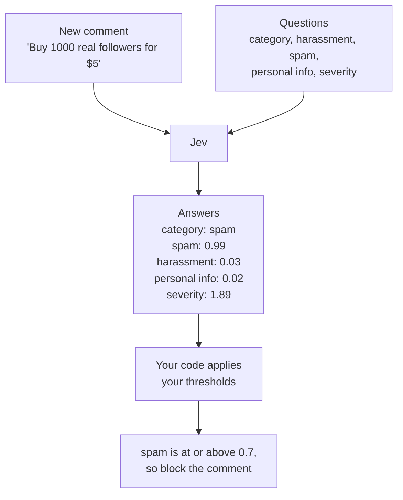

Content moderation is a common challenge when building products that accept user-generated content. You need to evaluate every message against a few key questions: Is it spam? Does it contain abusive language? Does it expose sensitive personal information? Should it be allowed, flagged for review, or blocked? A common approach is to use a large language model (LLM) to assess content and explain its decisions in natural language. LLMs are good at understanding text, but their responses can be inconsistent and difficult to integrate into automated workflows. For pipelines that process large volumes of messages, typed, machine-readable outputs are more reliable for driving moderation decisions.

[Jev](https://typesafe.ai), by TypeSafe AI, is a **System One** decision model. Instead of generating a reply, it answers a set of questions about the input you send it, returning structured answers: a label from a predefined set, a score on a scale you specify, or a probability between 0 and 1. Your application can consume these outputs directly instead of interpreting a natural-language response.

The design separates **judgment from policy**. Jev evaluates a message against the questions you define; your application decides what to do with the results. You might ask Jev to classify a message, check for spam and personal information, and assess its severity. Your code then combines those answers using rules and thresholds you control to determine whether to allow, review, or block the message. When your moderation policy changes, you can adjust those rules without redesigning the entire pipeline.

Because Jev returns scores and probabilities instead of generated text, the cost per message is much lower. In TypeSafe's [benchmark](https://typesafe.ai/blog/introducing-system-one-models-and-jev), Jev runs faster and costs less than frontier chat models on workflow evaluations, which makes it practical to run on every message rather than a sample.

In this guide, you'll build a content moderation pipeline in TypeScript using Jev through the Neon AI Gateway. You'll evaluate a batch of sample messages. Then you'll use Jev's structured outputs and your own rules to decide which messages to allow, flag for review, or block. The pipeline shows how to turn model-based judgments into consistent moderation decisions.

## How Jev answers questions

Use Jev when you need a judgment your code can act on. It doesn't write replies or explain its reasoning, so everything it returns is typed data you can branch on.

Every request has two parts: the **state** Jev should look at and the **questions** you want answered. The state is the context for the questions, and the questions define what you want Jev to judge.

The state can be plain text, a set of named fields, or a list. If your questions need context, use named fields so a question can point to a specific part, like `message.text`.

Each question has an `instructions` string and a type. The type determines the shape of the answer. The three types are:

| Type              | What it asks               | What you get back                                                                          |
| ----------------- | -------------------------- | ------------------------------------------------------------------------------------------ |
| **Choice**        | Pick one option            | The chosen option, a probability for each option, and a confidence value                   |
| **Score**         | Place the state on a scale | The expected level, which can fall between levels, a probability per level, and confidence |
| **Noul** (yes/no) | Is this statement true?    | A probability between 0 and 1                                                              |

Choice picks one label from a list, like `spam`, `abuse`, or `discussion`. You supply the options as a map, and each option gets a short description. Score places the state on an ordered list of levels you supply, and the answer can fall between two of them. Noul is TypeSafe's yes/no type, and it gives the probability that a statement is true.

You can mix all three types in one request. For example, one request can combine a category choice, two probability checks, and a severity score. See [Decisions](/docs/ai-gateway/decisions#question-types) for the full question-type reference, including the optional true and false descriptions you can add to Noul questions and the `legend` a Score answer returns.

The following diagram shows how Jev evaluates a message and returns structured answers. Your code then applies your own thresholds to decide what to do with the message.



## Using the TypeSafe SDK

The examples in this guide call Jev through the [TypeSafe SDK](https://www.npmjs.com/package/@typesafe-ai/sdk). The SDK provides a `TypeSafeClient` class that handles authentication and request formatting. Point it at your branch's gateway with your Neon credential, and set the default model to `typesafeai-jev-1-14-0`:

```ts
import { choice, noul, score, TypeSafeClient } from '@typesafe-ai/sdk';

const client = new TypeSafeClient({
  apiKey: process.env.NEON_AI_GATEWAY_TOKEN!,
  baseURL: `${process.env.NEON_AI_GATEWAY_BASE_URL!}/typesafe`,
  defaultModel: 'typesafeai-jev-1-14-0',
});
```

You'll set both environment variables in [Set up the project](#set-up-the-project).

<Admonition type="note" title="Set the model explicitly">
The TypeSafe SDKs default to `jev-latest`, which is the model ID for TypeSafe's own API. The gateway uses its own model IDs, so set `defaultModel` when you create the client. See [Decisions](/docs/ai-gateway/decisions#setup) for the gateway setup and [the model list](/docs/ai-gateway/decisions#models) for the current IDs.
</Admonition>

The following examples show how to use the three question types. Each example sends a single question to Jev and logs the answer. The state is a message, and the question asks Jev to classify it, check for personal information, or assess its severity.

<Tabs labels={["Choice", "Score", "Noul"]}>

<TabItem>

**Choice** selects one label from a list, so it fits questions whose answer belongs to a known set of options.

```ts
const { answers } = await client.systemOne({
  state: { message: 'Check out my espresso gear shop this week. Use code BREW10 for 20% off.' },
  questions: {
    category: choice('What is the main purpose of `message`?', {
      discussion: 'Ordinary conversation about the topic.',
      promotion: 'Unsolicited advertising or referral links.',
      spam: 'Scams, phishing, or bot-like posts.',
    }),
  },
});

console.log(answers.category.choice); // 'promotion'
console.log(answers.category.confidence); // 1
console.log(answers.category.probabilities); // { discussion: 0, promotion: 1, spam: 0 }
```

The `choice` function takes an `instructions` string and an object whose keys are the options you want Jev to choose from. You'll use the answer's confidence value in [Turn answers into a decision](#turn-answers-into-a-decision).

</TabItem>

<TabItem>

**Score** places the state on a scale you define, and the answer can fall between two levels.

```ts
const { answers } = await client.systemOne({
  state: 'you are genuinely the worst poster here, nobody asked and nobody cares',
  questions: {
    severity: score('If this message needed moderation, how harmful would it be?', [
      'None: normal and harmless.',
      'Mild: rude or off topic, but it does no real harm.',
      'Serious: targeted abuse, a scam, or exposed private data.',
      'Severe: a threat of violence or content that puts someone in danger.',
    ]),
  },
});

console.log(answers.severity.score); // 1.58
console.log(answers.severity.confidence); // 0.58
console.log(answers.severity.probabilities); // { '0': 0, '1': 0.42, '2': 0.58, '3': 0 }
```

The `score` function takes an `instructions` string and an array of levels. Each level description can pair a short label with an explanation, as in the example.

</TabItem>

<TabItem>

**Noul** gives the probability that a statement is true. It suits checks where the probability itself is the signal your code acts on, rather than a label it has to interpret.

```ts
const { answers } = await client.systemOne({
  state: {
    message:
      'heads up, the moderator posted their personal number 555-0142 in the welcome thread',
  },
  questions: {
    personal_info: noul(
      'Does `message` reveal the private information of a real person, such as a phone number, home address, or ID number?',
    ),
  },
});

console.log(answers.personal_info.noul); // 0.7
```

The `noul` function takes an `instructions` string and returns a probability between 0 and 1. A value near 1 means Jev thinks the statement is true; a value near 0 means it thinks the statement is false.

</TabItem>

</Tabs>

The examples use both state forms: a plain string in the Score tab, and an object with named fields in the Choice and Noul tabs.

## Prerequisites

Before you begin, make sure you have the following:

- **Node.js 22 or later:** Download it from [nodejs.org](https://nodejs.org/).
- **A Neon account on the Launch or Scale plan:** Neon AI Gateway is available only on paid plans. Sign up at [console.neon.tech](https://console.neon.tech/signup).
- **Prepaid AI Gateway credits:** Buy credits from the **Billing** page in the Neon Console. One credit is $1 USD, with a $5 minimum purchase. See [AI Gateway prepaid credits](/docs/ai-gateway/prepaid-credits).

<Admonition type="info" title="Region availability">
The AI Gateway is available in AWS US East (Ohio), AWS US East (N. Virginia), AWS Europe (Frankfurt), and AWS Asia Pacific (Singapore). Support is expanding toward [all regions](/docs/introduction/regions). Create your project in one of these regions to follow along.
</Admonition>

<Steps>

## Create a Neon project

You need a Neon project with the AI Gateway enabled. Create one in the Neon Console:

1. In the [Neon Console](https://console.neon.tech), click **New Project**.
2. Enter a **Project name**, such as `jev-moderator`, and choose a **Region** that supports the AI Gateway. See [Region availability](#prerequisites).
3. Under **Services**, make sure **AI gateway** is enabled. See [Create a project](/docs/manage/projects#create-a-project) for details about the services you can enable.
4. Click **Create project**.


## Get your AI Gateway credential

In the Neon Console, open your project, click **Connect** at the top of the sidebar, and open the **AI Gateway** tab. Click **Copy snippet** to copy both environment variables.


## Set up the project

Create a new directory and initialize a Node.js project:

```bash filename="Terminal"
mkdir jev-moderator
cd jev-moderator
npm init -y
npm pkg set type=module
```

Install the [TypeSafe SDK](https://www.npmjs.com/package/@typesafe-ai/sdk) to call Jev:

```bash filename="Terminal"
npm install @typesafe-ai/sdk dotenv
```

Create a `.env` file in the project root with the base URL and token you copied from the AI Gateway tab:

```env filename=".env"
NEON_AI_GATEWAY_TOKEN="nt_live_..."
NEON_AI_GATEWAY_BASE_URL="https://br-example-branch-123456-api.ai.c-6.us-east-2.aws.neon.tech"
```

## Define the messages and context

Create a file named `moderate.ts` and add the following code. It defines a channel and a batch of messages to evaluate. The messages mix ordinary conversation with two scams, two jabs, one phone number, and one off-topic post.

The code has three parts:

- `Message` and `Channel` are TypeScript types that describe the shape of a message and a channel. Later questions refer to fields like `message.text`.
- `CHANNEL` is the context Jev judges the messages against. A message that looks spammy in one channel might be on topic in another, so the channel name and topic give Jev something to compare against.
- `MESSAGES` is the batch to moderate. Each entry has a stable `id`, an `author`, and the `text` Jev evaluates. The batch is deliberately mixed so you can see how one set of questions handles ordinary posts, scams, insults, a leaked phone number, and an off-topic question.

```ts filename="moderate.ts"
import { choice, noul, score, TypeSafeClient } from '@typesafe-ai/sdk';
import 'dotenv/config';

type Message = { id: string; author: string; text: string };
type Channel = { name: string; topic: string };

const CHANNEL: Channel = {
  name: 'home-brewing',
  topic: 'Espresso machines, grinders, and brewing espresso at home',
};

const MESSAGES: Message[] = [
  {
    id: 'm1',
    author: 'maya_k',
    text: 'Has anyone tried the new dual-boiler machine from the gear shop? Wondering if it is worth the upgrade.',
  },
  {
    id: 'm2',
    author: 'dana_s',
    text: 'finally dialed in my grinder, the shots are so much sweeter now',
  },
  {
    id: 'm3',
    author: 'promo_pete',
    text: 'Want more followers? Buy 1000 real followers for $5 at cheapfans dot example, link in bio',
  },
  {
    id: 'm4',
    author: 'grim_gus',
    text: 'you are genuinely the worst poster here, nobody asked and nobody cares',
  },
  {
    id: 'm5',
    author: 'helpful_hana',
    text: 'heads up, the moderator posted their personal number 555-0142 in the welcome thread if you need to reach them',
  },
  {
    id: 'm6',
    author: 'sunny_j',
    text: 'anyone else here into mountain biking? looking for trail recommendations',
  },
  {
    id: 'm7',
    author: 'prize_bot',
    text: 'Congratulations! You have been selected for a $500 gift card. Claim it now at free-prizes dot example',
  },
  {
    id: 'm8',
    author: 'quiet_quinn',
    text: 'whoever wrote this clearly has no idea what they are talking about',
  },
];
```

## Define the questions

To the same file, add the questions you want Jev to answer. The five questions cover the main moderation concerns: category, harassment, spam, personal information, and severity.

`QUESTIONS` is an object, so each answer comes back under a name you choose. Here's what each entry asks for:

- `category` is a **Choice** with five options: `discussion`, `promotion`, `abuse`, `spam`, and `off_topic`. Each option carries a short description that tells Jev what belongs in it.
- `harassment`, `spam`, and `personal_info` are **Noul** questions. Each is phrased as a yes or no statement, so the answer is a probability you can compare against your thresholds.
- `severity` is a **Score** on a four-level scale, from `None` to `Severe`, so the answer is a number between 0 and 3.

```ts filename="moderate.ts"
const QUESTIONS = {
  category: choice(
    'Which category best describes the main purpose of `message.text` in `channel`?',
    {
      discussion:
        "Ordinary conversation, opinions, questions, or useful links about the channel's topic.",
      promotion:
        'Unsolicited advertising, self-promotion, or referral and affiliate links.',
      abuse: 'Insults, harassment, hate speech, or threats aimed at a person or group.',
      spam: 'Scams, phishing, or repetitive low-quality or bot-like posts.',
      off_topic: "Content that is unrelated to the channel's topic.",
    },
  ),
  harassment: noul(
    'Is `message.text` insulting, harassing, or hateful toward a person or group?',
  ),
  spam: noul('Is `message.text` spam, a scam, or unsolicited promotion?'),
  personal_info: noul(
    'Does `message.text` reveal the private information of a real person, such as a phone number, home address, or ID number?',
  ),
  severity: score('If `message.text` needed moderation, how harmful would it be?', [
    'None: normal and harmless.',
    'Mild: rude or off topic, but it does no real harm.',
    'Serious: targeted abuse, a scam, or exposed private data.',
    'Severe: a threat of violence or content that puts someone in danger.',
  ]),
};
```

## Classify messages with Jev

To the same file, add a `classify` function that sends a message and its context to Jev. It builds the state, sends all five questions in one request, and returns the answers as a plain object. The answers include the category choice, the probabilities for harassment, spam, and personal information, and the severity score.

```ts filename="moderate.ts"
const client = new TypeSafeClient({
  apiKey: process.env.NEON_AI_GATEWAY_TOKEN!,
  baseURL: `${process.env.NEON_AI_GATEWAY_BASE_URL!}/typesafe`,
  defaultModel: 'typesafeai-jev-1-14-0',
});

async function classify(message: Message, channel: Channel) {
  const { answers } = await client.systemOne({
    state: {
      channel: { name: channel.name, topic: channel.topic },
      message: { author: message.author, text: message.text },
    },
    questions: QUESTIONS,
  });

  return {
    category: answers.category.choice,
    categoryConfidence: answers.category.confidence,
    harassment: answers.harassment.noul,
    spam: answers.spam.noul,
    personalInfo: answers.personal_info.noul,
    severity: answers.severity.score,
  };
}
```

Each message is a separate state, so each message gets its own request. The five questions about a message share that request instead of making five round trips.

## Turn answers into a decision

`classify` collects Jev's judgments. Your code decides what to do with them. Add a `decide` function that applies your thresholds and returns an action (`allow`, `review`, or `block`) with a short reason.

Confidence tells you how much to trust a Choice or Score answer: it's high when one option is clearly ahead, and it drops when the options are close or the message is too vague to judge. Noul answers carry the same signal in their probability, where a value near 0.5 means Jev is unsure.

Use that to decide when the pipeline can act on its own. Act automatically on a high-confidence answer and send a low-confidence one to a person. Set the cutoffs by asking what a mistake costs: sending a harmless message to review is recoverable, but blocking a legitimate one is not.

```ts filename="moderate.ts"
type Decision = 'allow' | 'review' | 'block';

type Classification = {
  category: string;
  categoryConfidence: number;
  harassment: number;
  spam: number;
  personalInfo: number;
  severity: number;
};

const BLOCK_AT = 0.7; // hazard probability that blocks the message
const REVIEW_AT = 0.4; // hazard probability that sends the message to a person
const BLOCK_SEVERITY = 2; // severity score that blocks the message
const REVIEW_CATEGORIES = ['promotion', 'abuse', 'spam'];

type Hazard = { name: string; probability: number };

function hazardAt(result: Classification, threshold: number): Hazard | undefined {
  const hazards: Hazard[] = [
    { name: 'harassment', probability: result.harassment },
    { name: 'spam', probability: result.spam },
    { name: 'personal_info', probability: result.personalInfo },
  ];
  // Return the first hazard that meets or exceeds the threshold
  return hazards.find((hazard) => hazard.probability >= threshold);
}

function decide(result: Classification): { action: Decision; reason: string } {
  const blocking = hazardAt(result, BLOCK_AT);
  if (blocking) {
    return { action: 'block', reason: `${blocking.name} (${blocking.probability.toFixed(2)})` };
  }

  if (result.severity >= BLOCK_SEVERITY) {
    return { action: 'block', reason: `severity (${result.severity.toFixed(2)})` };
  }

  const uncertain = hazardAt(result, REVIEW_AT);
  if (uncertain) {
    return { action: 'review', reason: `${uncertain.name} (${uncertain.probability.toFixed(2)})` };
  }

  if (REVIEW_CATEGORIES.includes(result.category)) {
    return { action: 'review', reason: result.category };
  }

  if (result.categoryConfidence < 0.5) {
    return {
      action: 'review',
      reason: `low category confidence (${result.categoryConfidence.toFixed(2)})`,
    };
  }

  return { action: 'allow', reason: result.category };
}
```

`hazardAt` checks the three Noul hazards and returns the first one that meets or exceeds the threshold. `decide` applies the rules in order, returning the first match it finds. The rules are:

1. **Block a strong hazard.** Harassment, spam, or personal info at or above `BLOCK_AT`.
2. **Block high severity.** A severity score at or above `BLOCK_SEVERITY`.
3. **Review a weak hazard.** Any hazard at or above `REVIEW_AT`.
4. **Review risky categories.** `promotion`, `abuse`, or `spam`, even with high confidence.
5. **Review an unsure category.** Category confidence below `0.5`.
6. **Allow everything else.**

For example, here is how the rules apply to two messages, using the values from the sample run at the end of this guide:

| Signal                  | `promo_pete`  | `sunny_j`          |
| ----------------------- | ------------- | ------------------ |
| `harassment`            | 0.03          | 0.01               |
| `spam`                  | **0.99**      | 0.04               |
| `personalInfo`          | 0.02          | 0.02               |
| `severity`              | 1.89          | 0.62               |
| `category` (confidence) | `spam` (0.73) | `off_topic` (1.00) |
| Rule that fires         | 1             | none               |
| Decision                | `block`       | `allow`            |

For `promo_pete`, the first `hazardAt` call finds `spam = 0.99` and returns at rule 1, so `decide` never reaches the severity check. The result is `{ action: 'block', reason: 'spam (0.99)' }`.

For `sunny_j`, the highest hazard is `0.04`, `severity` is `0.62`, `off_topic` isn't in `REVIEW_CATEGORIES`, and the category confidence (`1.00`) is above `0.5`. Every rule passes, so `decide` returns `{ action: 'allow', reason: 'off_topic' }`.

A review decision happens when a message has a weak hazard, a risky category, or low confidence. For example, if `harassment` were `0.5`, the first `hazardAt` call would return `undefined`, but the second would return `{ name: 'harassment', probability: 0.5 }`, so rule 3 would fire and the result would be `{ action: 'review', reason: 'harassment (0.50)' }`.

## Run the pipeline

Now classify every message and print the results. Add a `main` function that calls `classify` for each message, applies `decide`, and prints the action, author, text, and reason. It also counts how many messages fall into each action.

```ts filename="moderate.ts"
async function main() {
  const results = await Promise.all(
    MESSAGES.map(async (message) => ({
      message,
      result: await classify(message, CHANNEL),
    })),
  );

  const counts: Record<Decision, number> = { allow: 0, review: 0, block: 0 };

  for (const { message, result } of results) {
    const { action, reason } = decide(result);
    counts[action] += 1;
    console.log(`${action.toUpperCase().padEnd(6)} ${message.author}: ${message.text}`);
    console.log(
      `       category=${result.category} severity=${result.severity.toFixed(2)} -> ${reason}\n`,
    );
  }

  console.log('Summary:', counts);
}

main().catch((err) => {
  console.error(err);
  process.exit(1);
});
```

Run it:

```bash filename="Terminal"
node moderate.ts
```

You'll see output like this. The exact labels, scores, and probabilities may vary slightly each time you run it, but the overall decisions should be consistent.

```text
ALLOW  maya_k: Has anyone tried the new dual-boiler machine from the gear shop? Wondering if it is worth the upgrade.
       category=discussion severity=0.00 -> discussion

ALLOW  dana_s: finally dialed in my grinder, the shots are so much sweeter now
       category=discussion severity=0.00 -> discussion

BLOCK  promo_pete: Want more followers? Buy 1000 real followers for $5 at cheapfans dot example, link in bio
       category=spam severity=1.89 -> spam (0.99)

BLOCK  grim_gus: you are genuinely the worst poster here, nobody asked and nobody cares
       category=abuse severity=1.69 -> harassment (0.97)

BLOCK  helpful_hana: heads up, the moderator posted their personal number 555-0142 in the welcome thread if you need to reach them
       category=off_topic severity=1.97 -> personal_info (0.75)

ALLOW  sunny_j: anyone else here into mountain biking? looking for trail recommendations
       category=off_topic severity=0.62 -> off_topic

BLOCK  prize_bot: Congratulations! You have been selected for a $500 gift card. Claim it now at free-prizes dot example
       category=spam severity=2.00 -> spam (0.99)

BLOCK  quiet_quinn: whoever wrote this clearly has no idea what they are talking about
       category=abuse severity=0.97 -> harassment (0.80)

Summary: { allow: 3, review: 0, block: 5 }
```

The summary shows that three messages were allowed, five were blocked, and none were sent for review. The reasons show which question triggered the action.

</Steps>

## Conclusion

You now have a moderation pipeline that separates content evaluation from policy enforcement. The `classify` function asks Jev five questions about each message. The `decide` function applies your thresholds to decide whether to allow, review, or block each message. The script prints each decision and the reason behind it, so you can see why each message got its outcome.

For a real application, replace the console output with code that takes the appropriate action on each message. You can also extend the pipeline in several ways:

- **Store decisions:** Write each decision and its reason to a Postgres table so you have an audit trail.
- **Use stronger models for review:** Your Neon credentials work across the AI Gateway's model catalog. Messages flagged for review can be sent to a more capable model, such as Claude Opus 5.5 (`claude-opus-5-5`) or GPT-6 Astra (`gpt-6-astra`), for a second assessment before you make the final decision. See [AI Gateway models](/docs/ai-gateway/models).
- **Use hybrid approaches:** Extend the classification step with checks for conditions that deterministic rules can reliably detect, such as malicious links or banned words.

## Resources

- [Jev introduction](https://docs.typesafe.ai/introduction)
- [TypeSafe example use cases](https://docs.typesafe.ai/concepts/use-case-map)
- [Neon AI Gateway](/docs/ai-gateway/overview)
- [AI Gateway model reference](/docs/ai-gateway/models)

<NeedHelp/>
