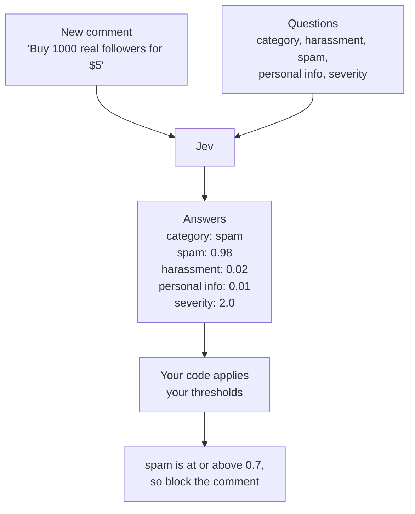

Content moderation is a common challenge when building products that accept user-generated content. Every message needs to be evaluated against a few key questions: Is it spam? Does it contain abusive language? Does it expose sensitive personal information? Should it be allowed, flagged for review, or blocked?

A common approach is to use a large language model (LLM) to assess content and explain its decisions in natural language. While LLMs are good at understanding text, their responses can be inconsistent and difficult to integrate into automated workflows. For moderation pipelines that process large volumes of messages, structured, machine-readable outputs provide a more reliable and practical way to evaluate content and drive moderation decisions.

[Jev](https://typesafe.ai), by TypeSafe AI, is a "System One" model built for this kind of task. You provide text and a set of questions. Jev returns structured answers: a label from a predefined set, a score on a scale you specify, or a probability between 0 and 1. Your application can consume these outputs directly instead of interpreting a natural-language response.

The design separates **judgment from policy**. Jev evaluates a message against the questions you define; your application decides what to do with the results. You might ask Jev to classify a message, check for spam and personal information, and assess its severity. Your code then combines those answers using rules and thresholds you control to determine whether to allow, review, or block the message. When your moderation policy changes, you can adjust those rules without redesigning the entire pipeline.

Because Jev returns a fixed set of answers instead of free text, it also scales differently. TypeSafe's [benchmark](https://typesafe.ai/blog/introducing-system-one-models-and-jev) reports that Jev is far faster and cheaper than frontier models on workflow evaluations. That makes it practical to run on every message rather than a sample of them.

In this guide, you'll build a content moderation pipeline in TypeScript using Jev through the Neon AI Gateway. You'll evaluate a batch of sample messages, then use Jev's structured outputs and your own rules to decide which messages to allow, flag for review, or block. The pipeline is simple, but it demonstrates how to turn model-based judgments into consistent moderation decisions.

## How Jev answers questions

Use Jev when you need a judgment your code can act on. It doesn't write replies or explain its reasoning, so everything it returns is typed data you can branch on.

Every request has two parts: the **state** Jev should look at and the **questions** you want answered. The state is the context for the questions, and the questions define what you want Jev to judge.

The state can be plain text, a set of named fields, or a list. If your questions need context, use named fields so a question can point to a specific part, like `message.text`.

Each question has a type, a prompt, and a set of options or a scale. The type determines the shape of the answer. The three types are:

| Type       | What it asks            | What you get back                                                        |
| ---------- | ----------------------- | ------------------------------------------------------------------------ |
| **Choice** | Pick one option         | The chosen option, a probability for each option, and a confidence value |
| **Score**  | Pick a level on a scale | A score, a probability for each level, and a confidence value            |
| **Noul**   | Is this statement true? | A probability between 0 and 1                                            |

Choice picks one label from a list, like `spam`, `abuse`, or `discussion`. Score places the input on a scale you define, and the answer can fall between two levels. Noul answers a yes or no question with a probability.

You can mix all three types in one request. For example, you might ask Jev to classify a message, check for spam and personal information, and assess its severity.

The following diagram shows how Jev evaluates a message and returns structured answers. Your code then applies your own thresholds to decide what to do with the message.



## Using the TypeSafe SDK

The examples in this guide call Jev through the [TypeSafe SDK](https://www.npmjs.com/package/@typesafe-ai/sdk). The SDK provides a `TypeSafeClient` class that handles authentication and request formatting. Point it at your branch's gateway with your Neon credential, and set the default model to `jev-latest`:

```ts
import { choice, noul, score, TypeSafeClient } from '@typesafe-ai/sdk';

const client = new TypeSafeClient({
  apiKey: process.env.NEON_AI_GATEWAY_TOKEN!,
  baseURL: process.env.NEON_AI_GATEWAY_BASE_URL!,
  defaultModel: 'jev-latest',
});
```

The SDK appends `/v1/systemone` to the base URL, so pass your branch host as-is. You'll add both environment variables in [Set up the project](#set-up-the-project).

The following examples show how to use the three question types. Each example sends a single question to Jev and logs the answer. The state is a message, and the question asks Jev to classify it, check for personal information, or assess its severity.

<Tabs labels={["Choice", "Score", "Noul"]}>

<TabItem>

**Choice** selects one label from a list, so it fits questions whose answer belongs to a known set of options.

```ts
const { answers } = await client.systemOne({
  state: { message: 'Want more followers? Buy 1000 real followers for $5.' },
  questions: {
    category: choice('What is the main purpose of `message`?', {
      discussion: 'Ordinary conversation about the topic.',
      promotion: 'Unsolicited advertising or referral links.',
      spam: 'Scams, phishing, or bot-like posts.',
    }),
  },
});

console.log(answers.category.choice); // 'promotion'
console.log(answers.category.confidence); // 0.66
console.log(answers.category.probabilities); // { discussion: 0, promotion: 0.77, spam: 0.23 }
```

The `choice` function takes a prompt and an object whose keys are the options you want Jev to choose from. The answer includes the chosen option, a probability for each option, and a confidence value between 0 and 1.

</TabItem>

<TabItem>

**Score** places the state on a scale you define, and the answer can fall between two levels.

```ts
const { answers } = await client.systemOne({
  state: 'you are genuinely the worst poster here, nobody asked and nobody cares',
  questions: {
    severity: score('If this message needed moderation, how harmful would it be?', [
      'None: normal and harmless.',
      'Mild: rude or off topic, but it does no real harm.',
      'Serious: targeted abuse, a scam, or exposed private data.',
      'Severe: a threat of violence or content that puts someone in danger.',
    ]),
  },
});

console.log(answers.severity.score); // 1.6
console.log(answers.severity.confidence); // 0.6
console.log(answers.severity.probabilities); // { '0': 0, '1': 0.4, '2': 0.6, '3': 0 }
```

The `score` function takes a prompt and an array of levels. The answer includes the score, a probability for each level, and a confidence value between 0 and 1.

</TabItem>

<TabItem>

**Noul** answers a yes or no question with a probability. It suits checks where the probability itself is the signal your code acts on, rather than a label it has to interpret.

```ts
const { answers } = await client.systemOne({
  state: {
    message:
      'heads up, the moderator posted their personal number 555-0142 in the welcome thread',
  },
  questions: {
    personal_info: noul(
      'Does `message` reveal the private information of a real person, such as a phone number, home address, or ID number?',
    ),
  },
});

console.log(answers.personal_info.noul); // 0.9
```

The `noul` function takes a prompt and returns a probability between 0 and 1. A value near 1 means Jev thinks the statement is true; a value near 0 means it thinks the statement is false.

</TabItem>

</Tabs>

The state can be a plain string, as in the Score tab, or an object with named fields, as in the Choice and Noul tabs. When the state is an object, a question refers to a field through a backticked path such as `message`, which tells Jev which part of the state to judge.

## Prerequisites

Before you begin, make sure you have the following:

- **Node.js 22 or later:** Download it from [nodejs.org](https://nodejs.org/).
- **A paid Neon account:** Sign up at [console.neon.tech](https://console.neon.tech/signup). Neon AI Gateway is available on the Launch and Scale plans and requires [prepaid credits](/docs/ai-gateway/prepaid-credits).

<Admonition type="info" title="Region availability">
The AI Gateway is available in AWS US East (Ohio) (`aws-us-east-2`), AWS US East (N. Virginia) (`aws-us-east-1`), AWS Europe (Frankfurt) (`aws-eu-central-1`), and AWS Asia Pacific (Singapore) (`aws-ap-southeast-1`). Create your project in one of these regions to follow along.
</Admonition>

<Steps>

## Create a Neon project

You need a Neon project with the AI Gateway enabled. Create one in the Neon Console:

1. In the [Neon Console](https://console.neon.tech), click **New Project**.
2. Enter a **Project name**, such as `jev-moderator`, and choose a **Region** that supports the AI Gateway, such as AWS US East (Ohio) (`aws-us-east-2`). See the region note in [Prerequisites](#prerequisites).
3. Under **Services**, make sure **AI gateway** is enabled.
4. Click **Create project**.


## Get your AI Gateway base URL and API key

1. In the Neon Console, open your project and click **Connect** in the sidebar.
2. Switch to the **AI Gateway** tab. Copy the **Base URL** and **Token**. You'll use them in your code to authenticate with the AI Gateway.


## Set up the project

Create a new directory and initialize a Node.js project:

```bash filename="Terminal"
mkdir jev-moderator
cd jev-moderator
npm init -y
npm pkg set type=module
```

Install the [TypeSafe SDK](https://www.npmjs.com/package/@typesafe-ai/sdk) to call Jev:

```bash filename="Terminal"
npm install @typesafe-ai/sdk dotenv
```

Create a `.env` file in the project root with the base URL and token you copied from the AI Gateway tab:

```env filename=".env"
NEON_AI_GATEWAY_TOKEN="nt_live_..."
NEON_AI_GATEWAY_BASE_URL="https://br-example-branch-123456-api.ai.c-6.us-east-2.aws.neon.tech"
```

## Define the messages and context

Create a file named `moderate.ts` and add the following code. It defines a channel and a batch of messages to evaluate. The messages mix ordinary conversation with two scams, two jabs, one phone number, and one off-topic post.

```ts filename="moderate.ts"
import { choice, noul, score, TypeSafeClient } from '@typesafe-ai/sdk';
import 'dotenv/config';

type Message = { id: string; author: string; text: string };
type Channel = { name: string; topic: string };

const CHANNEL: Channel = {
  name: 'home-brewing',
  topic: 'Espresso machines, grinders, and brewing espresso at home',
};

const MESSAGES: Message[] = [
  {
    id: 'm1',
    author: 'maya_k',
    text: 'Has anyone tried the new dual-boiler machine from the gear shop? Wondering if it is worth the upgrade.',
  },
  {
    id: 'm2',
    author: 'dana_s',
    text: 'finally dialed in my grinder, the shots are so much sweeter now',
  },
  {
    id: 'm3',
    author: 'promo_pete',
    text: 'Want more followers? Buy 1000 real followers for $5 at cheapfans dot example, link in bio',
  },
  {
    id: 'm4',
    author: 'grim_gus',
    text: 'you are genuinely the worst poster here, nobody asked and nobody cares',
  },
  {
    id: 'm5',
    author: 'helpful_hana',
    text: 'heads up, the moderator posted their personal number 555-0142 in the welcome thread if you need to reach them',
  },
  {
    id: 'm6',
    author: 'sunny_j',
    text: 'anyone else here into mountain biking? looking for trail recommendations',
  },
  {
    id: 'm7',
    author: 'prize_bot',
    text: 'Congratulations! You have been selected for a $500 gift card. Claim it now at free-prizes dot example',
  },
  {
    id: 'm8',
    author: 'quiet_quinn',
    text: 'whoever wrote this clearly has no idea what they are talking about',
  },
];
```

The batch mixes ordinary conversation with two scams, two jabs, one phone number, and one off-topic post. You'll see how a single set of questions handles all of them.

## Define the questions

To the same file, add the questions you want Jev to answer. Each question has a type, a prompt, and a set of options or a scale. The five questions cover the main moderation concerns: category, harassment, spam, personal information, and severity.

```ts filename="moderate.ts"
const QUESTIONS = {
  category: choice(
    'Which category best describes the main purpose of `message.text` in `channel`?',
    {
      discussion:
        "Ordinary conversation, opinions, questions, or useful links about the channel's topic.",
      promotion:
        'Unsolicited advertising, self-promotion, or referral and affiliate links.',
      abuse: 'Insults, harassment, hate speech, or threats aimed at a person or group.',
      spam: 'Scams, phishing, or repetitive low-quality or bot-like posts.',
      off_topic: "Content that is unrelated to the channel's topic.",
    },
  ),
  harassment: noul(
    'Is `message.text` insulting, harassing, or hateful toward a person or group?',
  ),
  spam: noul('Is `message.text` spam, a scam, or unsolicited promotion?'),
  personal_info: noul(
    'Does `message.text` reveal the private information of a real person, such as a phone number, home address, or ID number?',
  ),
  severity: score('If `message.text` needed moderation, how harmful would it be?', [
    'None: normal and harmless.',
    'Mild: rude or off topic, but it does no real harm.',
    'Serious: targeted abuse, a scam, or exposed private data.',
    'Severe: a threat of violence or content that puts someone in danger.',
  ]),
};
```

## Classify messages with Jev

To the same file, add a `classify` function that sends a message and its context to Jev. It builds the state, sends all five questions in one request, and returns the answers and the model name as a plain object.

```ts filename="moderate.ts"
const client = new TypeSafeClient({
  apiKey: process.env.NEON_AI_GATEWAY_TOKEN!,
  baseURL: process.env.NEON_AI_GATEWAY_BASE_URL!,
  defaultModel: 'jev-latest',
});

async function classify(message: Message, channel: Channel) {
  const { answers, model } = await client.systemOne({
    state: {
      channel: { name: channel.name, topic: channel.topic },
      message: { author: message.author, text: message.text },
    },
    questions: QUESTIONS,
  });

  return {
    category: answers.category.choice,
    categoryConfidence: answers.category.confidence,
    harassment: answers.harassment.noul,
    spam: answers.spam.noul,
    personalInfo: answers.personal_info.noul,
    severity: answers.severity.score,
    model,
  };
}
```

Each message gets its own request because each message is its own state. The five questions about a single message share one request, so they run in parallel.

## Turn answers into a decision

`classify` only gathers judgments. Your code decides what to do with them. Add a `decide` function that applies your own thresholds to the answers and returns an action and a reason.

Confidence is a separate signal from the probabilities. Choice and Score answers include a confidence value between 0 and 1. When one option is clearly ahead, confidence is high. When the options are close, or the state didn't give Jev enough to go on, confidence drops. Noul doesn't return a separate confidence value, because its probability already tells you how sure Jev is. A value near 0.5 means Jev is unsure.

Use confidence to decide when the pipeline can act on its own. A high-confidence answer can be applied automatically, while a low-confidence one should go to a person. Set the cutoffs according to what a mistake costs. Sending a harmless message to review is recoverable. Blocking a legitimate one is not.

```ts filename="moderate.ts"
type Decision = 'allow' | 'review' | 'block';

const ACTION_AT = 0.7; // a hazard at or above this blocks the message
const REVIEW_AT = 0.4; // a hazard at or above this sends it to a human
const SEVERITY_BLOCK = 2; // a severity score at or above this blocks

function decide(result: Awaited<ReturnType<typeof classify>>): {
  action: Decision;
  reason: string;
} {
  const hazards: [string, number][] = [
    ['harassment', result.harassment],
    ['spam', result.spam],
    ['personal_info', result.personalInfo],
  ];

  const blocking = hazards.find(([, probability]) => probability >= ACTION_AT);
  if (blocking) {
    return { action: 'block', reason: `${blocking[0]} (${blocking[1].toFixed(2)})` };
  }
  if (result.severity >= SEVERITY_BLOCK) {
    return { action: 'block', reason: `severity (${result.severity.toFixed(2)})` };
  }

  const uncertain = hazards.find(([, probability]) => probability >= REVIEW_AT);
  if (uncertain) {
    return { action: 'review', reason: `${uncertain[0]} (${uncertain[1].toFixed(2)})` };
  }
  if (
    result.category === 'promotion' ||
    result.category === 'abuse' ||
    result.category === 'spam'
  ) {
    return { action: 'review', reason: result.category };
  }
  if (result.categoryConfidence < 0.5) {
    return {
      action: 'review',
      reason: `low category confidence (${result.categoryConfidence.toFixed(2)})`,
    };
  }
  return { action: 'allow', reason: result.category };
}
```

The hazard questions catch the obvious cases, and the severity score catches the ones that need a stronger response than a single probability suggests. The category label and its confidence handle the rest. Promotion, abuse, and spam go to a human even when the probabilities stay low. A close category call also goes to a human before your code acts on it.

## Run the pipeline

Now classify every message and print the results. Add a `main` function that calls `classify` for each message, applies `decide`, and prints the action, author, text, and reason. It also counts how many messages fall into each action.

```ts filename="moderate.ts"
async function main() {
  const results = await Promise.all(
    MESSAGES.map(async (message) => ({
      message,
      result: await classify(message, CHANNEL),
    })),
  );

  const counts: Record<Decision, number> = { allow: 0, review: 0, block: 0 };

  for (const { message, result } of results) {
    const { action, reason } = decide(result);
    counts[action] += 1;
    console.log(`${action.toUpperCase().padEnd(6)} ${message.author}: ${message.text}`);
    console.log(
      `       category=${result.category} severity=${result.severity.toFixed(2)} -> ${reason}\n`,
    );
  }

  console.log('Summary:', counts);
}

main().catch((err) => {
  console.error(err);
  process.exit(1);
});
```

Run it:

```bash filename="Terminal"
node moderate.ts
```

You'll see output like this:

```text
ALLOW  maya_k: Has anyone tried the new dual-boiler machine from the gear shop? Wondering if it is worth the upgrade.
       category=discussion severity=0.00 -> discussion

ALLOW  dana_s: finally dialed in my grinder, the shots are so much sweeter now
       category=discussion severity=0.00 -> discussion

BLOCK  promo_pete: Want more followers? Buy 1000 real followers for $5 at cheapfans dot example, link in bio
       category=spam severity=1.92 -> spam (0.99)

BLOCK  grim_gus: you are genuinely the worst poster here, nobody asked and nobody cares
       category=abuse severity=1.72 -> harassment (0.97)

BLOCK  helpful_hana: heads up, the moderator posted their personal number 555-0142 in the welcome thread if you need to reach them
       category=off_topic severity=1.97 -> personal_info (0.78)

ALLOW  sunny_j: anyone else here into mountain biking? looking for trail recommendations
       category=off_topic severity=0.64 -> off_topic

BLOCK  prize_bot: Congratulations! You have been selected for a $500 gift card. Claim it now at free-prizes dot example
       category=spam severity=2.00 -> spam (0.99)

BLOCK  quiet_quinn: whoever wrote this clearly has no idea what they are talking about
       category=abuse severity=0.96 -> harassment (0.79)

Summary: { allow: 3, review: 0, block: 5 }
```

The summary shows that three messages were allowed, five were blocked, and none were sent for review. The reasons show which question triggered the action.

</Steps>

## Conclusion

You now have a moderation pipeline that separates content evaluation from policy enforcement. The `classify` function asks Jev five questions about each message, while `decide` applies your thresholds to determine whether to allow the message, flag it for review, or block it. The script prints each decision along with the question that drove it, making the reasoning behind every outcome easy to inspect.

For a real application, you would replace the console output with code that takes the appropriate action on each message. You can also extend the pipeline in several ways:

- **Use stronger models for review:** Your Neon credentials work across the AI Gateway's model catalog. Messages flagged for review can be sent to a more capable model, such as Claude Opus 5.5 (`claude-opus-5-5`) or GPT-6 Astra (`gpt-6-astra`), for a second assessment before you make the final decision. See [AI Gateway models](/docs/ai-gateway/overview#available-models).
- **Add more questions:** Extend the classification step with questions that reflect your moderation policy. You can also skip questions that don't affect your decisions, such as whether a message links to a known malicious domain or is written in one of your community's supported languages.

## Resources

- [Jev introduction](https://docs.typesafe.ai/introduction)
- [TypeSafe Example use cases](https://docs.typesafe.ai/concepts/use-case-map)
- [Neon AI Gateway](/docs/ai-gateway/overview)

<NeedHelp/>
