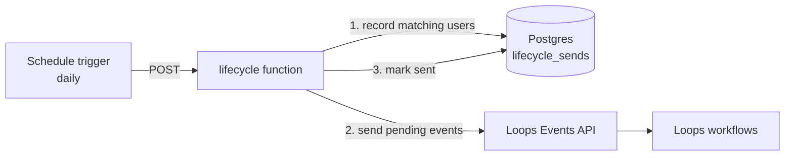

Some emails depend on what's in your database rather than on a user action: a nudge to a user who hasn't been active for a week, or a heads-up to an account that has used most of its plan. [Loops](https://loops.so) sends those emails from [workflows](https://loops.so/docs/workflows) that start when an [event](https://loops.so/docs/events) arrives. Your app still has to notice the condition and send the event.

In this guide, you'll build a [Neon Function](/docs/compute/functions/overview) that a [scheduled Function Trigger](/docs/compute/functions/triggers/schedule) runs every day. It queries Postgres for users who match each condition and sends one Loops event per user. A table in Postgres records every send, so a user gets each email once, even when the trigger retries or the same user matches again the next day.



## Prerequisites

- Node.js 22 or later
- A Neon project and the [Neon CLI](/docs/cli/install), with your directory [linked](/docs/cli/link) to the project
- A [Loops](https://loops.so) account with a verified [sending domain](https://loops.so/docs/sending-domain) and [an API key](https://app.loops.so/settings?page=api)

## Why record sends in Postgres

The Loops [Events API](https://loops.so/docs/api-reference/send-event) accepts an `Idempotency-Key` header and rejects a repeated key with a `409` for 24 hours. That alone isn't enough here, for two reasons:

- **Triggers retry for longer:** Neon [retries a failed trigger delivery](/docs/compute/functions/triggers/overview#delivery-and-retries) for up to 72 hours.
- **The same user matches every day:** A user who has been inactive for many days might still be inactive on the next day. Without a record, the daily run would send the event again each day.

The function inserts a row into `lifecycle_sends` before it sends anything. A unique constraint on the user, event, and `period` decides whether a send is new. After Loops accepts the event, the function marks the row sent.

The idempotency key is built from the user, the event, and the `period`. Loops marks a key as used even when the request fails, so the key also includes an `attempts` counter that goes up after each failed send. A retry after a failure uses a new key. The function reuses a key only if it stopped after Loops accepted the event but before it saved `sent_at`. In that case a `409` from Loops means the event was already sent.

<Steps>

## Create the tables

This guide uses an `app_users` table with the activity and usage data your app already tracks. If you use [Managed Better Auth](/docs/auth/overview), use its user ID as `id`, so events reach the same Loops contact that [the `loops-email` template](/docs/guides/loops#sync-users-to-loops) creates on sign-up.

Run this in the [Neon SQL Editor](/docs/get-started/query-with-neon-sql-editor) or with [`neon psql`](/docs/cli/psql):

```sql
CREATE TABLE app_users (
  id             text PRIMARY KEY,
  email          text NOT NULL,
  last_active_at timestamptz NOT NULL DEFAULT now(),
  usage          integer NOT NULL DEFAULT 0,
  plan_limit     integer NOT NULL DEFAULT 1000
);

CREATE TABLE lifecycle_sends (
  id               bigint GENERATED ALWAYS AS IDENTITY PRIMARY KEY,
  user_id          text NOT NULL,
  email            text NOT NULL,
  event_name       text NOT NULL,
  period           text NOT NULL,
  event_properties jsonb NOT NULL DEFAULT '{}',
  attempts         integer NOT NULL DEFAULT 0,
  created_at       timestamptz NOT NULL DEFAULT now(),
  sent_at          timestamptz,
  UNIQUE (user_id, event_name, period)
);
```

Add a few users to test with:

```sql
INSERT INTO app_users (id, email, last_active_at, usage, plan_limit) VALUES
  ('user-1', 'zhang.kai@example.com', now() - interval '9 days', 100, 1000),
  ('user-2', 'alex.lopez@example.com', now() - interval '1 day', 850, 1000),
  ('user-3', 'dana.smith@example.com', now() - interval '45 days', 10, 1000);
```

Your app keeps `last_active_at` and `usage` current, for example by updating `last_active_at` when a user signs in or makes a request.

## Write the function

Install the dependencies:

```bash
npm install loops pg @neon/functions @neon/config
npm install -D @types/pg
```

Create `functions/lifecycle.ts`:

```ts filename="functions/lifecycle.ts" collapse={1-3, 27-35} shouldWrap
import { attachDatabasePool } from '@neon/functions';
import { APIError, LoopsClient } from 'loops';
import { Pool } from 'pg';

const pool = new Pool({ connectionString: process.env.DATABASE_URL, max: 5 });
attachDatabasePool(pool);
const loops = new LoopsClient(process.env.LOOPS_API_KEY!);

// Each signal adds a row per user who should get the event. `period` is what makes a
// send unique: one inactivity email per stretch of inactivity, one limit email per month.
const SIGNALS = [
  `INSERT INTO lifecycle_sends (user_id, email, event_name, period, event_properties)
   SELECT id, email, 'inactive7Days', last_active_at::date::text,
          jsonb_build_object('daysInactive', extract(day FROM now() - last_active_at)::int)
   FROM app_users
   WHERE last_active_at < now() - interval '7 days'
     AND last_active_at > now() - interval '30 days'
   ON CONFLICT (user_id, event_name, period) DO NOTHING`,
  `INSERT INTO lifecycle_sends (user_id, email, event_name, period, event_properties)
   SELECT id, email, 'nearPlanLimit', to_char(now(), 'YYYY-MM'),
          jsonb_build_object('usagePercent', floor(100.0 * usage / plan_limit)::int)
   FROM app_users
   WHERE usage >= 0.8 * plan_limit
   ON CONFLICT (user_id, event_name, period) DO NOTHING`,
];

type PendingSend = {
  id: string;
  attempts: number;
  user_id: string;
  email: string;
  event_name: string;
  period: string;
  event_properties: Record<string, string | number | boolean>;
};

export default {
  async fetch(request: Request): Promise<Response> {
    // Neon strips client-set X-Neon-* headers, so this header means the call came from a trigger.
    if (!request.headers.get('x-neon-trigger-invocation-id')) {
      return Response.json({ error: 'not a trigger call' }, { status: 401 });
    }

    for (const sql of SIGNALS) await pool.query(sql);

    // Send everything not sent yet, including rows left over from a failed run.
    // A row that failed 5 times is skipped, so one bad row can't fail every run.
    const { rows } = await pool.query<PendingSend>(
      `SELECT id, attempts, user_id, email, event_name, period, event_properties
       FROM lifecycle_sends
       WHERE sent_at IS NULL AND attempts < 5
       ORDER BY id
       LIMIT 500`
    );

    let sent = 0;
    let failed = 0;
    for (const row of rows) {
      try {
        await loops.sendEvent({
          email: row.email,
          userId: row.user_id,
          eventName: row.event_name,
          eventProperties: row.event_properties,
          // The key names one send: the user, the event, and the period. Loops marks a key
          // as used even when the request fails, so attempts changes it after every failed
          // attempt. It repeats only if the function stopped after Loops accepted the event
          // and before sent_at was saved.
          headers: {
            'Idempotency-Key': `lifecycle-${row.user_id}-${row.event_name}-${row.period}-${row.attempts}`,
          },
        });
      } catch (error) {
        // 409: this exact key was accepted on an earlier run, so the event was sent.
        if (!(error instanceof APIError && error.statusCode === 409)) {
          console.error(`lifecycle send ${row.id} failed:`, (error as Error).message);
          await pool.query('UPDATE lifecycle_sends SET attempts = attempts + 1 WHERE id = $1', [row.id]);
          failed++;
          continue;
        }
      }
      await pool.query('UPDATE lifecycle_sends SET sent_at = now() WHERE id = $1', [row.id]);
      sent++;
    }

    console.log(`lifecycle: ${sent} sent, ${failed} failed`);
    if (failed > 0) {
      // Ask Neon to retry the invocation in 5 minutes. The retry only sends the rows still pending.
      return Response.json({ sent, failed }, { status: 503, headers: { 'Retry-After': '300' } });
    }
    return Response.json({ sent, failed });
  },
};
```

How the function works:

- **Signals:** Each query in `SIGNALS` is one condition. The inactivity signal uses the date of `last_active_at` as its `period`, so a user who comes back and goes quiet again gets a new email. Users inactive for more than 30 days are left out, so the first run doesn't email every dormant account. The plan limit signal uses the month, so an account gets one warning per month.
- **Pending rows:** The function sends every row without a `sent_at`, not only the ones added in this run. A row that failed yesterday is retried today, with a new idempotency key.
- **Failed rows:** After 5 failed attempts, the function stops sending a row. Loops rejects some sends every time, for example one with a property value that doesn't match the property's type, and without the limit every run would fail and retry. To find those rows, run `SELECT * FROM lifecycle_sends WHERE sent_at IS NULL AND attempts >= 5`.
- **Retries:** If any send fails, the function returns `503` with `Retry-After: 300`, and Neon [retries the invocation](/docs/compute/functions/triggers/overview#request-a-later-retry) in about 5 minutes. Rows already marked sent aren't sent again.
- **Trigger check:** Function URLs are public. The `X-Neon-Trigger-Invocation-Id` header can only come from Neon, so the function rejects calls without it.

Neon injects `DATABASE_URL`, and the module-scope `pg` pool follows the recommendation to [use a connection pool](/docs/compute/functions/get-started#connect-to-postgres). Loops allows 10 requests per second per team, so the function sends one event at a time. A `429` leaves the row pending for the retry. Each run sends up to 500 rows, and the rest go out on the next run.

## Declare the function and the trigger

Add the function and a daily schedule to [`neon.ts`](/docs/reference/neon-ts). The cron is in UTC. This one runs at 15:00 UTC:

```ts filename="neon.ts"
import { defineConfig } from '@neon/config/v1';

export default defineConfig({
  functions: {
    lifecycle: {
      name: 'Lifecycle emails',
      source: './functions/lifecycle.ts',
      env: {
        LOOPS_API_KEY: { value: process.env.LOOPS_API_KEY, required: true },
      },
    },
  },
  triggers: {
    'lifecycle-daily': {
      type: 'schedule',
      function: 'lifecycle',
      cron: '0 15 * * *',
    },
  },
});
```

Add your Loops API key to `.env.local`:

```bash filename=".env.local"
LOOPS_API_KEY=your-loops-api-key
```

## Create the workflows in Loops

In Loops, create a [workflow](https://loops.so/docs/workflows) for each event, with the **Event received** trigger:

- `inactive7Days`, with an email that brings the user back. The `daysInactive` event property is available in the email.
- `nearPlanLimit`, with an email about the account's usage and plan options. The `usagePercent` event property is available in the email.

Each event starts the workflow for the contact with the row's email or `userId`. If no contact matches, Loops creates one.


Loops creates an event the first time it receives one with a new name. To pick the event in a workflow trigger before the first run, create it on the Loops [Events](https://app.loops.so/settings?page=events) page. Add its [event properties](https://loops.so/docs/events/properties) there too, so you can use them in your emails: `daysInactive` and `usagePercent`, both numbers.


Set each workflow's [trigger frequency](https://loops.so/docs/workflows/triggers#trigger-frequency) to **Every time**. A new workflow starts with **One time**, which runs it only once per contact, so a user who goes inactive a second time, or nears the plan limit again next month, wouldn't get the email. `lifecycle_sends` already decides how often a user gets each event.


## Test the function locally

Run the function with [`neon dev`](/docs/cli/dev), which injects `DATABASE_URL` from your linked branch:

```bash
neon dev
```

Call it with the trigger header, the way a scheduled run does:

```bash
curl -s -X POST http://localhost:8787/ \
  -H 'content-type: application/json' \
  -H 'x-neon-trigger-invocation-id: local-test' \
  -d '{}'
```

```json
{ "sent": 2, "failed": 0 }
```

With the test data, `user-1` gets `inactive7Days` and `user-2` gets `nearPlanLimit`. `user-3` has been inactive for more than 30 days, so it's skipped. Run the command again, and it returns `{ "sent": 0, "failed": 0 }`, because both rows are already marked sent:

```sql
SELECT user_id, event_name, period, sent_at FROM lifecycle_sends ORDER BY id;
```

The events appear in the **Event log** on the Loops [Events](https://app.loops.so/settings?page=events) page. Without the header, the function returns `401`.


## Deploy

```bash
neon deploy --env .env.local
```

`neon deploy` deploys the function and creates the `lifecycle-daily` trigger. To see a run without waiting for 15:00 UTC, set `cron` to `* * * * *`, deploy, and check the logs:

```bash
neon logs query --source function --service-name neon-function/lifecycle --since 1h
```

Each run logs `lifecycle: <n> sent, <n> failed`. Set `cron` back to your daily schedule and deploy again. See [Schedule a function](/docs/compute/functions/triggers/schedule) for the cron reference and the other ways to manage triggers.

</Steps>

## Test changes on a branch

Triggers follow [branch inheritance](/docs/compute/functions/triggers/overview#triggers-and-branching). A branch created from production inherits `lifecycle-daily`, but the trigger is disabled there until you enable it, so a test branch never emails your users on its own. To try a new signal:

<Steps>

Create a branch and switch to it. The CLI pulls the branch's `DATABASE_URL` into your local env file:

```bash
neon branches create --name preview/lifecycle
neon checkout preview/lifecycle
```

---

In `.env.local`, set `LOOPS_API_KEY` to a key from a separate Loops team, so test events don't reach your production workflows.

---

Edit `SIGNALS`, then run the function with `neon dev` and call it as in [Test the function locally](#test-the-function-locally). It reads and writes the branch's copy of your data.

---

Deploy to the branch:

```bash
neon deploy --env .env.local
```

The deploy updates the branch's function and leaves the inherited trigger disabled. This needs Neon CLI 9.3.2 or later and `@neon/config` 1.14.0 or later. Earlier versions turn the inherited trigger on when you deploy, so the branch starts sending on its own schedule.

---

When you're done, switch back to your production branch and delete the test branch. If your production branch has another name, such as `main` (the CLI and API default), use it in place of `production`:

```bash
neon checkout production
neon branches delete preview/lifecycle
```

`neon checkout` pulls the production `DATABASE_URL` back into `.env.local`, but it keeps your other variables. Set `LOOPS_API_KEY` back to your production key before you deploy to production again, so production events don't go to the test team.

</Steps>

## Add your own signals

Add an entry to `SIGNALS` for each condition you want to email about. Each query inserts into `lifecycle_sends` with a new event name and a `period` that says how often a user can get it. For example, to email accounts whose trial ends in three days, once per trial:

```sql
INSERT INTO lifecycle_sends (user_id, email, event_name, period, event_properties)
SELECT id, email, 'trialEndingSoon', trial_ends_at::date::text,
       jsonb_build_object('trialEndsAt', trial_ends_at::date::text)
FROM app_users
WHERE trial_ends_at BETWEEN now() AND now() + interval '3 days'
ON CONFLICT (user_id, event_name, period) DO NOTHING
```

This example needs a `trial_ends_at` column on `app_users`. On the Loops Events page, create `trialEndingSoon` with `trialEndsAt` as a Date property. Loops accepts a `YYYY-MM-DD` string as a date.

<NeedHelp/>
