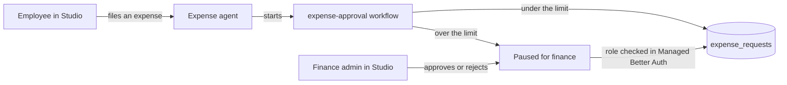

It's easy to build an approve button that only checks whether someone is signed in. But signing in only proves who someone is. It doesn't check whether their role, such as finance admin or employee, allows them to approve an expense. This gap, called broken access control, is the [top risk in the OWASP Top 10:2025](https://top10.owasp.org/2025/A01_2025-Broken_Access_Control/). When your whole organization uses an expense agent, that gap lets any employee approve their own expenses, or anyone else's.

In this guide, you host [Mastra](https://mastra.ai) as an internal tool for your team. People sign in to its Studio and API with [Managed Better Auth](/docs/auth/overview) through [`@mastra/auth-neon`](https://mastra.ai/integrations/auth/neon). Their role in your organization (owner, admin, or member) decides what they can do. A Mastra workflow pauses every expense over the limit, and only an owner or admin can approve it.

You'll:

- Set up Managed Better Auth with a team of three people
- Sign in to Mastra with Managed Better Auth and give each role its permissions
- See how the workflow checks who's allowed to approve
- File and approve an expense in Mastra Studio
- Test a policy change on a Neon branch



## Agent prompt

You can use the following prompt to have a coding agent clone and set up this project. Pick an agent to open it with the prompt filled in, or expand the prompt to copy it.

<TechCards>
<a href="https://claude.ai/new?q=Clone%20https%3A%2F%2Fgithub.com%2Frishi-raj-jain%2Fmastra-neon-expense-approvals%2C%20install%20its%20dependencies%2C%20and%20set%20it%20up%20on%20a%20new%20Neon%20project%3A%0A%0A-%20Create%20the%20project%20with%20neon%20projects%20create%20--name%20mastra-expense-approvals%20--set-context%2C%20enable%20Managed%20Better%20Auth%20with%20neon%20neon-auth%20enable%2C%20and%20turn%20on%20the%20organization%20plugin%20with%20neon%20neon-auth%20config%20organization%20update%20--enabled%20--creator-role%20owner.%0A-%20Pull%20DATABASE_URL%20and%20NEON_AUTH_BASE_URL%20with%20neon%20env%20pull%20--service%20postgres%20--service%20auth%20--file%20.env.%20Ask%20me%20for%20a%20Mastra%20Gateway%20API%20key%20and%20add%20it%20to%20.env%20as%20MASTRA_GATEWAY_API_KEY.%0A-%20Create%20the%20tables%20with%20neon%20psql%20--%20-f%20db%2Fschema.sql%2C%20then%20run%20npm%20run%20-s%20seed%20%3E%3E%20.env%20to%20add%20the%20Acme%20team%20and%20NEON_AUTH_ORGANIZATION_ID.%0A-%20Start%20Mastra%20Studio%20with%20npm%20run%20dev%2C%20and%20tell%20me%20I%20can%20sign%20in%20as%20alex%40example.com%20%28member%29%2C%20zhang%40example.com%20%28admin%29%2C%20or%20dana%40example.com%20%28owner%29%2C%20all%20with%20the%20password%20AbC123dEf.%0A%0AThen%20read%20src%2Fmastra%2Fauth.ts%20and%20src%2Fmastra%2Fworkflows%2Fexpense-approval.ts%2C%20and%20explain%20how%20Managed%20Better%20Auth%20organization%20roles%20decide%20who%20can%20approve%20an%20expense.%0A%0AThe%20%40mastra%2Fauth-neon%20docs%20are%20at%20https%3A%2F%2Fmastra.ai%2Fintegrations%2Fauth%2Fneon%20and%20the%20Managed%20Better%20Auth%20docs%20are%20at%20https%3A%2F%2Fneon.com%2Fdocs%2Fauth%2Foverview." title="Claude" description="Open the prompt in Claude" icon="claude">Claude</a>
<a href="https://chatgpt.com/?q=Clone%20https%3A%2F%2Fgithub.com%2Frishi-raj-jain%2Fmastra-neon-expense-approvals%2C%20install%20its%20dependencies%2C%20and%20set%20it%20up%20on%20a%20new%20Neon%20project%3A%0A%0A-%20Create%20the%20project%20with%20neon%20projects%20create%20--name%20mastra-expense-approvals%20--set-context%2C%20enable%20Managed%20Better%20Auth%20with%20neon%20neon-auth%20enable%2C%20and%20turn%20on%20the%20organization%20plugin%20with%20neon%20neon-auth%20config%20organization%20update%20--enabled%20--creator-role%20owner.%0A-%20Pull%20DATABASE_URL%20and%20NEON_AUTH_BASE_URL%20with%20neon%20env%20pull%20--service%20postgres%20--service%20auth%20--file%20.env.%20Ask%20me%20for%20a%20Mastra%20Gateway%20API%20key%20and%20add%20it%20to%20.env%20as%20MASTRA_GATEWAY_API_KEY.%0A-%20Create%20the%20tables%20with%20neon%20psql%20--%20-f%20db%2Fschema.sql%2C%20then%20run%20npm%20run%20-s%20seed%20%3E%3E%20.env%20to%20add%20the%20Acme%20team%20and%20NEON_AUTH_ORGANIZATION_ID.%0A-%20Start%20Mastra%20Studio%20with%20npm%20run%20dev%2C%20and%20tell%20me%20I%20can%20sign%20in%20as%20alex%40example.com%20%28member%29%2C%20zhang%40example.com%20%28admin%29%2C%20or%20dana%40example.com%20%28owner%29%2C%20all%20with%20the%20password%20AbC123dEf.%0A%0AThen%20read%20src%2Fmastra%2Fauth.ts%20and%20src%2Fmastra%2Fworkflows%2Fexpense-approval.ts%2C%20and%20explain%20how%20Managed%20Better%20Auth%20organization%20roles%20decide%20who%20can%20approve%20an%20expense.%0A%0AThe%20%40mastra%2Fauth-neon%20docs%20are%20at%20https%3A%2F%2Fmastra.ai%2Fintegrations%2Fauth%2Fneon%20and%20the%20Managed%20Better%20Auth%20docs%20are%20at%20https%3A%2F%2Fneon.com%2Fdocs%2Fauth%2Foverview." title="ChatGPT" description="Open the prompt in ChatGPT" icon="chatgpt">ChatGPT</a>
<a href="https://cursor.com/link/prompt?text=Clone%20https%3A%2F%2Fgithub.com%2Frishi-raj-jain%2Fmastra-neon-expense-approvals%2C%20install%20its%20dependencies%2C%20and%20set%20it%20up%20on%20a%20new%20Neon%20project%3A%0A%0A-%20Create%20the%20project%20with%20neon%20projects%20create%20--name%20mastra-expense-approvals%20--set-context%2C%20enable%20Managed%20Better%20Auth%20with%20neon%20neon-auth%20enable%2C%20and%20turn%20on%20the%20organization%20plugin%20with%20neon%20neon-auth%20config%20organization%20update%20--enabled%20--creator-role%20owner.%0A-%20Pull%20DATABASE_URL%20and%20NEON_AUTH_BASE_URL%20with%20neon%20env%20pull%20--service%20postgres%20--service%20auth%20--file%20.env.%20Ask%20me%20for%20a%20Mastra%20Gateway%20API%20key%20and%20add%20it%20to%20.env%20as%20MASTRA_GATEWAY_API_KEY.%0A-%20Create%20the%20tables%20with%20neon%20psql%20--%20-f%20db%2Fschema.sql%2C%20then%20run%20npm%20run%20-s%20seed%20%3E%3E%20.env%20to%20add%20the%20Acme%20team%20and%20NEON_AUTH_ORGANIZATION_ID.%0A-%20Start%20Mastra%20Studio%20with%20npm%20run%20dev%2C%20and%20tell%20me%20I%20can%20sign%20in%20as%20alex%40example.com%20%28member%29%2C%20zhang%40example.com%20%28admin%29%2C%20or%20dana%40example.com%20%28owner%29%2C%20all%20with%20the%20password%20AbC123dEf.%0A%0AThen%20read%20src%2Fmastra%2Fauth.ts%20and%20src%2Fmastra%2Fworkflows%2Fexpense-approval.ts%2C%20and%20explain%20how%20Managed%20Better%20Auth%20organization%20roles%20decide%20who%20can%20approve%20an%20expense.%0A%0AThe%20%40mastra%2Fauth-neon%20docs%20are%20at%20https%3A%2F%2Fmastra.ai%2Fintegrations%2Fauth%2Fneon%20and%20the%20Managed%20Better%20Auth%20docs%20are%20at%20https%3A%2F%2Fneon.com%2Fdocs%2Fauth%2Foverview." title="Cursor" description="Open the prompt in Cursor" icon="cursor">Cursor</a>
</TechCards>

<details>
<summary>**Show the agent prompt**</summary>

```bash shouldWrap
Clone https://github.com/rishi-raj-jain/mastra-neon-expense-approvals, install its dependencies, and set it up on a new Neon project:

- Create the project with neon projects create --name mastra-expense-approvals --set-context, enable Managed Better Auth with neon neon-auth enable, and turn on the organization plugin with neon neon-auth config organization update --enabled --creator-role owner.
- Pull DATABASE_URL and NEON_AUTH_BASE_URL with neon env pull --service postgres --service auth --file .env. Ask me for a Mastra Gateway API key and add it to .env as MASTRA_GATEWAY_API_KEY.
- Create the tables with neon psql -- -f db/schema.sql, then run npm run -s seed >> .env to add the Acme team and NEON_AUTH_ORGANIZATION_ID.
- Start Mastra Studio with npm run dev, and tell me I can sign in as alex@example.com (member), zhang@example.com (admin), or dana@example.com (owner), all with the password AbC123dEf.

Then read src/mastra/auth.ts and src/mastra/workflows/expense-approval.ts, and explain how Managed Better Auth organization roles decide who can approve an expense.

The @mastra/auth-neon docs are at https://mastra.ai/integrations/auth/neon and the Managed Better Auth docs are at https://neon.com/docs/auth/overview.
```

</details>

## Prerequisites

- Node.js 22.18 or later
- A [Neon account](https://console.neon.tech/signup)
- A Mastra Gateway API key from [projects.mastra.ai](https://projects.mastra.ai)

<Steps>

## Clone the example project

The example project has the agent, the workflow, the database schema, and a seed script ready to run. Clone it and install its dependencies:

```bash
git clone https://github.com/rishi-raj-jain/mastra-neon-expense-approvals.git
cd mastra-neon-expense-approvals
npm install
```

It installs these packages:

- `@mastra/core` and `mastra` for the agent, the workflow, and Mastra Studio
- `@mastra/auth-neon` 0.3.6 or later, which signs people in with Managed Better Auth and reads their roles from its organizations
- `@mastra/pg` and `pg` to store workflow state and expenses in Neon

The files you'll read in this guide:

| File                                       | What it does                                                                 |
| ------------------------------------------ | ---------------------------------------------------------------------------- |
| `src/mastra/auth.ts`                       | Signs people in with Managed Better Auth and maps their roles to permissions |
| `src/mastra/workflows/expense-approval.ts` | Approves small expenses and waits for finance on the rest                    |
| `src/mastra/tools/expense-tools.ts`        | Lets the agent file expenses and list the signed-in user's requests          |
| `src/mastra/index.ts`                      | Registers the agent and workflow, and stores workflow state in Neon          |

## Create a Neon project with Managed Better Auth

Create the project, enable Managed Better Auth on its default branch, and turn on the organization plugin:

```bash
neon projects create --name mastra-expense-approvals --set-context
neon neon-auth enable
neon neon-auth config organization update --enabled --creator-role owner
neon env pull --service postgres --service auth --file .env
```

- `--set-context` saves the project in a `.neon` file, so the commands after it don't need `--project-id`.
- `neon neon-auth enable` turns on email and password sign-in. **Allow localhost** is on by default, so Managed Better Auth accepts requests from `http://localhost:4111` while you develop.
- The [organization plugin](/docs/auth/guides/plugins/organization) lets users form organizations with `owner`, `admin`, and `member` roles. The user who creates an organization becomes its `owner`.
- `neon env pull` writes `DATABASE_URL` and `NEON_AUTH_BASE_URL`, which `MastraAuthNeon` reads, to `.env`.

Add your Mastra Gateway key to `.env`:

```bash filename=".env"
MASTRA_GATEWAY_API_KEY=msk-gateway-...
```

## Create the tables and your team

Create the expense tables from `db/schema.sql`:

```bash
neon psql -- -f db/schema.sql
```

`expense_policies` holds the limit under which each category is approved automatically, from $75 for meals to $500 for travel. `expense_requests` holds every request and its decision. Its user and organization columns reference the tables where Managed Better Auth stores them:

```sql filename="db/schema.sql"
CREATE TABLE expense_requests (
  id bigint GENERATED ALWAYS AS IDENTITY PRIMARY KEY,
  organization_id uuid NOT NULL REFERENCES neon_auth.organization (id),
  requester_id uuid NOT NULL REFERENCES neon_auth."user" (id),
  -- category, amount_cents, description, and status columns
  decided_by uuid REFERENCES neon_auth."user" (id),
  decision_note text,
  created_at timestamptz NOT NULL DEFAULT now(),
  decided_at timestamptz
);
```

Then run the seed script. It signs up three users with the Managed Better Auth API, creates the Acme organization as Dana, invites the others, and prints the organization ID, which you append to `.env`:

```bash
npm run -s seed >> .env
```

| User       | Email               | Password    | Role in Acme |
| ---------- | ------------------- | ----------- | ------------ |
| Dana Smith | `dana@example.com`  | `AbC123dEf` | `owner`      |
| Zhang Kai  | `zhang@example.com` | `AbC123dEf` | `admin`      |
| Alex Lopez | `alex@example.com`  | `AbC123dEf` | `member`     |

To check the result, query the `neon_auth` schema:

```bash
neon psql -- -c 'SELECT u.name, m.role FROM neon_auth.member m JOIN neon_auth."user" u ON u.id = m."userId"'
```

```text
    name    |  role
------------+--------
 Dana Smith | owner
 Zhang Kai  | admin
 Alex Lopez | member
```

## Sign in to Mastra with Managed Better Auth

`src/mastra/auth.ts` sets up sign-in and roles. `MastraAuthNeon` signs people in, and `MastraRBACNeon` turns their role in Acme into Mastra permissions:

```ts filename="src/mastra/auth.ts"
import { MastraAuthNeon, MastraRBACNeon } from '@mastra/auth-neon';

export const auth = new MastraAuthNeon({
  // Only people you add to the Acme organization can use this server.
  signUpEnabled: false,
});

export const rbac = new MastraRBACNeon({
  // Read every user's role in the Acme organization, whichever
  // organization is active in their session.
  organizationId: process.env.NEON_AUTH_ORGANIZATION_ID,
  roleMapping: {
    owner: ['*'],
    admin: ['auth:read', 'agents:*', 'workflows:*', 'memory:*'],
    member: ['auth:read', 'agents:read', 'agents:execute', 'workflows:read', 'workflows:execute', 'memory:*'],
    _default: [],
  },
});

// Roles in the Acme organization that can approve expenses.
export const APPROVER_ROLES = ['owner', 'admin'];
```

- **`signUpEnabled: false`** hides the sign-up form in Studio and rejects sign-up requests to the Mastra API, so people get access only when you add them to Acme.
- **`organizationId`** makes `MastraRBACNeon` read each user's role in Acme. A Studio sign-in creates a session without an active organization, so without it, users would get their Managed Better Auth user role, `user`, which maps to no permissions.
- **`roleMapping`** lets members chat with the agent and run workflows. Admins can also create, edit, and delete them, and owners can do everything. Every role needs `auth:read`, because Studio reads `/api/auth/permission-patterns` when it loads.

## Check the approver in the workflow

The `expense-approval` workflow in `src/mastra/workflows/expense-approval.ts` has three steps:

1. `submit-request` saves the request for the signed-in user, read with `getRequestUser(requestContext)`, never from the input.
2. `finance-approval` approves the request automatically when it's under the limit. Otherwise it suspends until someone resumes it with `{ approved, note }`.
3. `record-decision` writes the outcome to `expense_requests`.

Mastra requires `workflows:execute` both to start a run and to resume one, so a member who can file an expense can also resume its run. That's why `finance-approval` checks the approver itself:

```ts filename="src/mastra/workflows/expense-approval.ts" {9-16}
  execute: async ({ inputData, resumeData, suspend, requestContext }) => {
    // ...
    if (!resumeData) {
      return waitForFinance('Over the policy limit. A finance admin needs to approve or reject it.');
    }

    // resumeData comes from whoever resumed the run, so check that person
    // before you trust it. A member can resume runs too.
    const user = getRequestUser(requestContext);
    const roles = await rbac.getRoles(requestContext.get('mastra__user') as NeonAuthUser);
    if (!user || !roles.some(role => APPROVER_ROLES.includes(role))) {
      return waitForFinance(`${user?.email ?? 'This user'} can't approve expenses. Still waiting for finance.`);
    }
    if (user.id === requesterId) {
      return waitForFinance("Requesters can't approve their own expenses. Still waiting for finance.");
    }

    return {
      requestId,
      status: resumeData.approved ? ('approved' as const) : ('rejected' as const),
      decidedBy: user.id,
      note: resumeData.note ?? null,
    };
  },
```

Mastra passes the resuming request's context to the step, so it sees the person who clicked **Resume**:

- `getRequestUser(requestContext)` returns the signed-in user's ID, email, and name.
- `requestContext.get('mastra__user')` returns the Managed Better Auth user that `MastraAuthNeon` verified. `rbac.getRoles()` needs it to look up that user's role in Acme.

When a check fails, `waitForFinance()` suspends the step again instead of throwing an error, so the request keeps waiting.

The agent starts this workflow from its `submit-expense` tool, and passes the request context through so the workflow knows who is asking:

```ts filename="src/mastra/tools/expense-tools.ts"
const run = await workflow.createRun();
const result = await run.start({ inputData, requestContext: context.requestContext });
```

Its other tool, `list-my-expenses`, filters by the signed-in user's ID. Neither tool takes a user ID as input, so a prompt like "show me Dana's expenses" still returns only the caller's own requests.

<Admonition type="warning" title="Don't map users to resource IDs">
Leave `mapUserToResourceId` off in `MastraAuthNeon`. With it on, each workflow run belongs to the user who started it, and Mastra rejects Zhang's approval with `403 Access denied: workflow run belongs to a different resource`.
</Admonition>

## File an expense as an employee

Start the Mastra dev server:

```bash
npm run dev
```

Open Studio at `http://localhost:4111`. Studio shows an email and password form that checks credentials with Managed Better Auth. There's no sign-up link, because sign-up is off:


Sign in as Alex with `alex@example.com` and `AbC123dEf`. Open **Agents** > **Expense Agent** and ask it to file an expense over the travel limit, for example:

```text
File my $1,250 flight to the Denver customer onsite as a travel expense
```

The agent calls `submit-expense`, which starts the workflow. The flight is over the $500 travel limit, so the workflow pauses:


Then file a $40 team lunch. It's under the $75 meals limit, so it's approved right away. Ask the agent "What's the status of my expenses?" to see both.


## Approve it as finance

Studio lists paused runs under **Workflows** > **expense-approval** > **Recent runs**. Open the flight request's run. The **Step suspended** panel shows a form built from the step's `resumeSchema`, with an **Approved** checkbox and a **Note** field.

First, try to approve it as Alex. Check **Approved** and click **Resume**. The run stays suspended. Reload the page and expand the `finance-approval` payload under **The step is asking**, which now says Alex can't approve:


Sign out, and sign in as Zhang with `zhang@example.com` and `AbC123dEf`. Open the same run, check **Approved**, add a note, and click **Resume**:


This time the step finds the `admin` role in Acme, and the run finishes:


A resume can take a few seconds. If Studio still shows **Resuming workflow** after that, reload the page.

Check the decisions in Postgres:

```bash shouldWrap
neon psql -- -c 'SELECT r.id, requester.name AS requester, r.status, approver.name AS approver, r.decision_note FROM expense_requests r JOIN neon_auth."user" requester ON requester.id = r.requester_id LEFT JOIN neon_auth."user" approver ON approver.id = r.decided_by ORDER BY r.id'
```

```text
 id | requester  |    status     | approver  |         decision_note
----+------------+---------------+-----------+--------------------------------
  1 | Alex Lopez | approved      | Zhang Kai | Approved for the Denver onsite
  2 | Alex Lopez | auto_approved |           |
```

To see the self-approval rule, sign in as Dana, file an expense over the limit, and try to approve it. Dana is the `owner`, but the step still refuses, because she's the requester.

## Test a policy change on a branch

Suppose finance wants to raise the equipment limit from $300 to $500. You can try it on a [branch](/docs/introduction/branching) before you change production. [Managed Better Auth branches with your database](/docs/auth/branching-authentication), so the branch gets its own copy of the users, the Acme organization, and the roles, with its own Managed Better Auth URL.

Create the branch, copy `.env`, and pull the branch's connection string and Managed Better Auth URL into the copy:

```bash
neon branches create --name policy-test
cp .env .env.policy-test
neon env pull --branch policy-test --service postgres --service auth --file .env.policy-test
neon psql policy-test -- -c "UPDATE expense_policies SET auto_approve_limit_cents = 50000 WHERE category = 'equipment'"
```

`neon env pull` rewrites only Neon's variables in the file, so the copy keeps `NEON_AUTH_ORGANIZATION_ID` and your gateway key. The organization ID is the same on the branch, because the branch copied the `neon_auth` tables.

Stop the dev server, and start it against the branch:

```bash
npx mastra dev --env .env.policy-test
```

Sign in to Studio as Alex with the same password, and file a $349 monitor as equipment. On the branch, it's approved right away. On production, the limit is still $300 and the request isn't there.

When you're done, stop the dev server, start it again with `npm run dev` to go back to production, and delete the branch:

```bash
neon branches delete policy-test
```

## Prepare for production

Before you deploy Mastra:

1. Managed Better Auth rejects sign-in from origins it doesn't trust, so add the domain that serves Mastra to its trusted domains, and turn off localhost:

   ```bash
   neon neon-auth domain add https://expenses.example.com
   neon neon-auth domain allow-localhost disable
   ```

2. Serve Studio over HTTPS. The Managed Better Auth session cookie is `Secure`, so browsers only keep it on HTTPS or on `localhost`.
3. Set your [Mastra Enterprise Edition license](https://mastra.ai/docs/license) as `MASTRA_LICENSE_KEY`. RBAC and the Studio sign-in screen with a third-party provider need it in production, and a server with RBAC configured doesn't start without it.
4. Deploy Mastra in the same region as your Neon project, so each workflow step's storage writes stay fast.

</Steps>

## Frequently asked questions

<Faq>

<FaqItem question="Can I add a custom permission like expenses:approve instead?">
`roleMapping` is typed to Mastra's built-in permission names, so a custom string doesn't typecheck. Checking roles in the step keeps the rule in one place, `APPROVER_ROLES` in `auth.ts`, next to the role mapping.
</FaqItem>

<FaqItem question="Can an app call this Mastra server with a Managed Better Auth JWT?">
Yes, but a Managed Better Auth JWT doesn't include organization roles. Its `role` claim is always `authenticated`, the Postgres role for the [Data API](/docs/data-api/get-started). With `organizationId` set, a bearer JWT request gets no roles and a `403`. Because Managed Better Auth stores members in your database, you can read roles with `getUserRoles` instead, which works for both session cookies and JWTs:

```ts filename="src/mastra/auth.ts"
import { pool } from './db';

export const rbac = new MastraRBACNeon({
  getUserRoles: async user => {
    const { rows } = await pool.query(
      'SELECT role FROM neon_auth.member WHERE "userId" = $1 AND "organizationId" = $2',
      [user.id, process.env.NEON_AUTH_ORGANIZATION_ID],
    );
    return rows.map(row => row.role);
  },
  roleMapping: {
    // same mapping as before
  },
});
```

`getUserRoles` replaces the built-in lookup, so remove `organizationId` when you use it.
</FaqItem>

<FaqItem question="Where are paused requests stored?">
In the `mastra.mastra_workflow_snapshot` table. Studio lists them under **Recent runs** until someone resumes them.
</FaqItem>

<FaqItem question="What happens if an admin loses their role before approving?">
The step looks up the role when the approver clicks **Resume**, not when the request was filed. `MastraRBACNeon` caches each user's roles for up to a minute, so a removed admin can't approve once that minute is up.
</FaqItem>

</Faq>

## Resources

- [Mastra `@mastra/auth-neon` integration](https://mastra.ai/integrations/auth/neon)
- [Mastra suspend and resume](https://mastra.ai/docs/workflows/suspend-and-resume)
- [Managed Better Auth organization plugin](/docs/auth/guides/plugins/organization)
- [Branching authentication](/docs/auth/branching-authentication)

<NeedHelp/>
